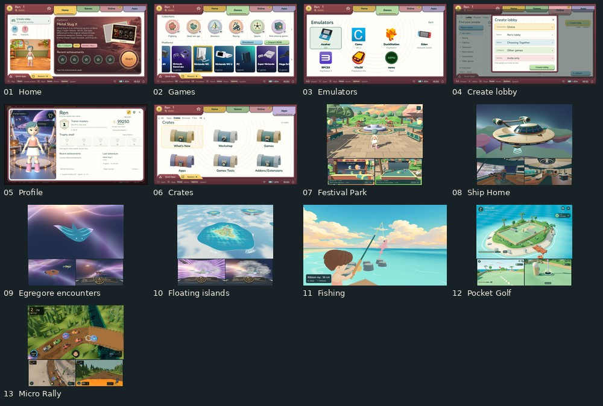

# OctoFox OS Alpha 9 · Медиапак

[Скачать ZIP для Discord и Reddit](https://codeload.github.com/EriArk/OctoFox-OS/zip/refs/heads/media/alpha-9-discord-reddit)

В пакете 13 изображений и английский текст анонса. В каждой папке `images` вложения пронумерованы в порядке публикации. Домашний экран OctoFox открывает галерею, следом идут библиотека и лобби, затем Базар, корабль, рыбалка, гольф и гонки.

## Discord

1. Открой [01-shell](Discord/01-shell). Скопируй содержимое `message.txt` в сообщение и прикрепи пять файлов из соседней папки `images`.
2. Так же отправь [02-worlds](Discord/02-worlds) следующим сообщением с восемью изображениями. В этой части анонса находятся ссылки на сайт и сообщество.

## Reddit

Создай пост с галереей. Скопируй [заголовок](Reddit/title.txt) и добавь [13 изображений](Reddit/images) по порядку номеров. Вставь [текст поста](Reddit/body.md) в режиме Markdown. Если у галереи нет поля для текста, его можно разместить первым комментарием.

## Кадры по порядку

[Авторский Markdown](announcement-original.md) сохранён в исходном виде. [Полная подборка из 41 скриншота и шести коллажей](https://github.com/EriArk/OctoFox-OS/tree/8203cd5804d8bb197160103801b36f9adf30968b/docs/alpha-release/publications/screenshots/alpha-9) пригодится, если захочется заменить кадр перед публикацией.
