# More screens and menus

English · [Russian](EXTRA_SCREENS_RU.md)

15 additional images to choose from. **In-game Home and Quick Apps use the real native QML interface rendered on a host with presentation fixtures.** Quick Apps is composited over a retained Home capture; application entries and icons are illustrative. Lobby members are fixtures too, not a recorded multiplayer session.

Files, the loaded browser page, Power, restart confirmation and keyboard are retained handheld captures. Start and New Collection are archived host captures from 10 November: their data is synthetic, and the background Pokémon tab belongs to a development configuration. Origins, dimensions and checksums are recorded in `extra-capture-manifest.json`.

[Main screens](MAIN_SCREENS.md) · [All captures](README.md)

## In-game Home — light

Host / presentation fixtures · 1920 × 1080

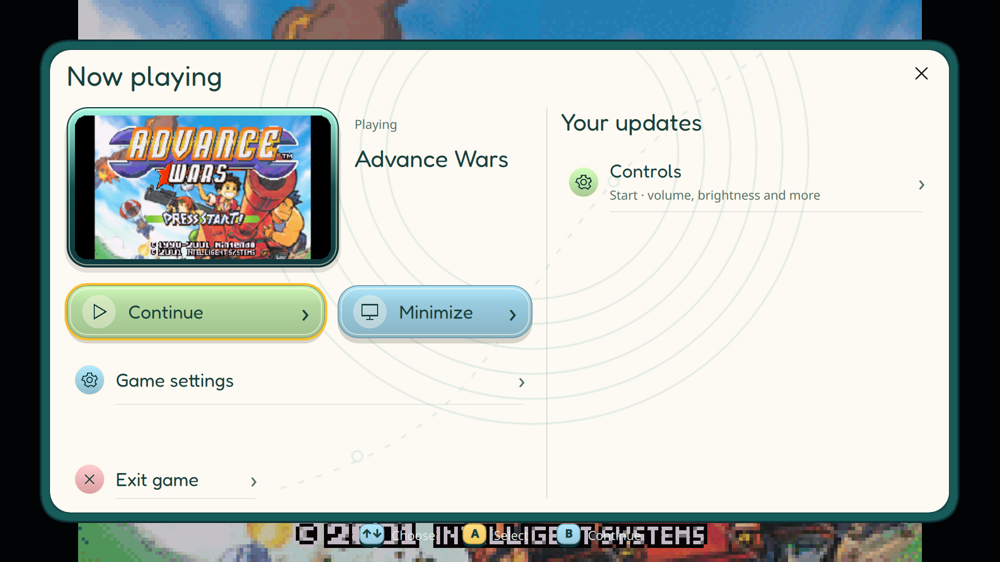

## In-game Home — dark

Host / presentation fixtures · 1920 × 1080

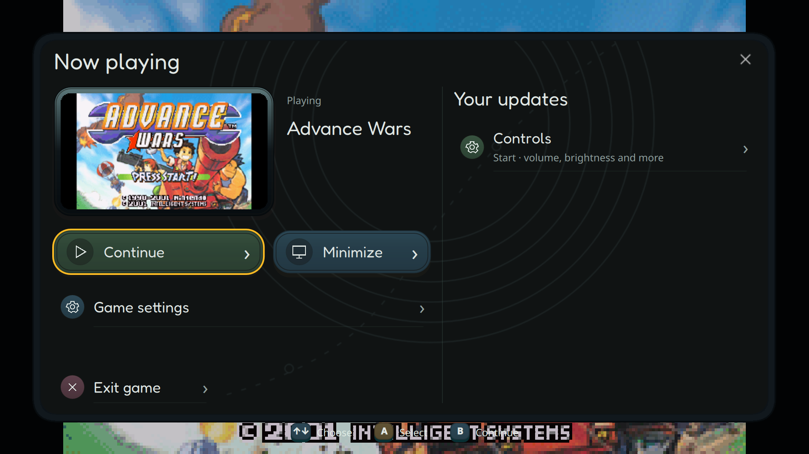

## In-game Home — lobby panel

Host / presentation fixtures · 1920 × 1080

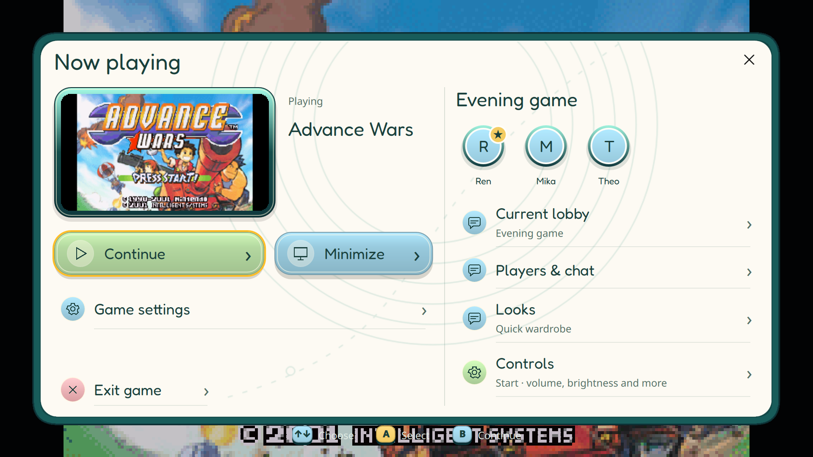

## Quick Apps — minimized application

Host / presentation fixtures · 1920 × 1080

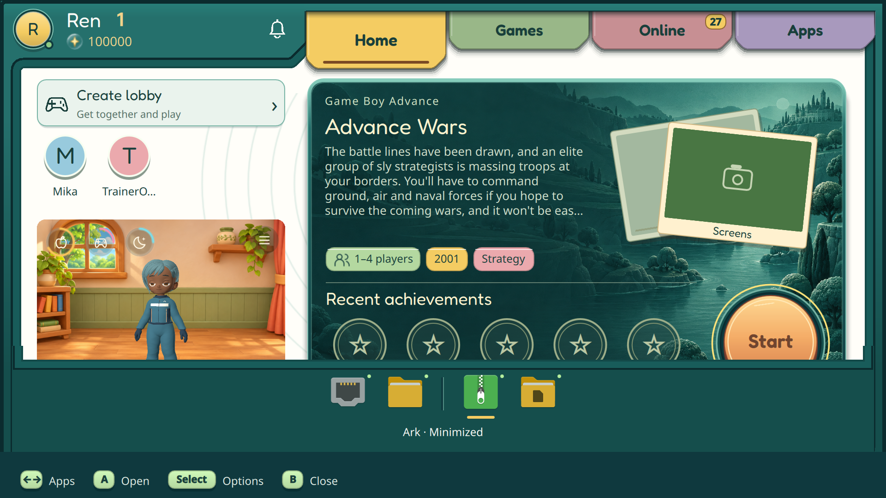

## Files — empty Documents folder

Handheld · 1920 × 1080

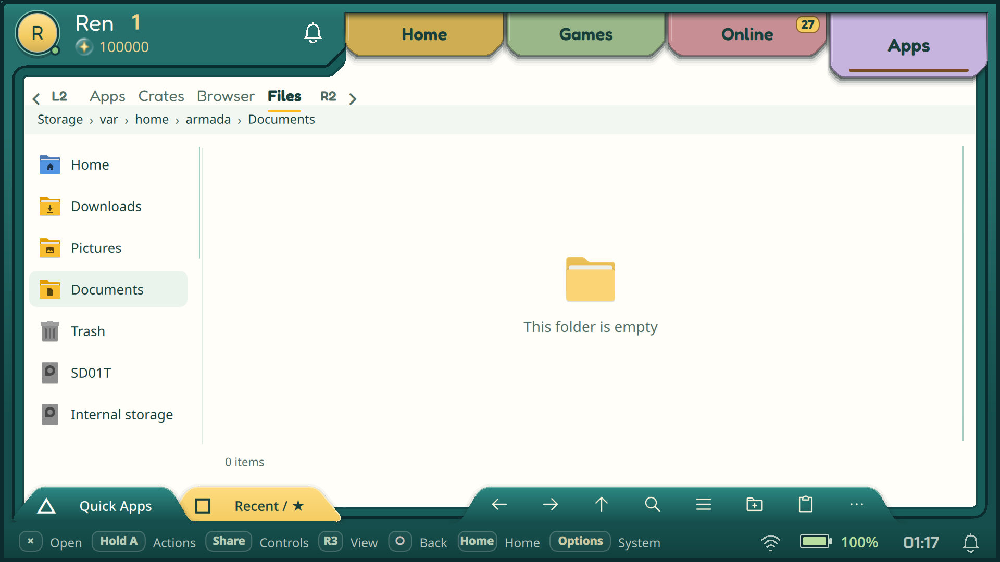

## Browser — loaded web page

Handheld · 1920 × 1080

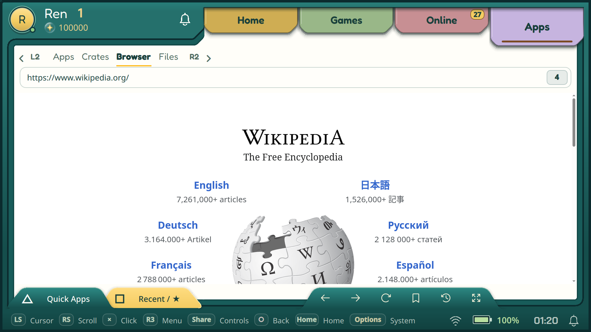

## Power menu

Handheld · 1920 × 1080

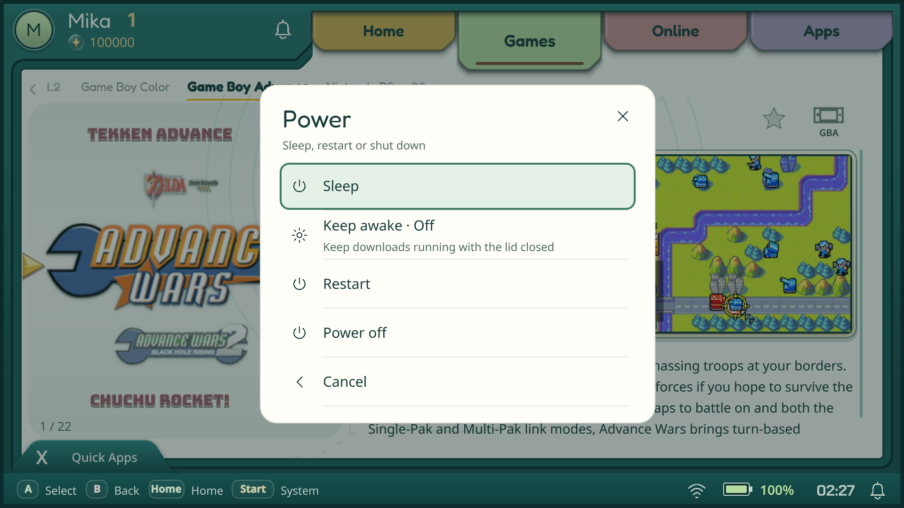

## Restart confirmation

Handheld · 1920 × 1080

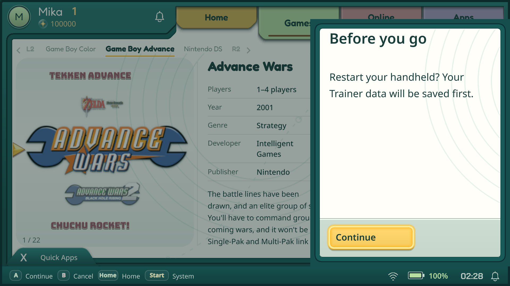

## Wizard — on-screen keyboard

Handheld · 1920 × 1080

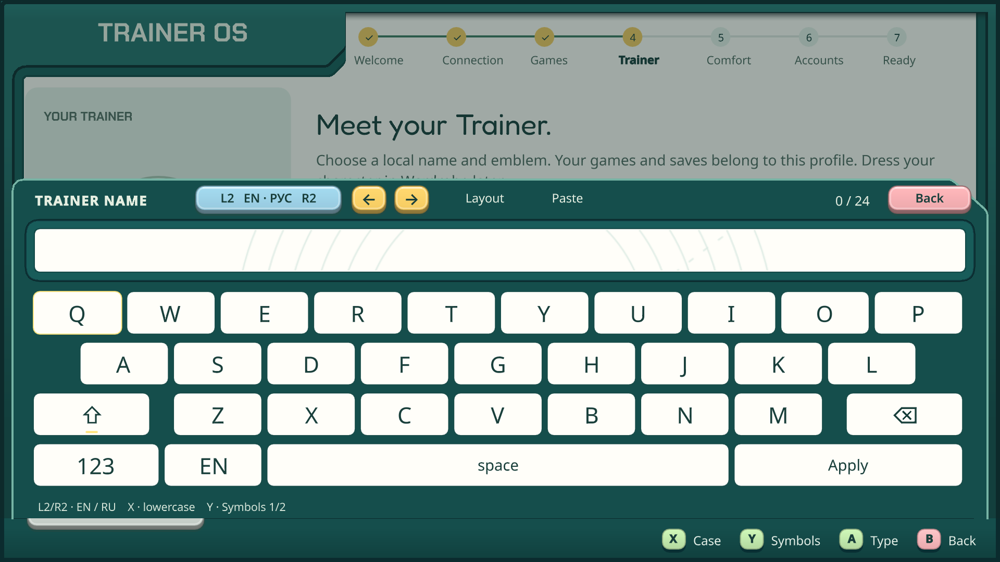

## Start — light

Host / presentation fixtures · 960 × 540

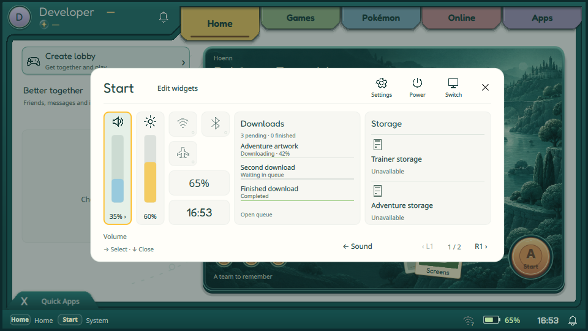

## Start — dark

Host / presentation fixtures · 960 × 540

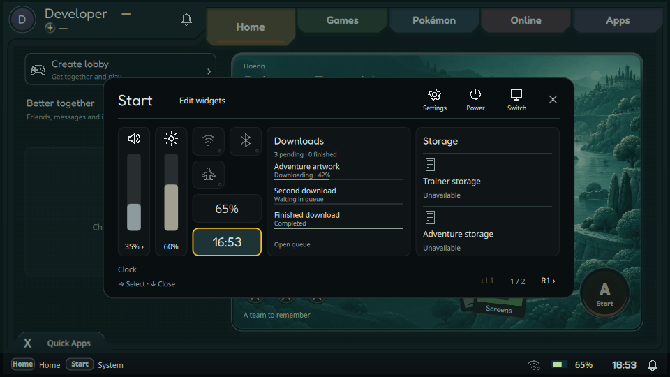

## Start — Wi-Fi

Host / presentation fixtures · 960 × 540

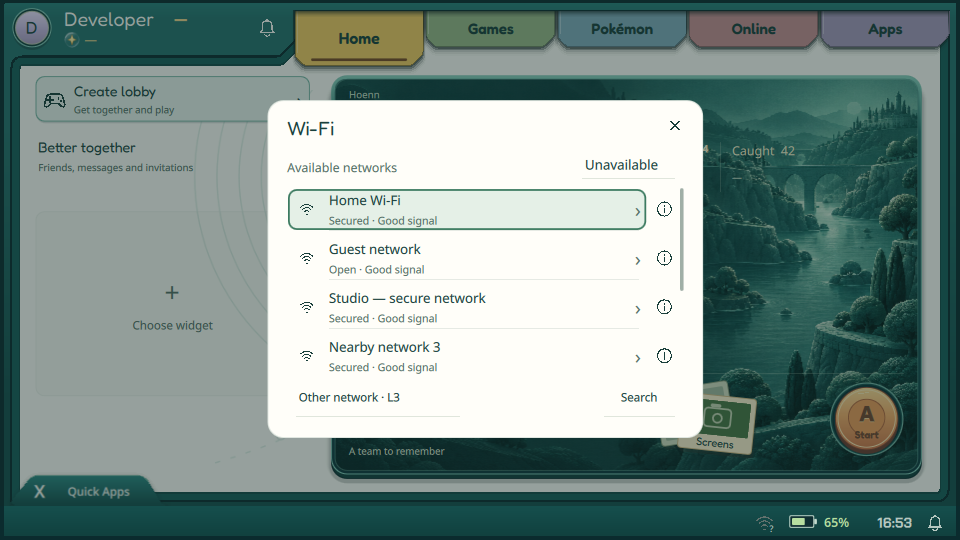

## Start — Bluetooth

Host / presentation fixtures · 960 × 540

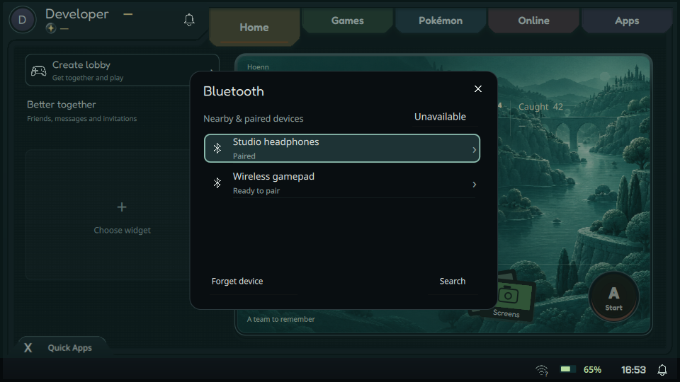

## Start — sound output

Host / presentation fixtures · 960 × 540

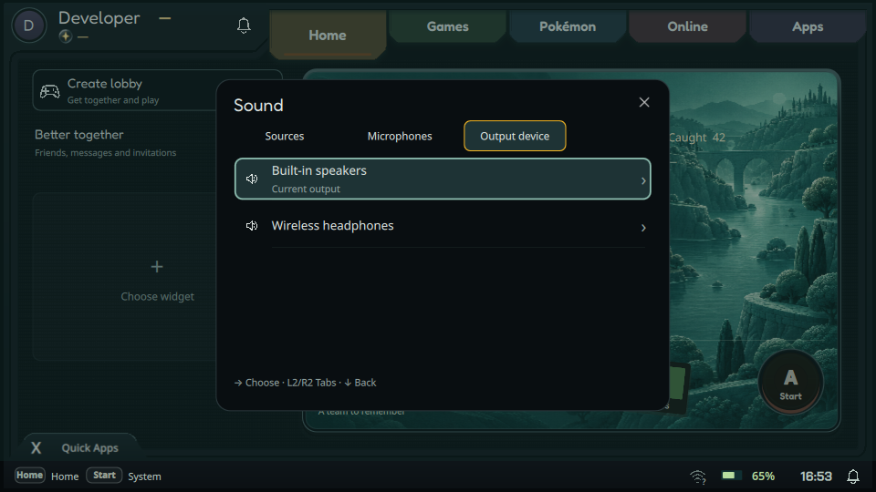

## New collection

Host / presentation fixtures · 960 × 540

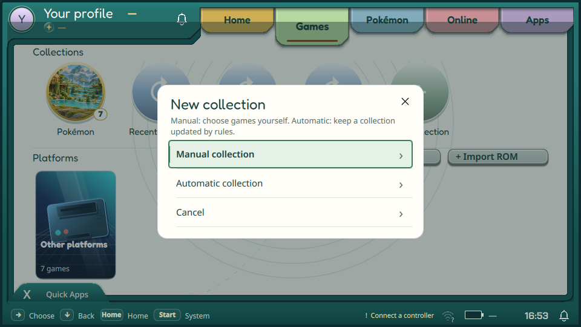
