# Дополнительные экраны и меню

[English](EXTRA_SCREENS.md) · Русский

15 дополнительных изображений для выбора. **Игровое Home и Quick Apps сняты на стенде из настоящего QML-интерфейса с подготовленными данными.** Quick Apps показан поверх сохранённого кадра Home; список приложений и иконки демонстрационные. Участники лобби также демонстрационные, это не запись мультиплеера.

Files, загруженная страница браузера, Power, подтверждение перезагрузки и клавиатура — сохранённые снимки с портативок. Start и New Collection — архивные стендовые кадры от 10 ноября: данные тестовые, фоновая вкладка Pokémon относится к конфигурации разработки. Происхождение, размеры и контрольные суммы указаны в `extra-capture-manifest.json`.

[Основные экраны](MAIN_SCREENS_RU.md) · [Все снимки](README_RU.md)

## Игровое Home — светлая тема

Стенд / демонстрационные данные · 1920 × 1080

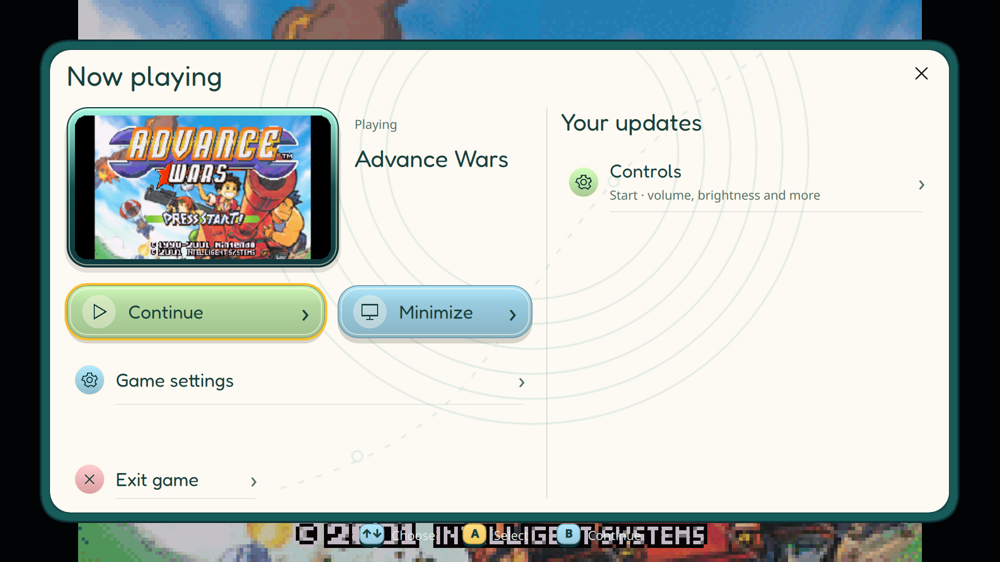

## Игровое Home — тёмная тема

Стенд / демонстрационные данные · 1920 × 1080

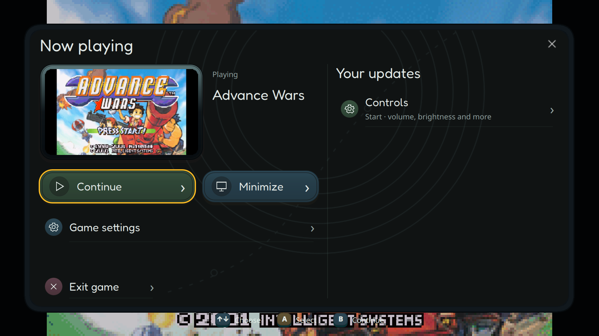

## Игровое Home — панель лобби

Стенд / демонстрационные данные · 1920 × 1080

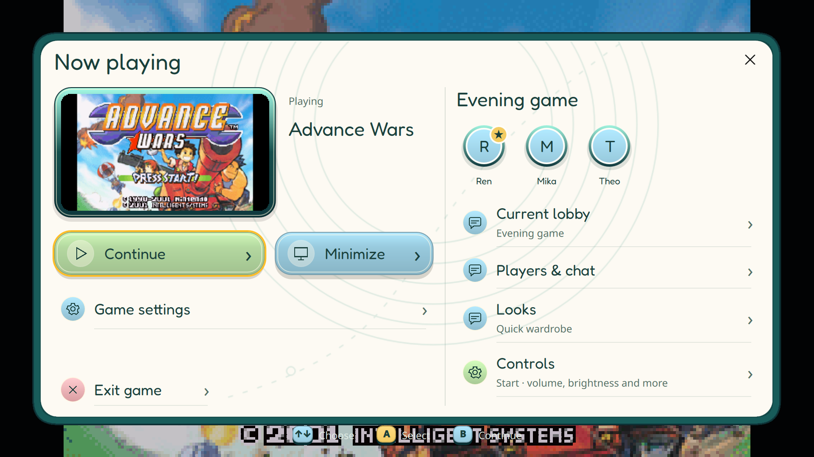

## Quick Apps — свёрнутое приложение

Стенд / демонстрационные данные · 1920 × 1080

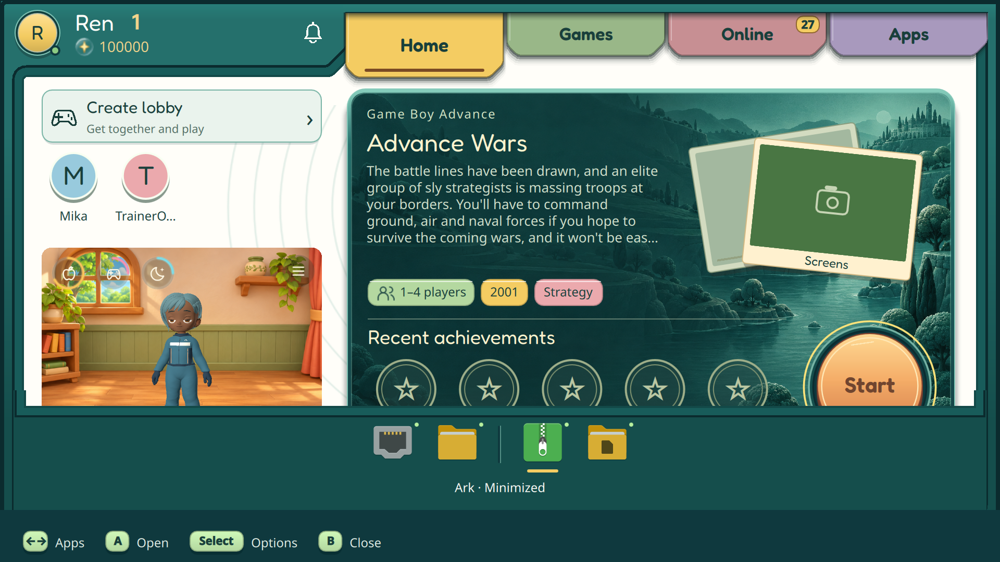

## Files — пустая папка Documents

Портативка · 1920 × 1080

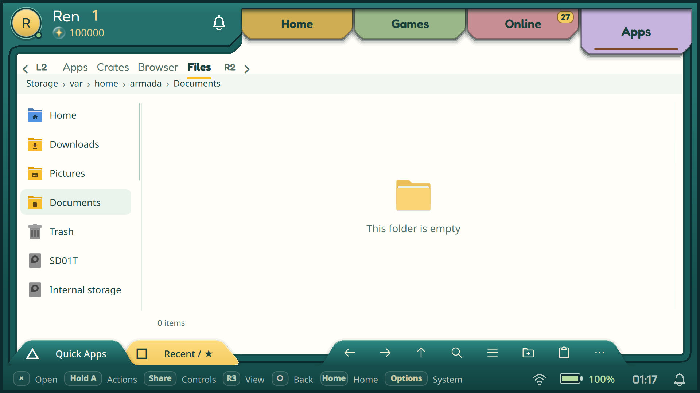

## Браузер — загруженная страница

Портативка · 1920 × 1080

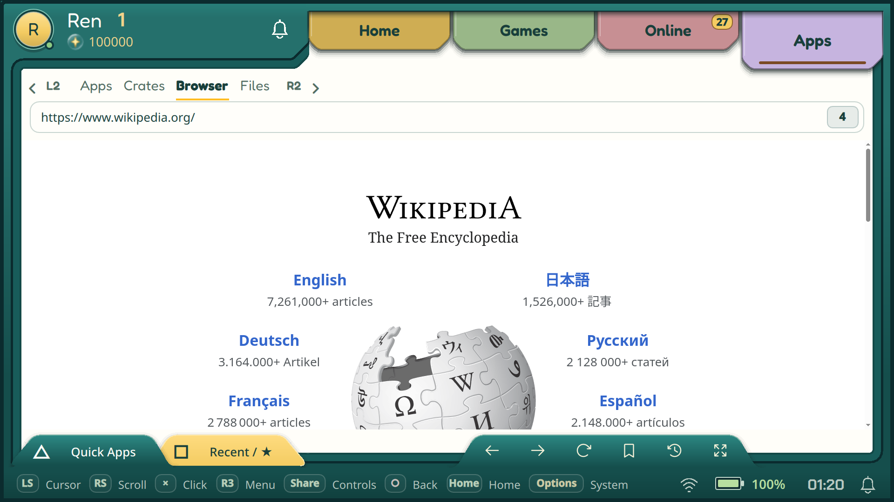

## Меню питания

Портативка · 1920 × 1080

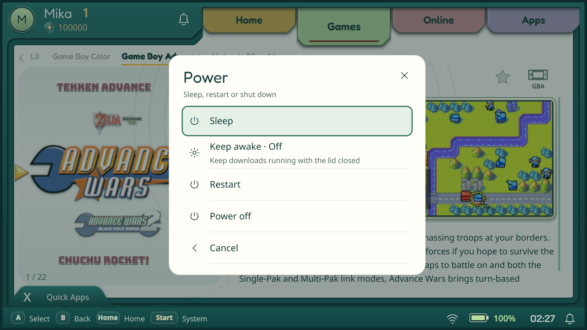

## Подтверждение перезагрузки

Портативка · 1920 × 1080

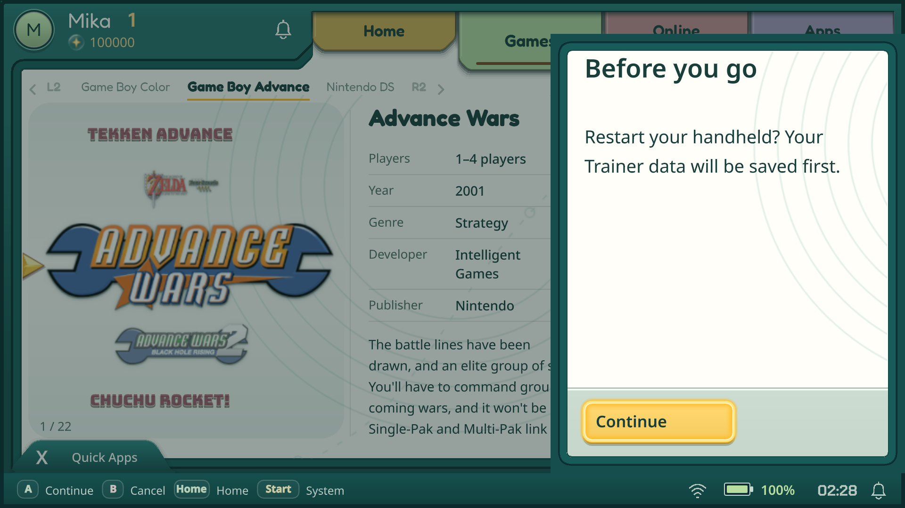

## Визард — экранная клавиатура

Портативка · 1920 × 1080

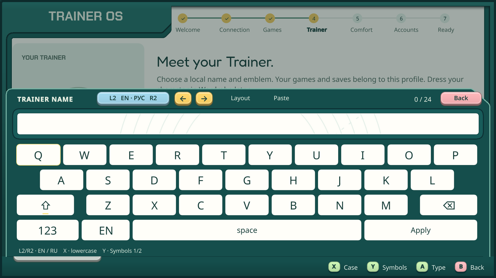

## Start — светлая тема

Стенд / демонстрационные данные · 960 × 540

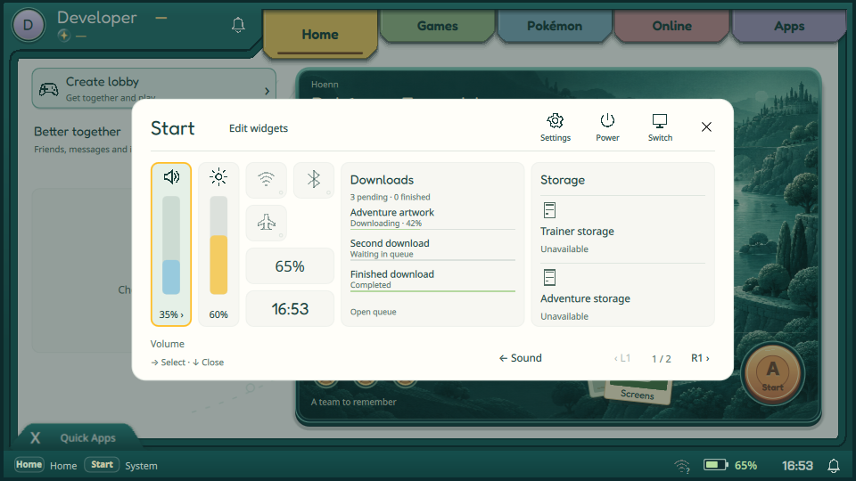

## Start — тёмная тема

Стенд / демонстрационные данные · 960 × 540

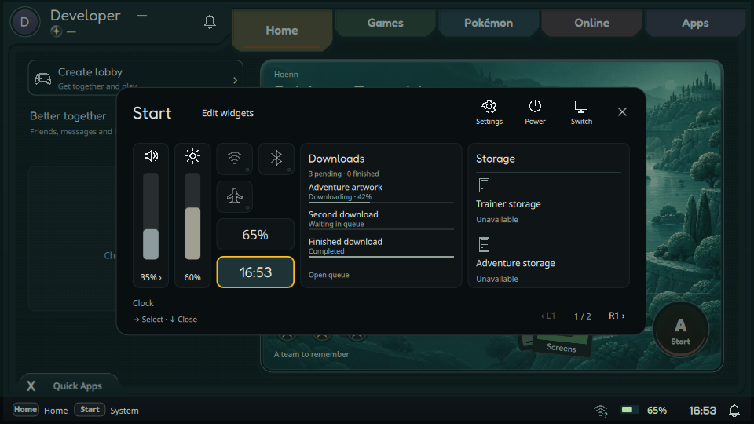

## Start — Wi-Fi

Стенд / демонстрационные данные · 960 × 540

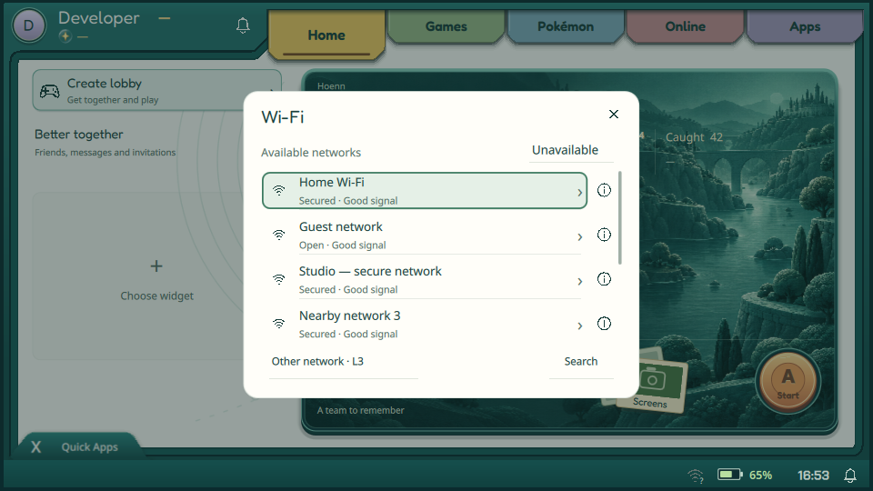

## Start — Bluetooth

Стенд / демонстрационные данные · 960 × 540

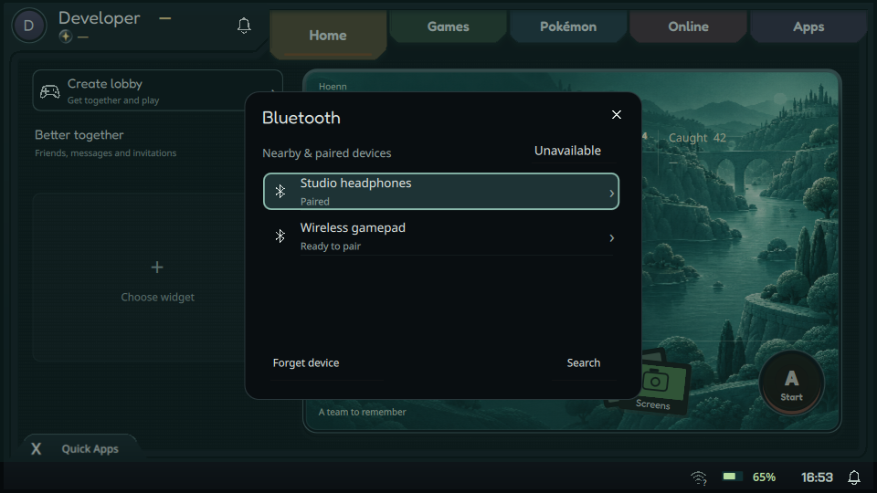

## Start — вывод звука

Стенд / демонстрационные данные · 960 × 540

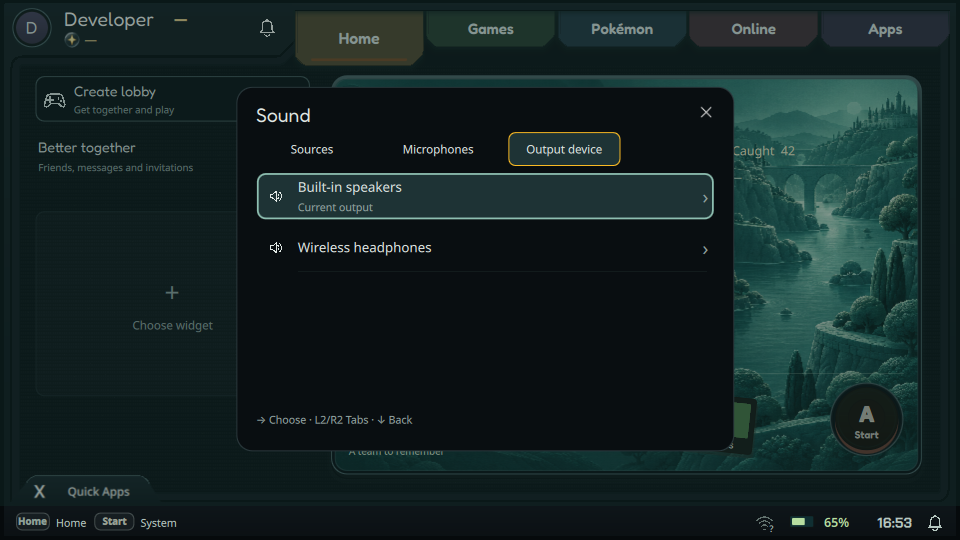

## Новая коллекция

Стенд / демонстрационные данные · 960 × 540

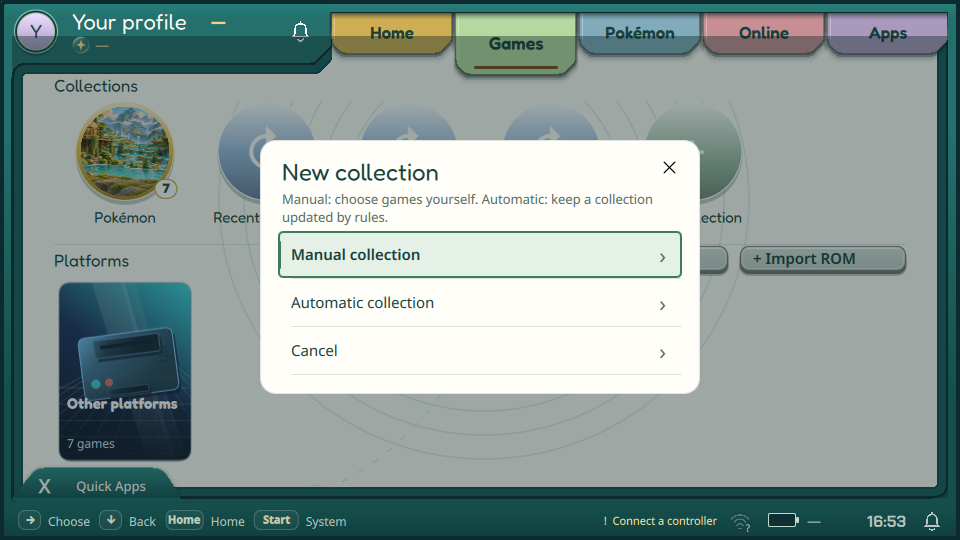
