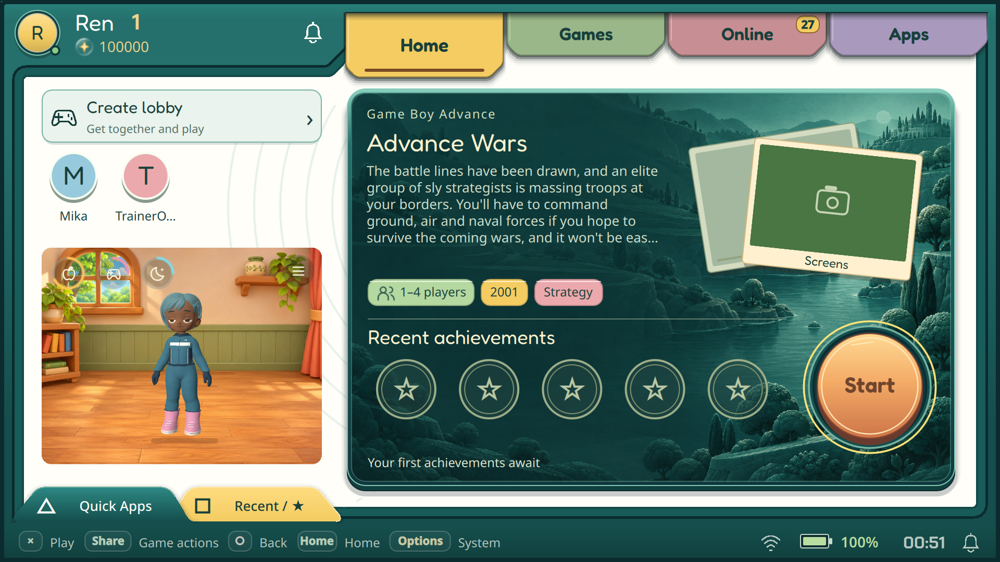
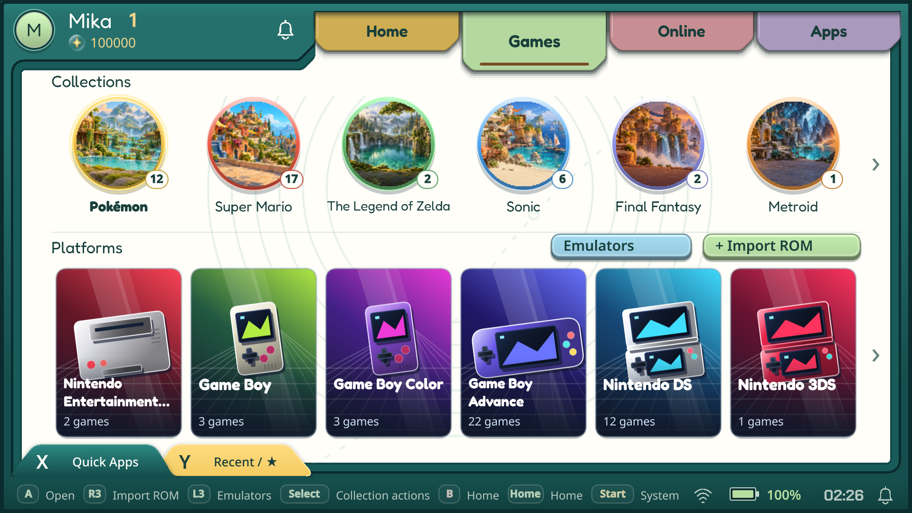
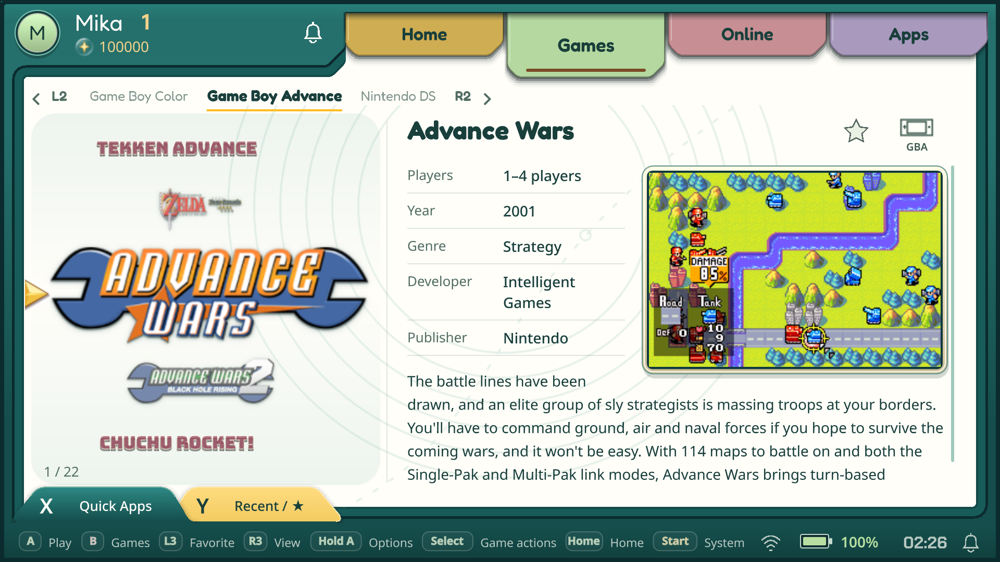
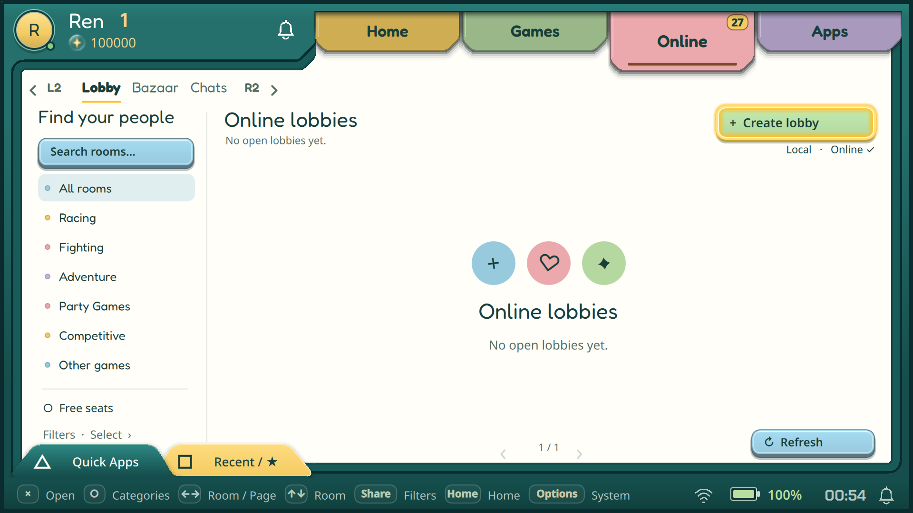
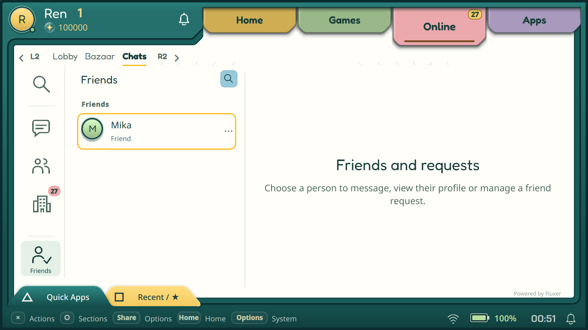
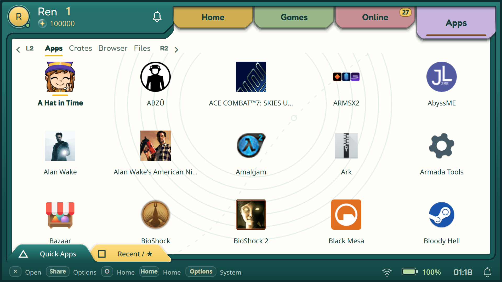
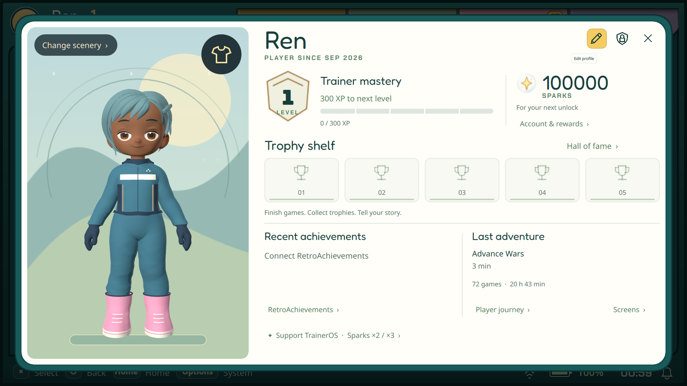
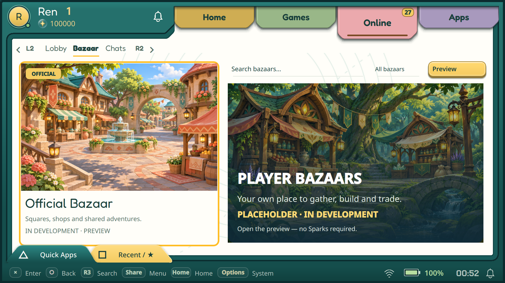

# Main TrainerOS screens

English · [Русский](MAIN_SCREENS_RU.md)

Actual Alpha 7 handheld captures from 11 November 2026, selected for a product overview. These are existing captures, not a local re-render. Games and Apps were omitted from the first publication selection and are now included.

## Home · Odin 2

## Games — collections and platforms · Flip 2

## Games — platform library · Flip 2

## Online — Lobby · Odin 2

## Online — Chats · Odin 2

## Apps · Odin 2

## Profile · Odin 2

## Online — Bazaar catalogue · Odin 2

[All captures and captions](README.md). The pictured apps/games belong to the test library; their presence does not establish launch compatibility. Bazaar worlds remain unavailable.
