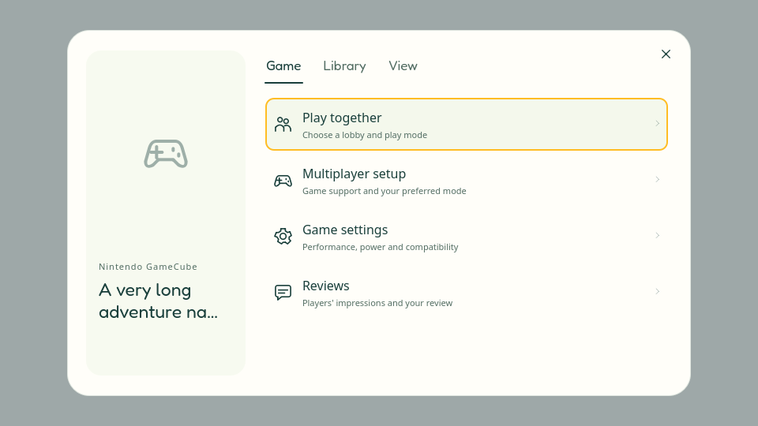
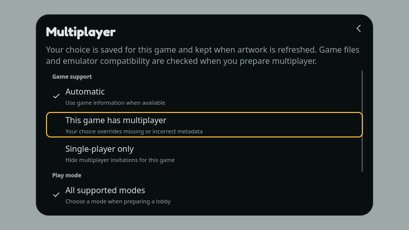

# Проверка выбранной игры и новое Select-меню

## Договорённость

Владелец попросил убрать массовое фоновое чтение образов, затем добавить
ручную отметку мультиплеера без ScreenScraper, выбор режима и переработать
контекстное меню игры. Это core-обвязка существующих механизмов; новые сетевые
протоколы, SDK, Crates и содержимое пакетов не меняются.

## Поведение

- При старте, обновлении каталога и обычном одиночном запуске не вычисляются
  сетевые отпечатки всей библиотеки. Кандидаты берутся из сохранённых записей.
  Обновление списка также не делает `stat` для каждого непроверенного ROM;
  отслеживаются зависимости уже проверенных игр и изменения записей каталога.
- В выборе игры лобби отображается кандидат без сетевой идентичности. Открытие
  его режимов запускает проверку только этой игры. Back/закрытие/смена игры
  отменяют работу. Непроверенную строку нельзя выбрать для запуска или голосования.
- Подготовка приглашения проверяет единственного подходящего локального кандидата.
  Название служит подсказкой поиска, не доказательством совместимости. Неоднозначность
  и отсутствие соответствия ведут к существующему выбору локального файла.
- Обычные приглашения можно показать до проверки. Приём, вход в запущенную игру
  и запуск по-прежнему требуют точной локальной идентичности, совместимого эмулятора,
  BIOS/настроек и прежних ограничений сессии/сохранений. Сетевой пакет не запускает
  фоновую проверку всей коллекции.
- Наблюдение уже проверенных зависимостей инвалидирует устаревшие результаты,
  но не начинает повторное чтение. Следующая явная подготовка выполняет проверку.
  Запущенный процесс и его прогресс не закрываются из-за обновления каталога.
- Ручные настройки хранятся в записи игры отдельно от метаданных: автоматически,
  мультиплеер или только одиночная игра; все поддержанные режимы либо выбранный
  режим платформы. Они не объявляют максимальное число игроков и не обходят
  ограничения установленного runtime. ScreenScraper их не перезаписывает.
- Select: карточка игры и группы «Game», «Library», «View»; плоские строки с
  иконками и пояснениями. Основные действия: Play together, Multiplayer setup,
  Game settings, Reviews. Перенос/удаление находятся в Library, вид списка — в View.

## Входы и возвраты

| Вход | Действие | Возврат / граница |
|---|---|---|
| Home или Games → Select | Выбранная игра → Game / Library / View | Back закрывает карточку; цель сохраняется по ID |
| Game → Multiplayer setup | Ручная отметка и режим; сохранение сразу | Back в карточку; устаревшая ревизия не записывается |
| Game → Play together | Online либо настроенное локальное лобби → режимы | Проверка одной игры; Back отменяет её |
| Лобби → выбор игры | Кандидат → проверенные режимы → выбор | Кандидат без отпечатка не попадает в предложения |
| Входящее приглашение / live join | Подготовка выбранного контента | Точная проверка до приёма/запуска; прежние save guards |

## Состояние проверки

ARM Release-тесты на microSD Flip: все семь CTest-наборов прошли, 141,50 с.

| Набор | Passed | Skipped |
|---|---:|---:|
| pc_games | 32 | 0 |
| lobby | 73 | 13 |
| game_party | 36 | 0 |
| runtime_multiplayer | 116 | 0 |
| social | 211 | 0 |
| interactions | 58 | 1 |
| library | 30 | 0 |

Пропуски: 13 существующих интеграционных сценариев требуют реальных transport
helpers; один сценарий быстрого гардероба — внешнего avatar pack. В изолированном
builder их нет. Это не новые доказательства транспорта или гардероба.

Проверены отсутствие стартового worker и проверки при solo launch, выбранная
игра, отмена, неоднозначный кандидат, CUE/M3U/BIOS/SBI, сохранение текущей сессии,
точный допуск после показа приглашения, ручная настройка через SQLite и её
сохранение после перезапуска/сканирования библиотеки. Два старых fixture-ожидания
скорректированы: число кандидатов и обязательная локальная запись игры.

После удаления массовых `stat`-вызовов повторён затронутый набор: 9 passed,
0 failed, 0 skipped (включая init/cleanup и два варианта дисковых зависимостей).
Дополнительный сценарий подтверждает: изменение непроверенного постороннего
ROM не сбрасывает готовность выбранной игры; изменение проверенного файла
сбрасывает её, но не запускает новое чтение автоматически.

`selectedGameMenuAtTwoSizes`: 3 passed (включая init/cleanup), без QML warnings.
Проверены controller navigation, фактическое pointer-нажатие, Back и закрытие;
просмотрены рендеры 960×540 light и 800×450 dark. После просмотра исправлены
заглушка отсутствующей обложки и индикатор прокрутки; повторная UI-проверка
финальных QML прошла перед production build (`BUILD_TESTING=OFF`).

## Поставка и проверка на устройствах

На Flip и Odin установлен один ARM Release (`BUILD_TESTING=OFF`), SHA-256
`499c01b6f8106ab8d0ac4efc3355768f31ec3b908ae34033667b004fc52366ee`.
Предыдущая версия `ea50351a…` и согласованные резервные копии баз сохранены.
Проверены фактический перезапуск нового executable, целостность SQLite,
сохранность прежних защищённых строк, настроек, helpers и avatar pack.
Steam-регистрации: Flip — 1, Odin — 96; громкость сохранена 20% / 0%.

На обоих устройствах просмотрены Home, новая карточка Select и возврат.
На Flip через настоящий интерфейс Daytona USA 2: Power Edition проверены
ручная отметка, её подпись на карточке, сохранение режима Linked cabinets,
прокрутка до последнего пункта и повторное открытие. После проверки восстановлены
исходные Automatic / All supported modes. Это проверка настройки, не нового
игрового сеанса или сертификация совместимости Daytona.

После перехода Play together открылась уже существующая комната другого
организатора с Micro Rally; её игру/участников/готовность не меняли.
Существующее поведение гостя (переход в текущую комнату вместо выбора новой игры)
остаётся отдельным UX-улучшением. Реальная подготовка новой комнаты, запуск пары
и сетевой rejoin в этом проходе не повторялись; проверки переходов выше автоматические.

Замеры процесса оболочки на Flip после завершения сборки:

| Экран | Интервал | CPU, % одного ядра | RSS, KiB, начало → конец | Прочитано логически | Прочитано с диска | ROM handles |
|---|---:|---:|---:|---:|---:|---:|
| Home | 12,09 с | 50,28 | 902316 → 901420 | 13978 байт | 0 байт | 0 |
| Apps | 12,28 с | 3,66 | 903340 → 902828 | 1392 байта | 0 байт | 0 |

В обоих интервалах опрос открытых файлов каждые 0,5 с не обнаружил ROM/образов.
Это ограниченные наблюдения установленной версии, не доказательство отсутствия
каждого короткого открытия файла и не сравнение FPS/батареи. Старый CPU baseline
был смешан с массовым чтением, поэтому процент ускорения не заявляется.
Нагрузка Home с живым виджетом остаётся отдельной темой. В просмотренном журнале
новых процессов сообщений QML/ошибок не найдено; оба устройства оставлены на Home.

Физическое управление, речь, отдельные сети и новые игровые совместимости
не заявляются по результатам этой работы.
