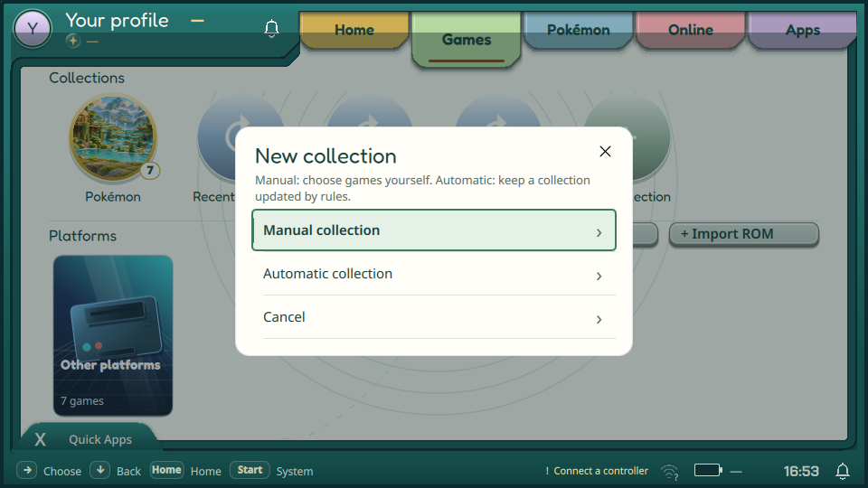
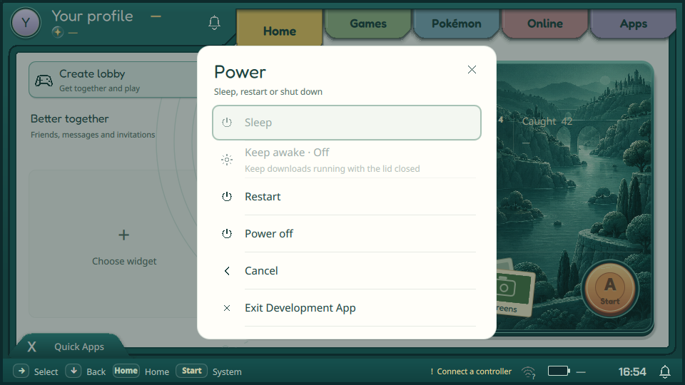
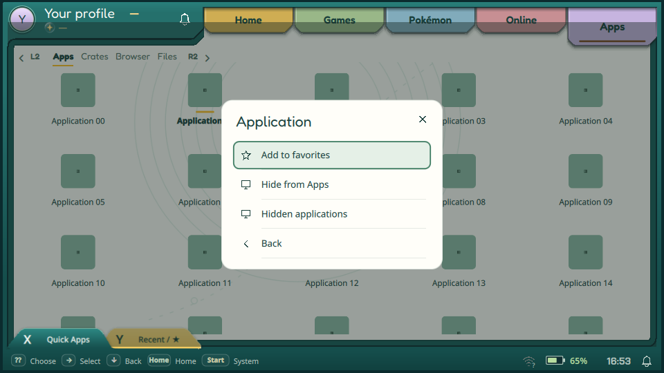
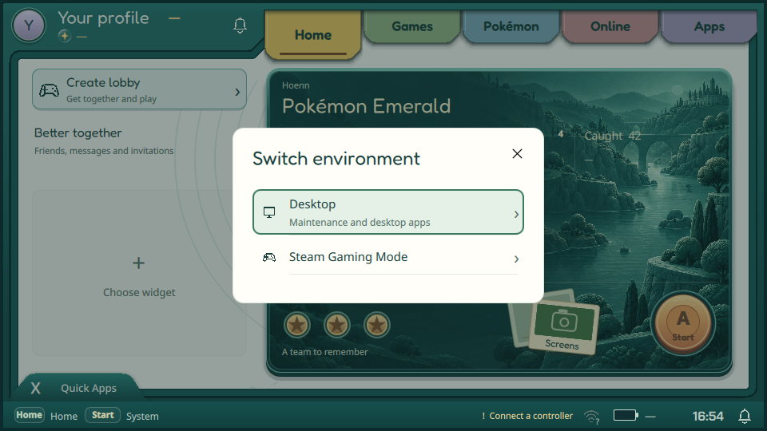
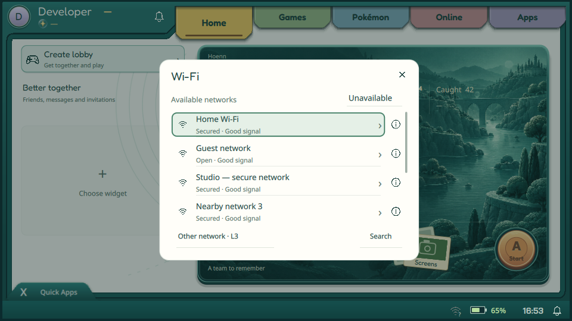

# Всплывающие окна — 10 ноября 2026

## Принятый результат

- New Collection: карточка 440×254 логических единиц для трёх пунктов;
  размеры полноценного редактора и предпросмотр умной коллекции сохранены.
- Power: плоские строки на спокойной поверхности, явное On/Off для Keep awake,
  прежние доступность, действия, сообщения об ошибках и защитные подтверждения.
  Список прокручивается до контроллерного фокуса при ограниченной высоте.
- Select в Apps: компактное меню с иконками, заголовком и крестиком;
  прежние избранное/скрытие/скрытые приложения/возврат сохранены.
- Start: Wi-Fi/Bluetooth, звук, Switch и выбор виджета скрывают обзорную панель,
  сохраняя её экземпляр и состояние. Загрузки/скрапер также не оставляют её
  карточку позади себя. Закрытие возвращает исходную панель.
- По последнему уточнению владельца Home игры **не упрощался**: композиция,
  превью, оформление и контроллерная навигация сохранены. Home внешнего
  приложения также не менялся. Подтверждено сравнением соответствующих
  QML/C++ файлов с предыдущим HEAD с учётом существовавшего CRLF.

## Проверка

Серверная сборка `traineros` в Qt 6.11.2 успешна. Реальный QML/Xvfb/OpenGL,
изолированные HOME и `--network none`, без живых аккаунтов и установки на
портативки:

- `--apps-smoke-test`: exit 0, [PASSED](apps-verification.txt). Проверены
  контекстные действия, скрытие/избранное, Home приложения, сворачивание и
  Quick Apps; сценарий включает 800×450 и обе темы.
- `--platform-smoke-test`: exit 0, 0 QML warnings. Проверены SDK-виджет,
  редактирование Start, Wi-Fi/пароль, Bluetooth/подтверждение и звук,
  включая возврат и восстановление фокуса.
- Отдельный интерактивный прогон текущего бинарника с `--ephemeral`, 960×540:
  открытие/закрытие New Collection, Power, Switch и возврат в Start. Свежие
  кадры осмотрены; пересечений и старых карточек позади вложенного окна нет.
- В трёх логах нет ошибок QML. Home не перестраивался; непрошедшие старые
  сценарии из предыдущего обзора не выдаются за проверки этой поставки.

## Кадры текущей сборки

Sleep/Keep awake недоступны на стенде без Armada Power service. Exit Development
App относится к стендовому запуску. Контент, устройства и загрузки в UI-сценариях
тестовые; кадры не доказывают реальную работу сети, питания или установку.

Локальные сырые артефакты: `build/popup-polish-20261110/`.
Сервер: `/home/abysscloud/traineros-crates-apps-20261109/popup-polish-20261110/`;
журнал сборки рядом: `popup-polish-build.log`.
На Flip/Odin не устанавливалось по текущей паузе владельца. Физическая
контроллерная проверка новых окон остаётся на устройствах.
