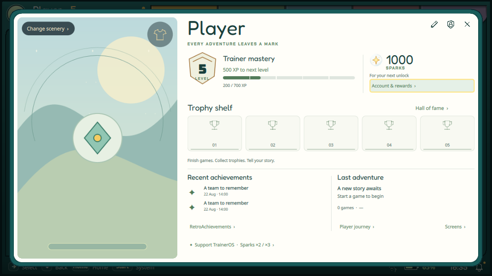

# Wardrobe: кнопка в окне персонажа — 10 ноября 2026

Крупная круглая кнопка 56×56 расположена с отступом 10 в правом верхнем
углу самой сцены персонажа. Векторная рубашка, подсказка Wardrobe,
контроллерный фокус и прежний action 1 сохранены. Нижняя текстовая ссылка убрана.
Смена сцены остаётся слева сверху. По следующей коррекции владельца
удалена вся нижняя плашка «YOUR CHARACTER / Make it yours» и её отступ
`footerInset:43`: эта высота возвращена превью персонажа.

## Проверено

- Серверная сборка `traineros`, Qt 6.11.2: успешна.
- Реальный QML-рендер через Xvfb/OpenGL, 960×540: круг и рубашка видны,
  пересечений со сменой сцены и остальным профилем нет; нижняя плашка
  отсутствует. После её удаления сборка и захват кадра повторены.
- Проверен существующий маршрут в ShellController: действие 1 открывает
  outfits, Back возвращает в summary с фокусом 1; логика не менялась.
- В ограниченном прогоне нет ошибок QML. Использованы синтетические данные,
  сеть контейнера отключена. Прогон старого Online smoke остановлен после
  нужных кадров; это не успешное прохождение всего сценария.

На стенде нет пакета 3D-аватара: показана эмблема, Wardrobe приглушён по
прежнему условию доступности. Установка и физический джой на Flip/Odin
не проверялись в этом изменении, согласно паузе владельца на установки.
Сырые кадры и лог: `build/profile-clean-20261110/`; серверный каталог
`/home/abysscloud/traineros-crates-apps-20261109/profile-clean-20261110/`.
