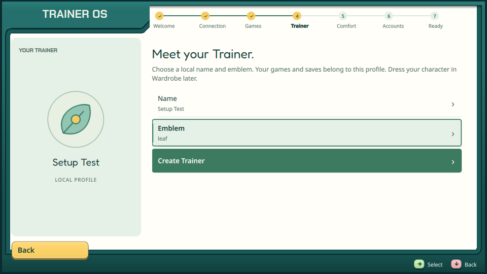
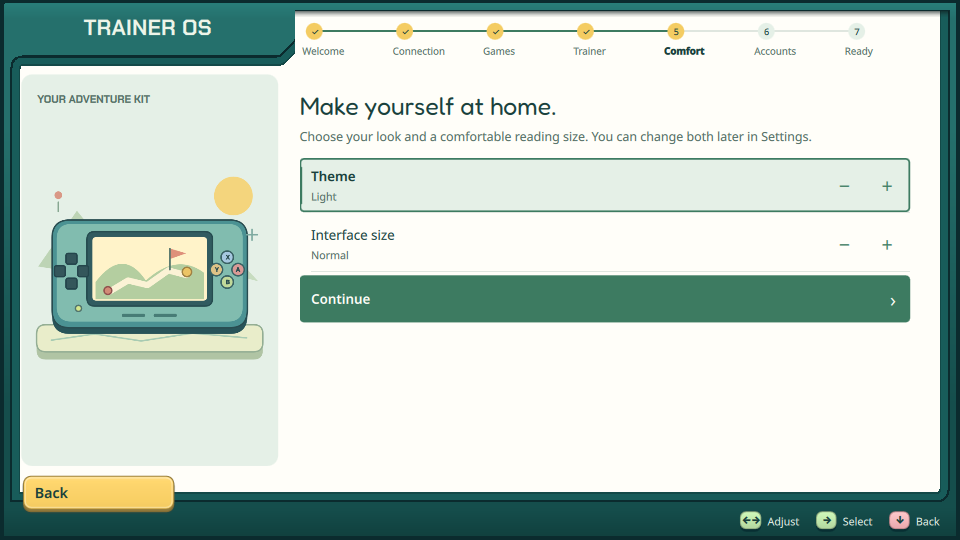
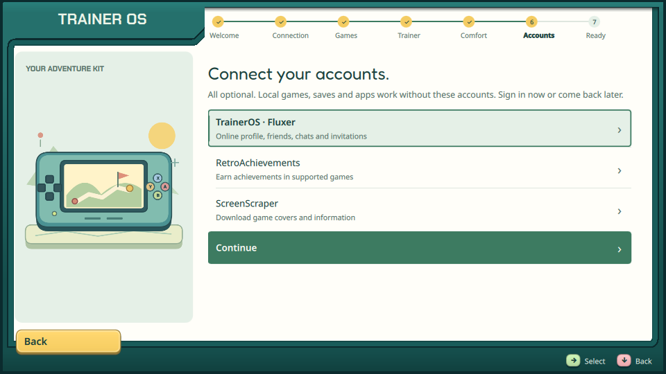
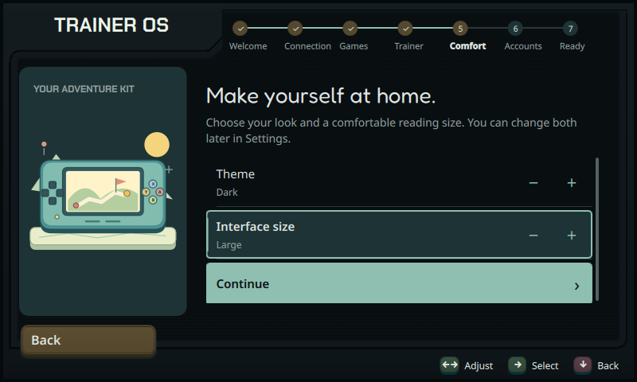
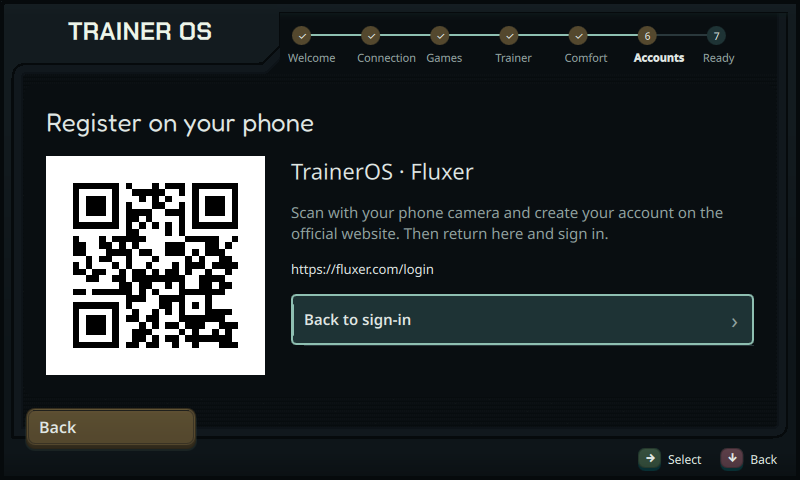
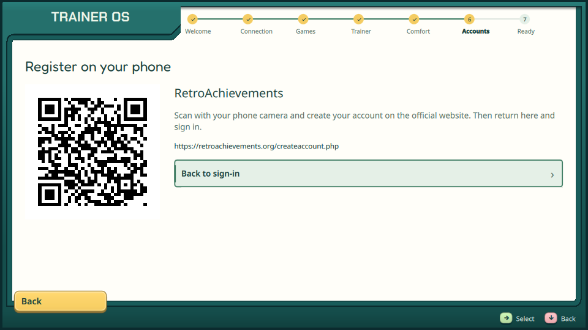
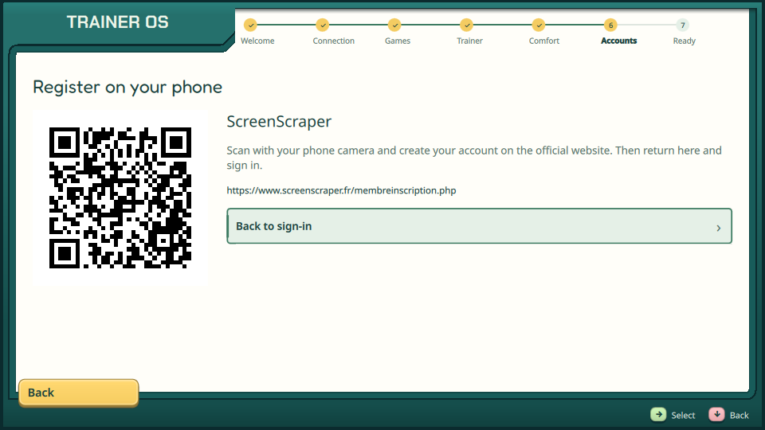

# Визард и регистрация с телефона — 10 ноября 2026

Исходники и Linux host, без установки на портативки. Текущий контракт —
[FIRST_RUN](../../FIRST_RUN.md). Предыдущие обязательные аккаунты, экзамен
Controls и большой Comfort не являются текущим сценарием.

## Изменение

- Welcome → Connection → Games → Trainer → Comfort → Accounts → Ready → Home.
- Имя/эмблема/создание Trainer вписаны в общую страницу. Общая клавиатура,
  проверка имени, сохранение черновика и прежние защищённые профили сохранены.
  Старый favorite из черновика тоже переносится; повторное нажатие не создаёт
  второй профиль. Обычная регистрация вне визарда сохраняет review/PIN.
- В Comfort только тема Light/Dark и Normal/Large (100/120%), без переходов
  в полные настройки. Фокус и прокрутка работают при 800×480 и 120%.
- Accounts показывает три необязательных сервиса и поясняет зависимые функции.
  Общение Fluxer и подтверждённый Backend профиль имеют отдельные состояния;
  недоступный Backend не изображает успешный вход. ScreenScraper внутри визарда
  ограничен полями входа и Done, общие настройки скрейпинга остаются в Settings.
- У каждого сервиса есть «Register on your phone». QR содержит официальный
  публичный URL; работает как локальная картинка без сети и внешнего QR-сервиса.
  Регистрация не авторизует устройство автоматически. ↑ с первой строки и A
  открывают QR, B/кнопка возвращают к той же форме; введённые поля не сбрасываются.
- Прежние progress v1/v2 принимаются; Controls/Time возобновляются с Connection,
  Accounts остаётся Accounts, созданный Trainer не дублируется. PIN/паролей в
  progress нет. Ready и весь визард завершаются офлайн.
- В Apps добавлена отдельная проверка URL-запуска. Только разблокированный
  экран входа TrainerOS может открыть браузер во время визарда; обычные приложения
  сохраняют прежний запрет. При ожидании helper разрешение проверяется повторно.
- Игровой Home и Bazaar не менялись.

## Проверка

Fedora 44 / Qt 6.11.2, существующий image `traineros-browser-ci:20261110`,
CMake build targets `traineros`, `trainer_first_run_tests`, `trainer_apps_tests`,
`trainer_scraper_tests`, `trainer_access_tests` — exit 0.

[Четыре CTest suites](unit-tests.txt) прошли: first_run, apps, screenscraper,
trainer_access. Проверены миграция прогресса, сохранение существующих файлов,
ошибки хранилища, создание/защищённое возобновление, сохранение темы/масштаба,
QR/back/граница входа и отсутствие обычного app launch по разрешению браузера.

Настоящий QML `--first-run-smoke-test` под Xvfb/xcb, OpenGL/Mesa software,
изолированные HOME/progress/storage и `--network none` прошёл до Home:
[verification](verification.txt). Виртуальный SDL-контроллер и pointer нажимают
экранные элементы; имя проходит общую клавиатуру. Непустой/пустой профиль,
переключение темы и масштаба, возвраты сервисов/QR, глобальные блокировки,
видимость Continue на компактном экране и 0 QML warnings проверены сценарием.

Все три QR декодированы **с финальных UI-скриншотов**, включая тёмный 800×480
с 120%, и сравнены с ожидаемыми URL: [результат ZXing](qr-decoding.txt).
[Официальные адреса и генерация](../../../assets/setup/registration/README.md).

## Кадры

## Границы

Это офлайн UI/host verification, а не реальные регистрация, OAuth, earning RA,
скрейпинг библиотеки или аппаратная приёмка. QR чтение камерой телефона остаётся
проверкой пользователя; декодирование снимка не выдаётся за неё. Временный smoke
Backend не настроен и явно показывает недоступность, production использует
существующее configure после открытия локального профиля.

После сообщения владельца о перезагрузке выполнен только read-only SSH через
сервер: Odin 2 ответил и сообщил живой процесс TrainerOS; Flip 2 по прежнему
адресу не отдал SSH banner. Новая сборка на них не установлена, их профили,
игры/BIOS, активные окна и загрузочные настройки не менялись.
