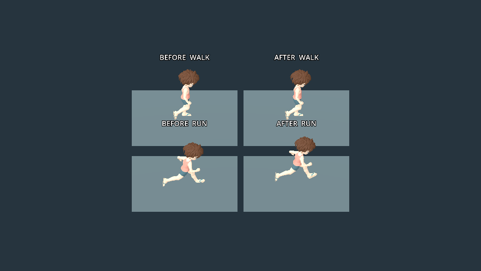

# Movement response and running flight — 14 November 2026

**Later delivery:** the owner resumed installation. Bazaar 0.0.9 embeds these
SDK helpers on both Flip and Odin; shell Software 45 is unchanged.
[Device record](https://github.com/EriArk/crates/blob/codex/bazaar-world-20261114/games/bazaar/docs/response-evidence/README.md#delivered-on-flip-2-and-odin-2).
The source-only boundary below describes the earlier test pass.

Source validation on the existing server, Godot 4.7.2. No handheld connection,
installation, merge or public release. Software 45 / Bazaar 0.0.8 remain installed.

The Bazaar left-stick path previously multiplied its original magnitude by the
remapped magnitude, suppressing partial input twice. The shared motor now maps
18% inner to 80% full travel linearly; the final 20% is full speed. Zero/drift,
midpoint, full threshold, plateau and diagonal checks pass. Partial resolved
motion selects Walk rather than a slowed Jog. Existing speeds, acceleration,
braking and gravity are unchanged.

The former ground-support correction pinned the lowest foot even in the donor
running clip's flight phase, lowering the pelvis. Jog and Sprint now preserve
that clearance, scaled to the target rig. Bind matrices, skin, reference arms,
shoulder helpers and user appearance are unchanged.

- Motor: 20 checks, including collisions, crouch headroom, jump/landing, disabled
  controls and stick mapping; [captured result](motor.txt).
- Retargeting: seven states, 360 sampled frames each after settling; no failures.
  [Measured report](locomotion.json). Jog has 230 flight / 108 stance frames;
  Sprint 205 / 120 (threshold bands leave some intermediate frames unclassified).
  Maximum clearance is ~0.148 / 0.112 in rig-local units, not penetration.
- OpenGL/Mesa comparison: synthetic avatar, before and after at the same elapsed
  time. Walking keeps its support; running regains flight height. This is visual
  pose evidence, not handheld performance or physical controller acceptance.

Reproduction: `godot --headless --path sdk/godot --script res://tests/character_motor.gd`; retargeting uses `tests/locomotion.gd` with a
synthetic `--descriptor` and `--output`. Optional game `tests/gait_review.gd`
requires the preceding helper only in an isolated review checkout, named
`previous_locomotion.gd` with its global class declaration removed.

Remaining: owner's physical-pad feel, uneven-terrain foot IK, multiplayer motion.
The outer zone is in the reusable SDK helper, consumed by Bazaar; other games
must opt in when they use raw sticks. Right-stick camera response is unchanged.
