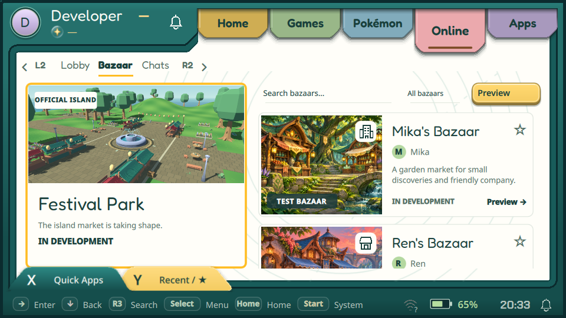

# Player Bazaar cards — 14 November 2026

Private Software 46, source `ff90adc69686684b5484458840eb7d3dd7674c9a`,
is installed on Flip 2 and Odin 2. This branch remains separate; no merge or
public release. [Package record](package.json).

The fixed official card is unchanged. The right side is a scrollable list with
Mika's garden Bazaar and Ren's harbor Bazaar. Covers, owner badges, descriptions,
favorites and test/development labels use the real catalogue card presentation.
Each card opens its own named full-screen placeholder. Search and favorites work
locally; sample IDs are excluded from server favorite requests. Real provider rows
or explicit test fixtures replace the samples. No live attendance, ownership,
server records or purchases are fabricated. Art reuses the existing attributed
[grove/harbor assets](../../../assets/bazaar/README.md).

The screenshot uses an isolated developer fixture, not a personal device profile.

## Verification

- ARM Release build and native Release build passed.
- Bazaar tests: 9 passed; Apps tests: 20 passed, no failures.
- Native UI: light 960×540 / compact 800×450, dark catalogue, long-list scroll,
  named player preview and signed-in fixture checks passed with zero QML warnings.
  [UI report](ui-report.json). Dark long-list checks use explicit fixture rows.
- Both devices: remote Right/Down/Up/Confirm/Back selected and opened Ren/Mika,
  scrolled the right list and restored selection. Both showed the expected covers,
  labels and owner names. Official island 0.0.9 launched and normal Leave returned
  to the official card, without remaining live game processes or game log errors.
- Running binary hashes matched the signed candidate. Flip managed receipt reached
  `first-frame-confirmed`; Odin used its established legacy update method, changing
  only the executable and preserving adjusted runtime libraries and PC exit helper.
- SQLite quick checks and profile/owner/adventure counts passed. Game preferences
  remained byte-identical. Personal screenshots and database backups stay private.
- Normal Start → Switch → Desktop was used before installation; normal session
  control returned to the shell. No forced session teardown or suspend test.

[Flip verification](flip-verification.json) · [Odin verification](odin-verification.json)

## Cleanup and limits

Task installation staging, scripts/helpers and capture cache were removed from
both devices. Odin's slow microSD preparation was cancelled before activation and
repeated through normal signed validation using a bounded temporary RAM cache;
that cache was removed after verification. The superseded Software 43 rollback
was removed after checking the current/previous identities and known binary hash.
Software 45 and game 0.0.8 remain available for rollback; personal backups remain.
[Flip cleanup](flip-cleanup.json) · [Odin cleanup](odin-cleanup.json).

Physical pad/touch feel is owner acceptance. These cards do not implement playable
personal worlds, peer hosting, purchases or trading. The official island and SDK
gait work are recorded separately in the game branch. Reserve Software 47+ next.
