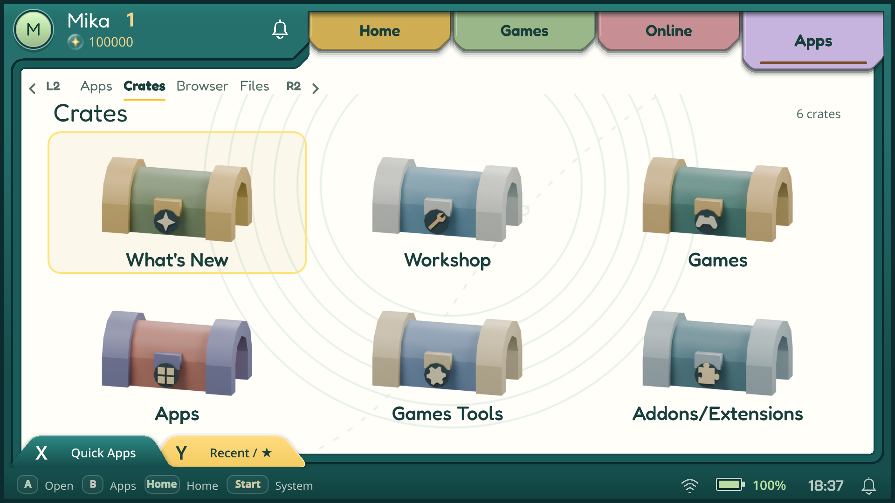

# Crates layout and categories — 14 November 2026

The owner rejected the sequence 39 overview as uneven and too small, then
specified a new six-category set. The final screen uses equal tiles in a 3×2
grid, larger chest renders and centred titles, with clearance above Quick Apps.

## Categories and compatibility

| Category | Emblem | Contents |
| --- | --- | --- |
| What's New | Spark | Existing recent-project selection |
| Workshop | Wrench | Existing Workshop selection |
| Games | Gamepad | Game projects |
| Apps | Four tiles | Application projects |
| Games Tools | Gear | Curated gaming utilities; currently Session Timer |
| Addons/Extensions | Puzzle | Modules; currently empty |

The application owns the labels and order. A validated legacy catalogue with
Adventure/Arcade/Strategy/Tools is regrouped by its project kinds and the existing
curated utility membership. Project/package identities, signature verification,
installed records and catalogue trust are retained. Canonical new catalogues
keep their explicit group membership; unknown category sets are rejected.

Bundled data contains 13 games and 4 apps. The live catalogue observed on the
handhelds contained 14 games, 4 apps, 1 gaming utility and no modules, with 18
What's New and 12 Workshop entries. These are dated observations, not limits.

The actual Kenney-based mesh is wider and rendered from a straighter angle.
Offline packing trims transparent margins, aligns the bottom baseline and pulls
back during opening to keep the lid visible. Closed images are 512×320; opening
strips are 1536×160. There is no live 3D renderer or idle animation. Historical
asset filenames remain stable; [asset documentation](../../../assets/crates/README.md)
maps them to the current categories and documents sources/regeneration.

## Build and host checks

- Final source: `c97825ea45c17ad303b2f01d827109949e995bfc`.
- Private Software sequence: **42**, version `0.1.0-alpha.8-device.c97825ea`.
- Production ARM64 binary SHA-256: `5d21dfbc7a8a80221ea7a8196bd6a6b88f8601ffec05da2184db0fbf516b49ea`.
- Signed release identity: `a9c8e7f9d353d50dffdfdd5d0889ec68fc75e7d76d7fa5ad41f3629add4ab3b3`.
- Native and ARM builds passed; the cached ARM cross-builder was reused.
- **28 Crates C++ tests passed**, including grid edges/vertical columns,
  return focus, atomic catalogue rejection and legacy remote regrouping.
- **9 signed-catalogue Python tests passed**.
- Art probe and normal catalogue UI smoke passed without collected QML warnings.
  The probe includes opening, Back, reduced motion, light/dark and two sizes.

Native captures use synthetic host data and are not handheld evidence:
[960 light](native/light-960.png), [opening](native/opening-960.png),
[1280 dark](native/dark-1280.png).

Sequence 40 first exposed insufficient clearance above the dock; sequence 41
corrected that. Sequence 42 adds the final category set and compatibility path.
The earlier [sequence 39 artwork record](../2026-11-14-art-direction/README.md)
remains historical. No public release or OTA feed was changed.

## Actual Odin and Flip checks

Both devices exited through Start → Switch → Desktop before activation, then
returned through the normal session launcher without reboot. Odin used its
existing in-place update path; Flip used managed Software activation. Both live
processes matched the binary hash above. Flip confirmed its first frame and
retains sequence 41 identity
`322e11a80f0cc628eb31535ccba9c81a01e999f089b934a5ff877cedfaf31008` for rollback.

On each device all six sections opened and returned to the selected chest.
Keyboard Up/Left navigation crossed the grid into Workshop and What's New;
pointer selection reached Games, Apps, Games Tools and Addons/Extensions.
Canonical labels remained after catalogue refresh. Empty Addons/Extensions
shows its normal empty state. Both shells were left at the Crates overview.

These are actual 1920×1080 Gamescope captures, using remote pointer/keyboard
input. This is not a physical-controller, touch, game-installation or sustained
frame-time benchmark. No games or applications were installed/launched in this
bounded presentation check. Bazaar implementation was not changed.

| Screen | Odin | Flip |
| --- | --- | --- |
| Overview | [Screenshot](devices/odin-categories-overview.png) | [Screenshot](devices/flip-categories-overview.png) |
| What's New | [Screenshot](devices/odin-categories-new.png) | [Screenshot](devices/flip-categories-new.png) |
| Workshop | [Screenshot](devices/odin-categories-workshop.png) | [Screenshot](devices/flip-categories-workshop.png) |
| Games | [Screenshot](devices/odin-categories-games.png) | [Screenshot](devices/flip-categories-games.png) |
| Apps | [Screenshot](devices/odin-categories-apps.png) | [Screenshot](devices/flip-categories-apps.png) |
| Games Tools | [Screenshot](devices/odin-categories-tools.png) | [Screenshot](devices/flip-categories-tools.png) |
| Addons/Extensions | [Screenshot](devices/odin-categories-addons.png) | [Screenshot](devices/flip-categories-addons.png) |
| Back / retained selection | [Screenshot](devices/odin-categories-back.png) | [Screenshot](devices/flip-categories-back.png) |

## Preservation and cleanup

Both personal databases passed SQLite quick_check and retained adventure counts;
profile/config backups remain private. The previously verified PC exit helper
retained SHA-256 `903a8fe8eda3f8abf79b955dc38a05f67ec8d7047302226562ce071610d13f3e`.
Both application-session journals were empty.

After acceptance, task archives, preparation caches, remote captures and the
superseded sequence 40 rollback were removed after ownership/live-reference
checks. Sequence 41 recovery and personal games, profiles, BIOS and saves remain.
Final internal free space after filesystem reclamation: **Odin 9.90 GiB,
Flip 22.79 GiB** (before this layout task: 9.90 / 22.82 GiB).
