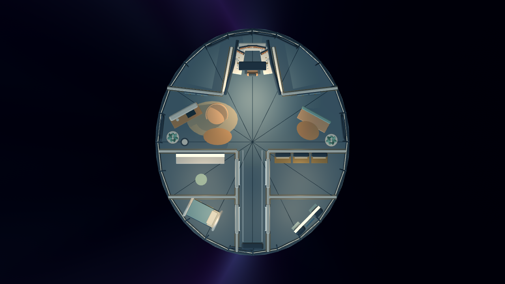

# Ship Home — compact saucer and single-seat cockpit

14 November 2026. Development preview on `codex/ship-home-20261114`.
The owner found the [Orbit restyle](../2026-11-14-ship-redesign/README.md)
too spacious, too rectangular and inconsistent with a flying saucer. This pass
changes the actual floor plan, rather than adding more ship-shaped decoration.

## Layout

One 10.6 × 12.4 metre oval hull now contains the whole interior. Its 24-sided
pressure-wall footprint is approximately 102 m², compared with the previous
372 m² combined rectangular rooms. These are geometry measurements before
partitions/furniture, not an engineering-certified habitable-area calculation.
The shallow ceiling drops toward the sloping rim; radial ribs and deck seams
make that curved shape visible indoors.

- Bow: one pilot seat between side consoles, forward instruments and an overhead
  pod. The approach is behind the seat. Sealed shoulder spaces reserve machinery
  volume instead of providing empty floor on either side.
- Centre: a small galley, movable chair/table and two-person dinette.
- Aft: workshop, collection archive, single-berth cabin and wardrobe share one
  short 1.7 metre spine, narrowing toward the rim.
- Windows are individual tapered, chamfered openings, roughly 0.75 metres high,
  with opaque hull above and below. Four forward panes give the cockpit its view.
  Ivory, brass, blue light and the ringed planet retain the Orbit reference.

## Captures

These are actual Godot viewport PNGs at 1280×720. Architecture captures use
inspection cameras with the avatar/HUD hidden. Only the overhead capture hides
the roof; it is the same scene and furniture, not a separately drawn plan.

| Architecture view | Image |
| --- | --- |
| Cockpit entrance | [bridge.png](bridge.png) |
| Pilot well and windows | [cockpit.png](cockpit.png) |
| Dinette | [lounge.png](lounge.png) |
| Central access spine | [spine.png](spine.png) |
| Single berth | [cabin.png](cabin.png) |
| Workbench | [workshop.png](workshop.png) |
| Collection bay | [gallery.png](gallery.png) |
| Outfitting bay | [wardrobe.png](wardrobe.png) |

[Gameplay camera captures](gameplay/) retain the normal HUD and shared character,
using the approved locally resolved development descriptor. No private profile
or model file is included. `panorama.png` shows normal third-person distance;
`cabin.png` and `wardrobe.png` exercise close wall retraction. In those tight
views, the avatar hides so the camera does not display the inside of its head.
It returns once camera clearance exceeds the hysteresis threshold.

## Verification

Godot 4.7.2 headless checks passed:

- all seven starter furniture footprints fit without overlapping fixed or other
  solid furniture;
- walking through all four physical hatches, curved hull collision and pilot-seat
  collision;
- placement rejects the central route, door approaches, curved perimeter and
  rugs whose corners cross it;
- chase-camera retraction and hiding the nearby character;
- per-profile save/reload, atomic replacement, corrupt-file preservation,
  placement/undo and mixed indexed/unindexed geometry batching.

The architecture tour and shared-avatar gameplay-camera tour completed under
Xvfb/Mesa llvmpipe on the development server without script/render errors.
Captures were visually inspected; a blocked wardrobe entrance, overlapping
starter furniture and inside-head camera views were corrected during this pass.
Software-render screenshots are not a handheld frame-time benchmark, and camera
poses are not a physical-controller acceptance run.

The new deck uses `homes/saucer-v2/<profile-hash>.json`. The old preview's
coordinates no longer fit; its original files in `homes/` remain untouched.
This starts a separate compact arrangement per profile, with no silent destructive
migration or claim that the earlier furniture arrangement was carried over.

See [run commands and controls](../../../experiences/ship-home/README.md).
Shell entry, Apps process ownership, shared avatar source, Bazaar, device builds,
Setup and OTA were not changed. Neither handheld was accessed.

## Still unfinished

This is a playable layout/art iteration. Flight, seating animation, functional
crafting, wardrobe actions and owned-reward presentation remain unimplemented.
Final art and physical-controller, compositor and handheld-performance acceptance
remain open. The service panels do not expose a working machinery simulation.
