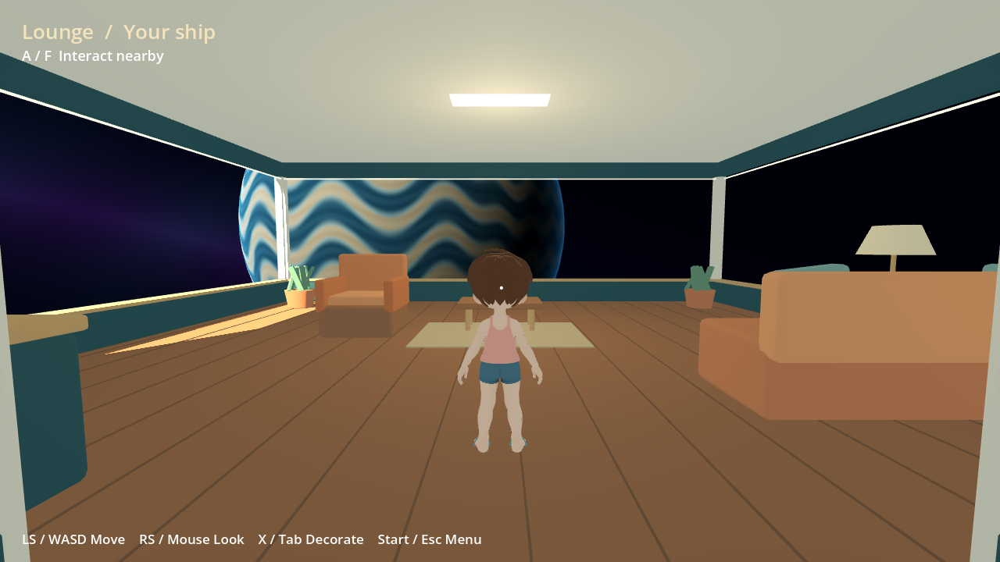

# Ship Home — first playable layout, 14 November 2026

Development preview on `codex/ship-home-20261114`. **Neither Odin nor Flip was
accessed or modified.** Bazaar/economy work is outside this branch. No Software
sequence was reserved, no Setup/OTA bundle was changed and no public release was
published.

## What is playable

- Separate Godot process: third-person movement, mouse/right-stick camera,
  collision-aware camera arm, room and window collision.
- Panoramic lounge, passage, workshop, gallery, bedroom and wardrobe, with
  original code-built furnishings, warm materials and a procedural space view.
- Seven starter furniture types, placement preview, rotation, movement, removal,
  undo and per-profile save/reload. Doors and passage are protected.
- Real local avatar SDK consumer with the shared presenter, a simple procedural
  walk and identity clearing on disconnect. Guest home is separate.
- Upper bell replaced by a saucer entry. Home controller navigation reaches it;
  the lower inbox remains. Launch/return delegates to existing Apps rather than
  adding another process supervisor.
- Development installer, retained process ID, single-instance lock, visible
  launch-error path and polite window close/save.

This is a functional layout study. Workbench recipes, wardrobe editing inside
the ship, real owned trophy/card displays and richer decoration are **unfinished**.
There is no multiplayer visit system or new economy. The room model and lighting
are early art, and the wardrobe panel is not a working reflective mirror.

## Actual renders

These are 1280×720 frames rendered from the game, not concept illustrations.
They use a locally resolved development avatar; no personal profile/model data is
included. The native shell frame is 960×540. Avatar artwork keeps its existing
[attribution and licensing](../../../assets/avatar/README.md).

| Lounge and panorama | Other rooms |
| --- | --- |
| [Lounge](lounge.png) | [Workshop](workshop.png) |
| [Window view](panorama.png) | [Gallery](gallery.png) |
| [Decoration mode](decorating.png) | [Bedroom](cabin.png) |
| [Ship icon and retained inbox](shell-ship-and-inbox.png) | [Wardrobe](wardrobe.png) |

## Validation and limits

Godot 4.7.2 compatibility renderer, Linux x86_64 development host. Native Qt
build and `trainer_interaction_tests`: **63 passed, 0 failed, 0 skipped**, including
an actual PlatformBinding → external Godot avatar check. See
[interaction log](interaction.txt). The physics/storage suite passed replacement,
reload, profile isolation, invalid/corrupt saves, placement/undo, workbench overlap,
protected doors, glass collision and camera retraction.

The versioned development install was actually launched in Xvfb. A second
instance was rejected while the first kept its tracked PID; `WM_DELETE_WINDOW`
closed the game with exit 0. [Result](launch-check.txt). The bare Xvfb fixture
needed `WM_DELETE_WINDOW` interned before starting Godot, as a real window manager
would do; the initial missing-atom test did not deliver a close event. This was
corrected in the fixture, not bypassed with process killing as a successful exit.

Settings and full Home/inbox UI traversals passed (exit 0; Home QML warnings: 0).
Home/inbox verification is recorded in
[home-check.txt](home-check.txt). An obsolete 76 px Quick Apps expectation was
updated to the existing 100 px layout, avoiding an infinite animation wait.
The initial bare-Xvfb pass did not activate Qt's window and failed three early
focus assertions; the fixture now assigns actual X11 focus, as a window manager
would. Reproduce with `tests/focus_shell.py` around the native binary under Xvfb,
using a 1920×1080 Xvfb screen, `--persistence-smoke-test library-home` and a fresh
`--data-dir`. The scenario resizes between 1920×1080 and handheld dimensions; a
1280×800 virtual desktop constrains its active window and invalidates bounds
checks. Animated height comparisons use the same 0.1 px settling tolerance as
the animation wait.

The engine's [close-request contract](https://docs.godotengine.org/en/stable/tutorials/inputs/handling_quit_requests.html)
and [SpringArm3D camera](https://docs.godotengine.org/en/stable/tutorials/3d/spring_arm.html)
were used rather than a custom window-close or camera-collision protocol.

Fixed room meshes are grouped by material. The final tour reported 391 nodes,
337 draw calls in decoration mode with the shared avatar and about 86 MB of
Godot static allocations. These are **not handheld FPS or process-RSS claims**;
Mesa llvmpipe and an editor-capable engine were used. Foreground is capped at
60 fps; background movement pauses and rendering is capped at 10 fps. Sustained
performance, physical controller/touch and actual handheld compositor
minimize/Quick Apps/return/close acceptance remain pending.

[Run, install and controls](../../../experiences/ship-home/README.md).
