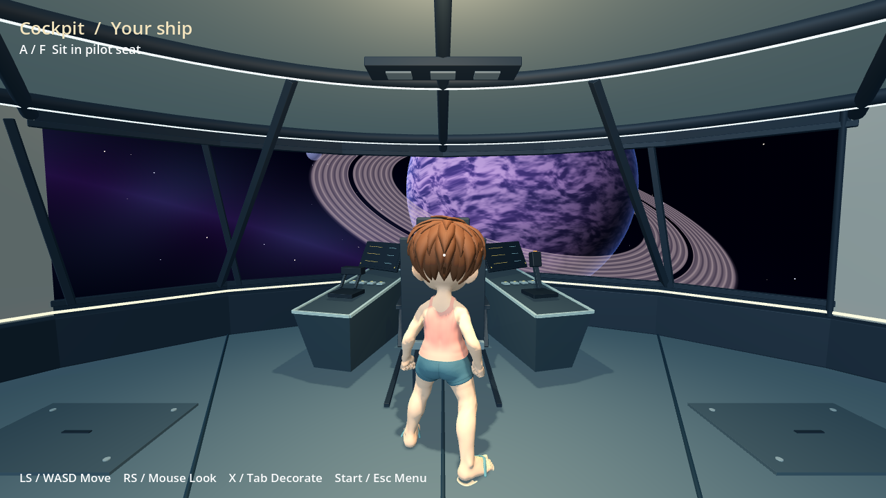
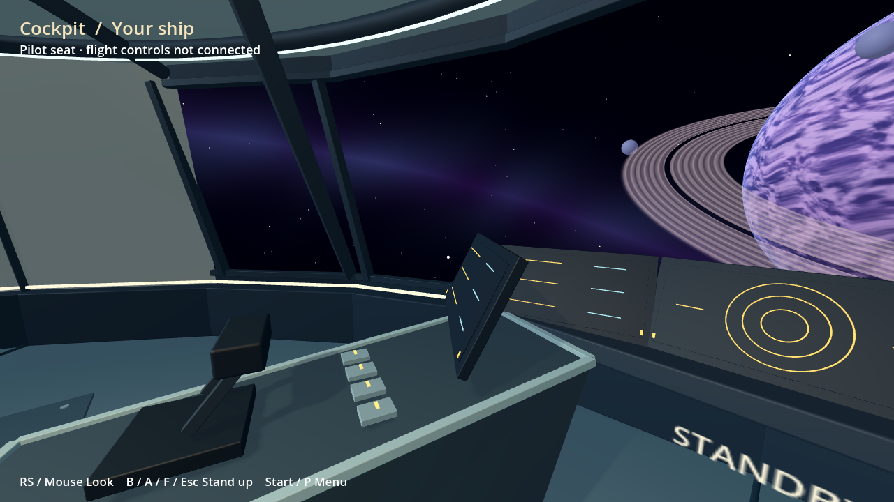
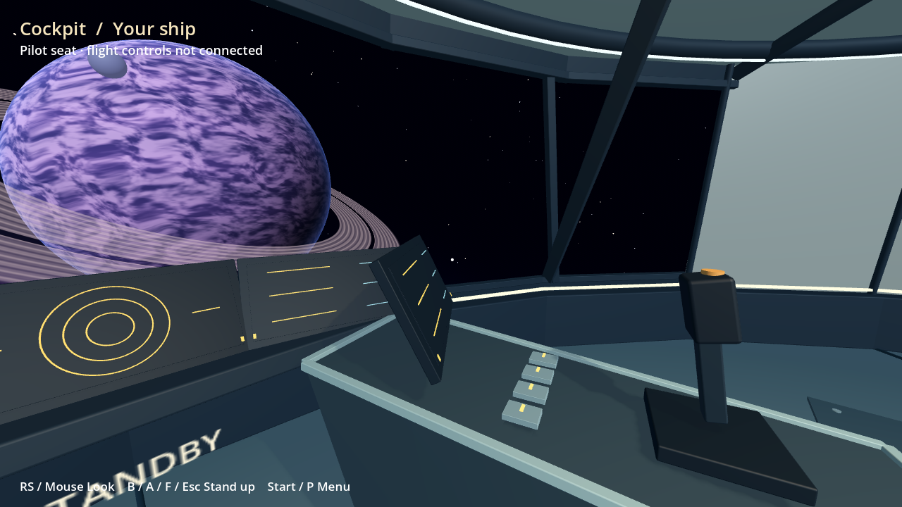
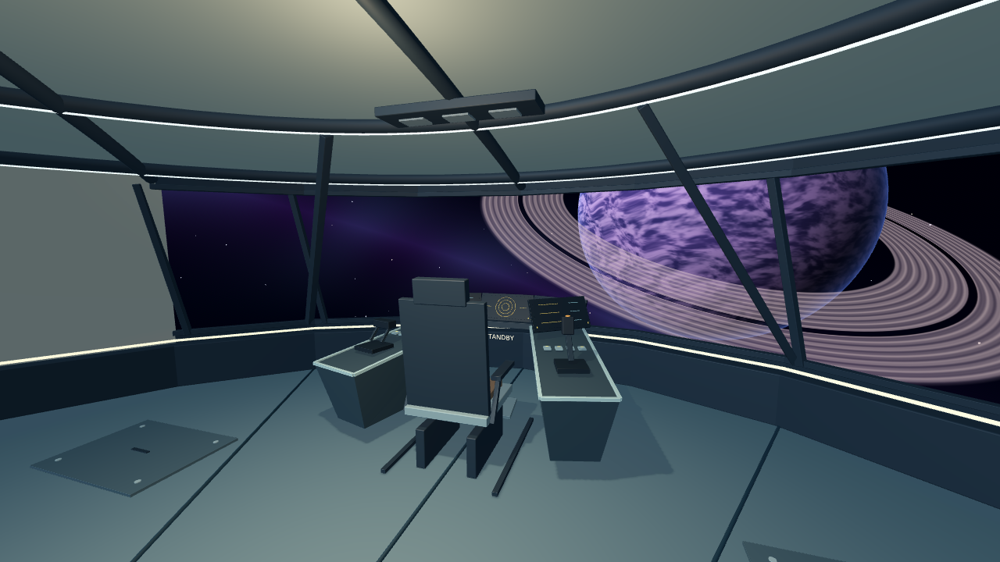
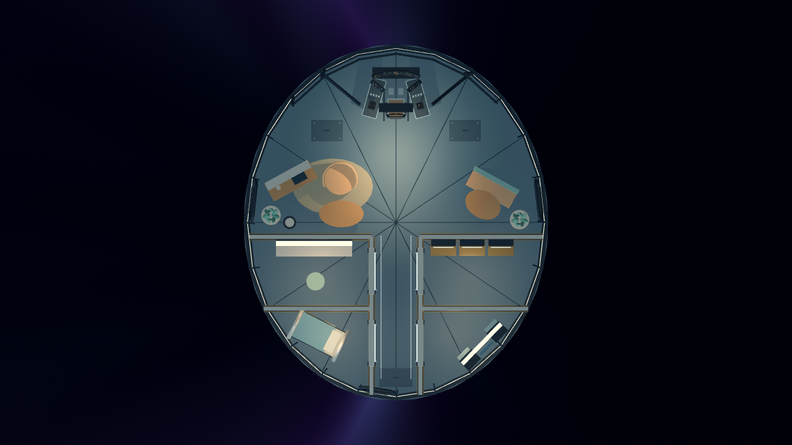
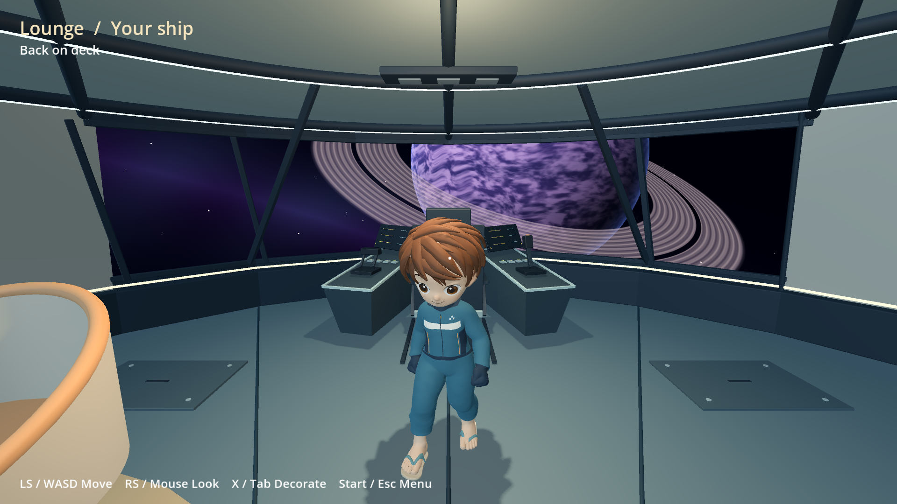
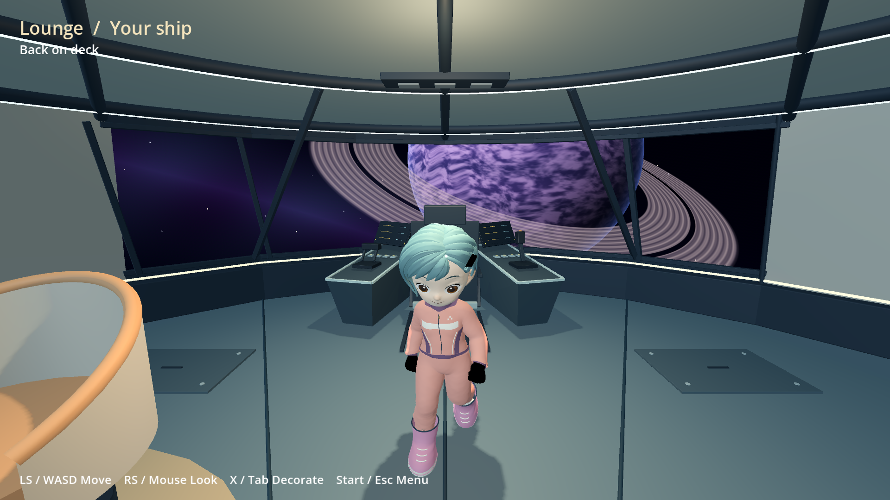
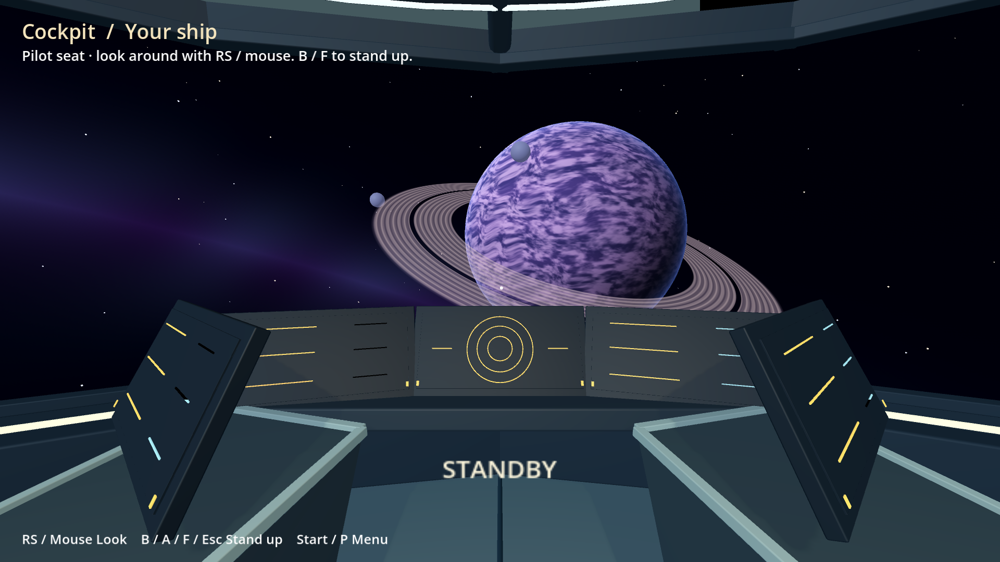
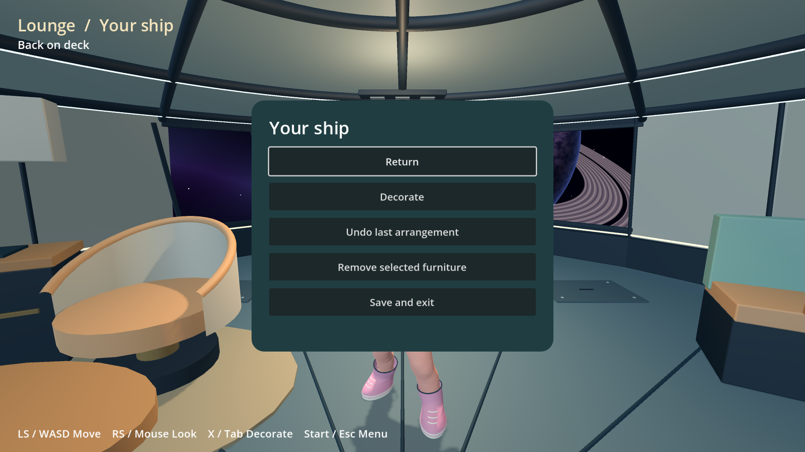

# Pilot cockpit and shared movement — 14 November 2026

Development branch `codex/ship-home-20261114`; standalone installed game revision
`c941fe3279ae760e` on Odin 2 and Flip 2. This is not a public release or OTA.

## Delivered

Removed the cockpit-side partitions and machinery cabinets. Technical space is
reserved below the floor, marked by flush service hatches. The compact oval hull
now has panoramic glazing around the bow and shaped portholes in living bays.
Thinner metal edges, faceted consoles, stick/throttle and a low instrument cluster
replace the pillowy fittings. Instruments remain decorative standby displays.

A/F at the chair switches to first-person view; mouse/right stick turns the head.
A/F or B/Esc returns to a checked free space on the deck and restores third person.
Pause, blocked exits, avatar refresh and identity withdrawal preserve safe state.
The seated pose is a simple game-owned pose, not an authored boarding animation.

Idle/walk/run now use the **unchanged common SDK locomotion from `c45675a5`**,
including the attributed CC0 Quaternius animation pack. Only SDK files were
brought across from the other branch; Bazaar implementation/art were not merged.
The ship's former procedural walking code is removed. Cadence uses actual travel
after collisions; the animator is recreated with the avatar, suspended when
seated and resumed on standing. Shared motor code/docs/tests are included with
the SDK dependency, but Ship Home retains its existing compact-deck controller.

The cockpit composition borrows ideas from the
[official Elite Dangerous manual](https://hosting.zaonce.net/elite/website/assets/ELITE-DANGEROUS-MANUAL.pdf)
(pilot sightline and angled instrumentation). No Elite artwork or code is bundled.

## Verification

- Godot 4.7.2 general geometry/storage/collision checks and pilot input/state checks
  passed on the development host and both ARM64 handhelds.
- Graphical host tour passed actual captured-mouse input, shared SDK idle/walk/run
  selection, seat/stand, and same-profile avatar refresh while seated.
- Both handhelds: launched **through Apps**, loaded their own SDK profile avatar,
  walked, entered the first-person seat, looked around, stood up, and used the
  game's menu to save/exit. Apps then had no tracked session and InputPlumber
  returned to mode 0. Logs contained no Godot errors; renderer was Mesa 26.2.6
  freedreno FD740 (Odin) / FD650 (Flip).
- Device input was remote keyboard/pointer. This is not physical-controller or
  touch acceptance. The headless checks inject Godot controller events separately.
- Home/minimize/Quick Apps return remains **unverified for this game**. A remote
  Guide injection timed out; requesting the existing Home interception path
  mapped the shell's Home window, but capture/input did not establish a usable
  overlay. This is an open integration check, not a claimed successful minimize.
  Native save/exit recovered normally without killing the game or shell.
- The existing shell/Bazaar builds were not replaced. Flip's shell and Bazaar
  manifest hashes matched the pre-test baseline; Odin retained the same live
  shell process, but its baseline hash capture was interrupted by storage delay.
- Odin twice stalled in microSD journal I/O during staging, then recovered without
  reboot/unmount/repair. Installation eventually completed normally. Do not infer
  a hardware diagnosis or a kernel fix from this observation.

The installed runtime is the official Godot 4.7.2 ARM64 binary. Its downloaded
ZIP SHA-256 was `5dd0d86405cf7e8adf79fb6377b38ba682a2846cb378ffe5364f38c01ad29b9d`.
No KDE runtime or system packages were installed. Required runtime and one working
Ship Home rollback are retained; staging, temporary captures and synthetic test data were removed from both devices.
Personal layouts/avatars and rollback `224a8186dea12158` are retained. Final internal
free space was 8,005 MiB (Odin) / 22,636 MiB (Flip); cleanup reclaimed less than
1 MiB internally because build/import staging was on microSD.

## Captures

Host engine views (1280×720, software renderer; final SDK integration):

Architecture views (same geometry, HUD/avatar hidden):

Real handheld captures (1920×1080; keyboard/pointer driven):

## Still open

Physical pad/touch and native Home/minimize/return acceptance; sustained frame-time
and thermal measurements; final art, boarding animation and first-person hands;
flight simulation; crafting, wardrobe actions and owned gallery providers. The
header ship icon is present in this branch's shell source, but the currently
installed Bazaar shells were deliberately retained: use **Apps → OctoFox Ship
Home** on the handhelds. Setup/OTA packaging remains separate.
