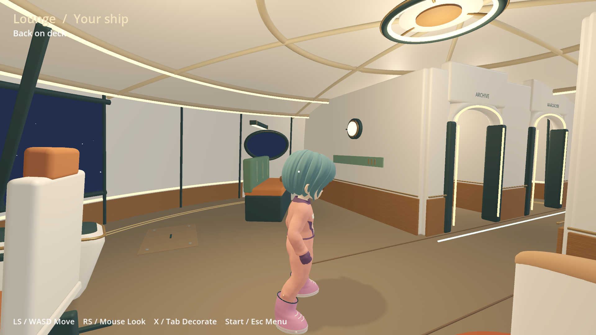
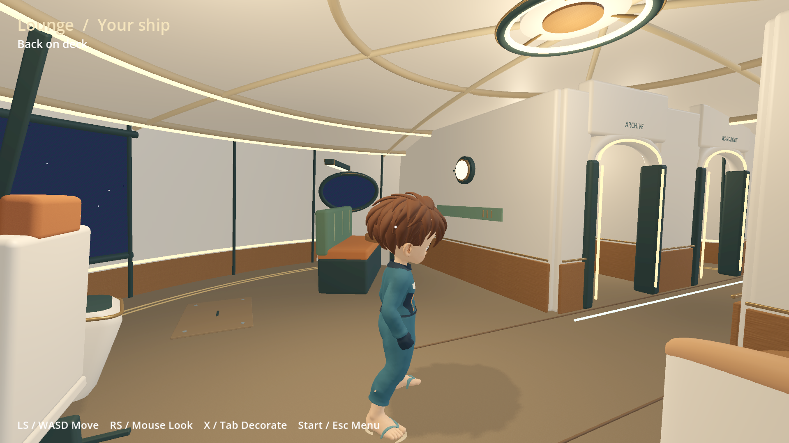
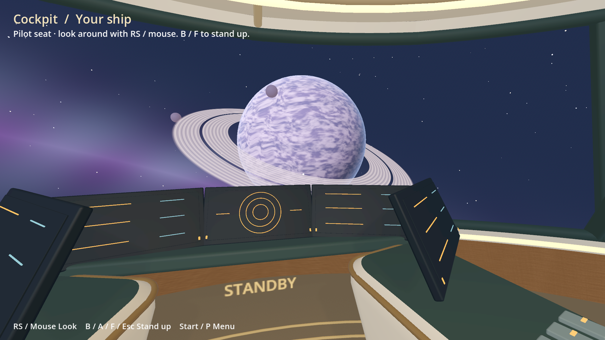
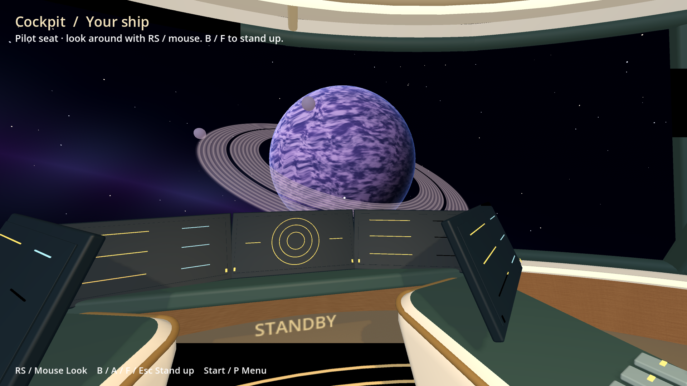

# Warm ship on Odin and Flip — 14 November 2026

The owner resumed device access after the host-only visual revision. Both
handhelds now use standalone Ship Home revision **`34aa5da8b7518ad3`**, based on
the warm interior in `ebafca7e` with Vulkan Mobile selected in `project.godot`.
The existing shell/Bazaar binaries and processes were retained. This is not a
public release, Setup update or OTA. Enter through **Apps → OctoFox Ship Home**.

## Installation and native checks

- Godot 4.7.2 ARM64 was already installed; no engine download, KDE runtime, system
  package, kernel change, reboot or shell replacement was required.
- Sources/import staging were on microSD. Odin hit another storage wait during
  SDK staging, so the final already-imported ARM application was copied from
  Flip to Odin with all 41 payload files read back and SHA-256 verified. No
  per-user homes, avatars, saves or device-specific shader cache were copied.
- The geometry/storage/collision and pilot suites passed on both ARM devices for
  the warm scene. The subsequent renderer-only change was verified through actual
  Apps launches and native rendering on both handhelds.
- Both devices loaded their own profile avatar, walked, entered the pilot seat,
  turned the first-person camera, stood up, looked around the living area and
  used **Save and exit**. Both returned to the shell with no tracked app session
  and InputPlumber mode 0. Input was remote keyboard/pointer, not a physical-pad
  acceptance run.
- Final game logs contained no errors. Odin: Vulkan 1.4.354 / Turnip Adreno 740;
  Flip: Vulkan 1.3.354 / Turnip Adreno 650; Godot **Forward Mobile** on both.

## Renderer correction

Compatibility showed black patches on Odin's floor, ceiling and instruments.
They varied with the camera and were not limited to startup. Disabling shadows,
disabling environment reflections and bounding the sky shader's arithmetic did
not remove them. Those diagnostic changes were reverted. Switching to Godot's
standard Vulkan Mobile renderer removed the patches in the tested start,
pilot/look and living-room views on both devices, retaining the authored scene,
lights, shadows and SDK avatar. The exact lower-level GL/driver cause remains
undiagnosed; this is not a claim of a Mesa or kernel repair.

The renderer change also changes sky/tonemapping appearance slightly compared
with the earlier Compatibility captures. See Godot's
[renderer overview](https://docs.godotengine.org/en/stable/tutorials/rendering/renderers.html)
for the distinction between the two paths. Sustained GPU time, memory, thermals
and battery use were not benchmarked in this deployment check.

## Native captures

1920×1080 Gamescope captures from the installed application:

Diagnostic evidence from the rejected Compatibility rendering path:

## Cleanup and limits

Only the final installed version, the existing Godot runtime and one known
working rollback (`c941fe3279ae760e`) are retained. Our intermediate app copies,
synthetic test homes, microSD source/import staging and temporary device captures
were removed. Personal profiles, games, BIOS, saves and furnishing layouts remain.
The shell executable path/hash and live PID matched each device's baseline.
Final internal free space: **7,940 MiB on Odin**, **22,599 MiB on Flip** (before
this deployment: 7,978 / 22,637 MiB). These are free-space snapshots, not a claim
that installation reduced total disk use. [Final state and check logs](final-checks.json).

Physical pad/touch, native Home/minimize/Quick Apps return and sustained
performance acceptance remain open. The brief initial guest figure before the
profile avatar arrives is also not yet a polished loading transition. Flight,
boarding animation, crafting, wardrobe actions and owned reward providers retain
their earlier scope boundaries.
