# Warm ship interior and lighting — 14 November 2026

Later the same day the owner resumed deployment. See the
[handheld delivery record](../2026-11-14-ship-warm-devices/README.md) for the installed
Vulkan Mobile revision and native captures. This page retains the earlier
host-only verification and Compatibility-renderer images.

Host-only visual revision on `codex/ship-home-20261114`. The owner paused handheld
work: **neither Odin nor Flip was accessed, updated or tested in this increment**.
They retain the preceding installed pilot preview `c941fe3279ae760e`.

## Changes

- Curved wall panels and canopy rails, smoothly shaded ceiling, refined edge
  fillets, formed console shells and oval portholes replace conspicuous facets.
- Warm ivory shell, sage fittings, terracotta textiles, selective wood inserts
  and a matte deck replace the cold grey treatment and radial triangle seams.
- Ceiling halo fixtures, frosted bulkhead lenses, under-cabinet/workbench reading
  lights, pilot overhead optics and warm perimeter strips have visible housings.
- Two shared 128×128 procedural noise textures provide modest grain/cloth detail.
  No downloaded art, AI images, new shader dependencies or external room assets.
- Existing six room lights, one shadowed bridge spot and one unshadowed directional
  remain; there is no new per-lamp dynamic shadow or full-screen effect. Static
  room/ceiling meshes batch separately by material. The ceiling cutaway retains
  all of its own fixtures.

Layout, save namespace, item footprints, avatar/SDK movement and pilot controls
are retained. Technical space remains below deck. No Bazaar or shell changes.

## Verification

Godot 4.7.2 on the development host:

- `tests/checks.gd`: passed storage/profile isolation, corruption preservation,
  furniture placement/undo, four hatch routes, hull/seat collision, camera
  clearance and batching. Added coverage that nested ceiling fixtures survive
  batching beneath the hideable roof, with their triangle count intact.
- `tests/pilot_checks.gd`: passed entry/exit, eye camera, look bounds, pause,
  blocked exit and identity withdrawal.
- `tests/design_tour.gd`: architecture capture in the actual game scene, with
  HUD/avatar hidden. Eleven interior views and one inspection-only roof cutaway.
- `tests/pilot_tour.gd`: passed shared SDK idle/walk/run selection, captured
  pointer look, seat/stand and seated appearance refresh in a graphical session.

The default guest scene contains approximately 365,396 visible mesh triangles
and 101 mesh instances after batching, including movable furnishings, roof and
planet/moons, excluding star MultiMesh instances. This is a source complexity
check, **not** measured frame rate, GPU time or device memory. The additional
smooth geometry needs a later handheld performance check when the owner resumes
access. No claim of final art approval, physical-pad acceptance or native
Home/minimize/return verification is made.

## Host engine captures

1280×720, Godot Compatibility renderer, Mesa llvmpipe in the development server's
Xvfb container. These are game-engine captures, not handheld photos or concept
renders. The development server was used only as a renderer; no handheld SSH
connection was made.

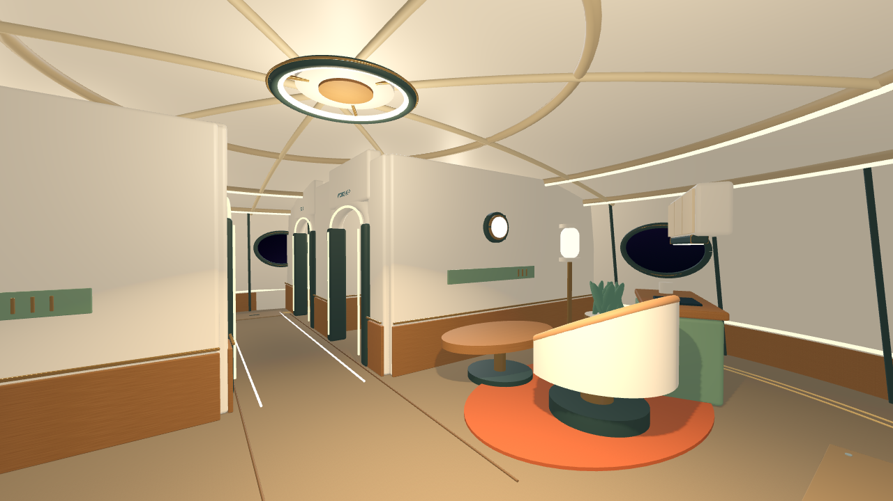
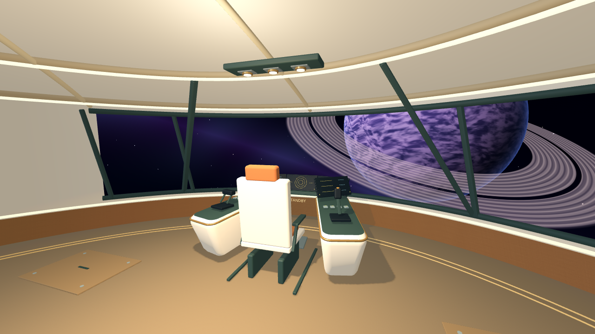
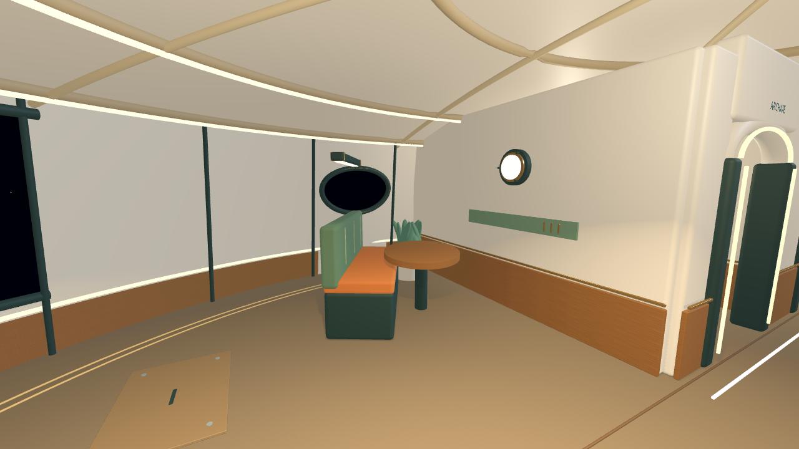
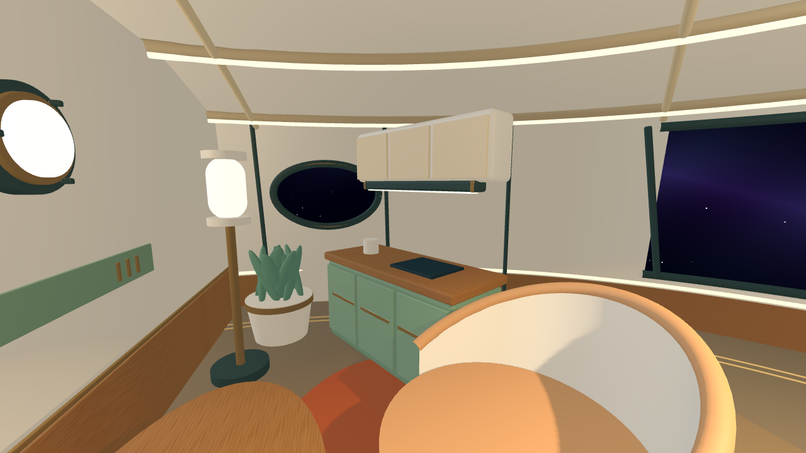
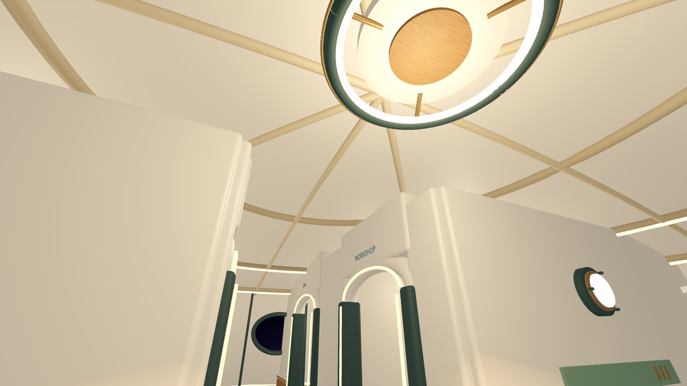
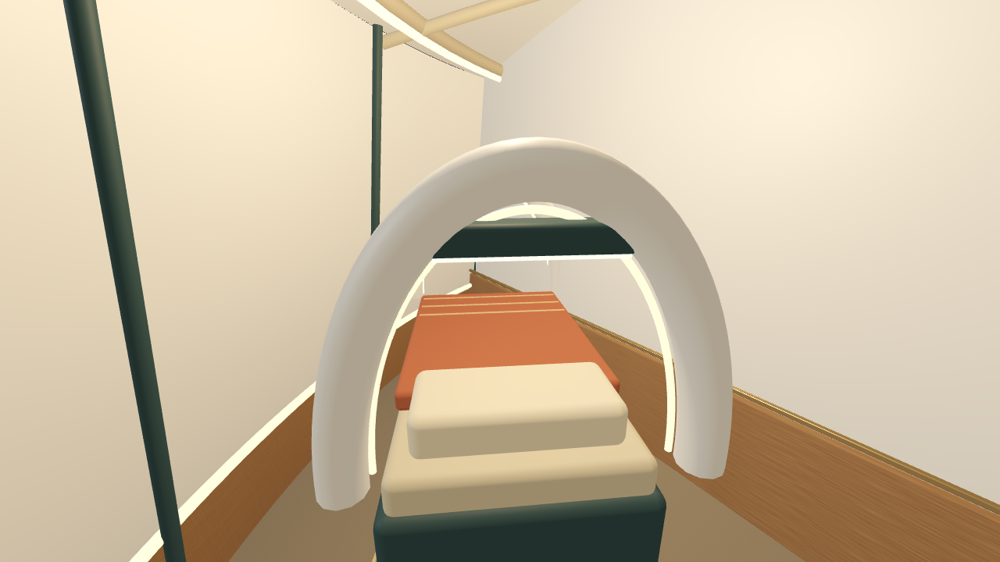
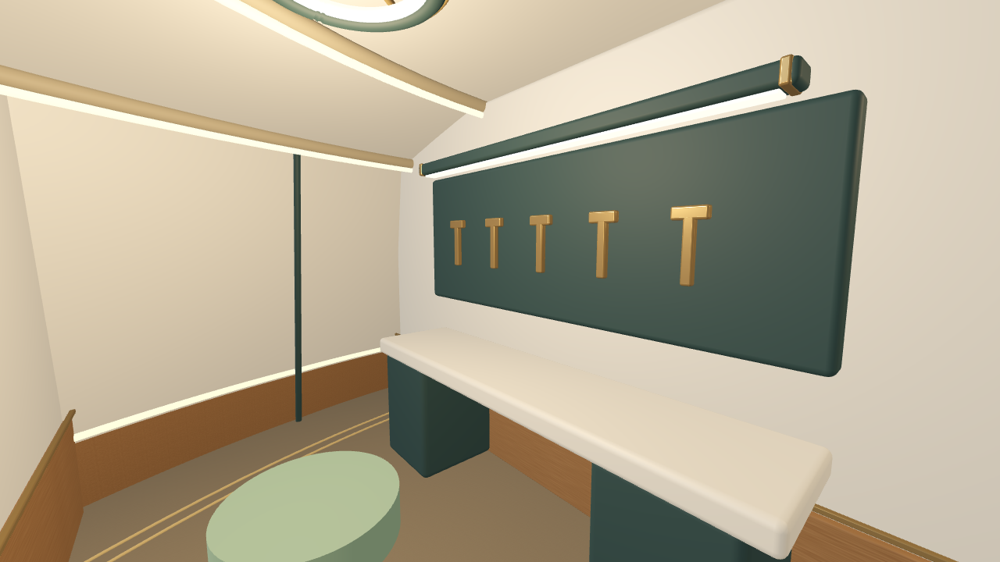
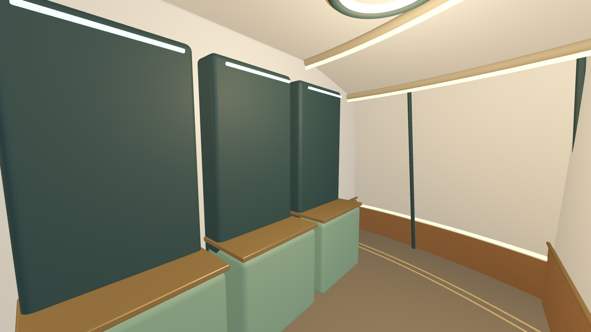
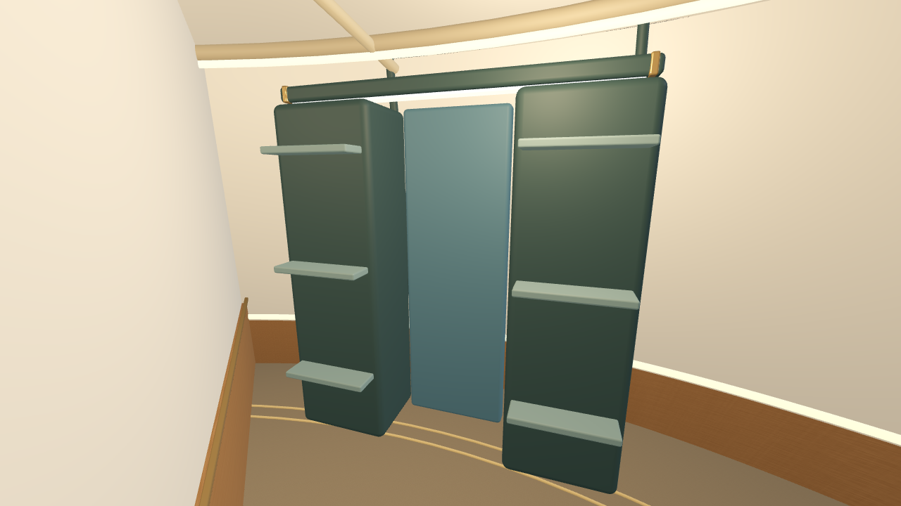
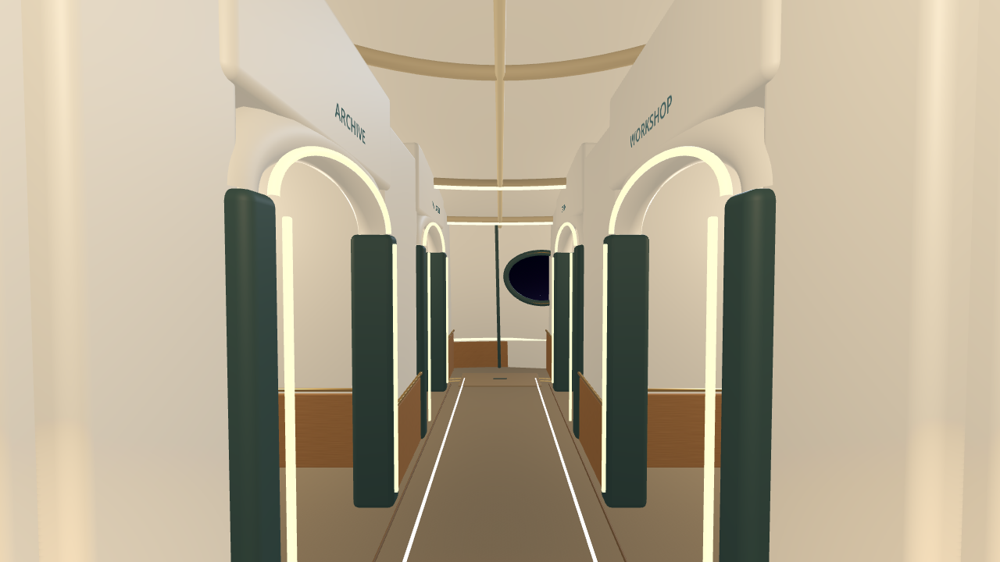
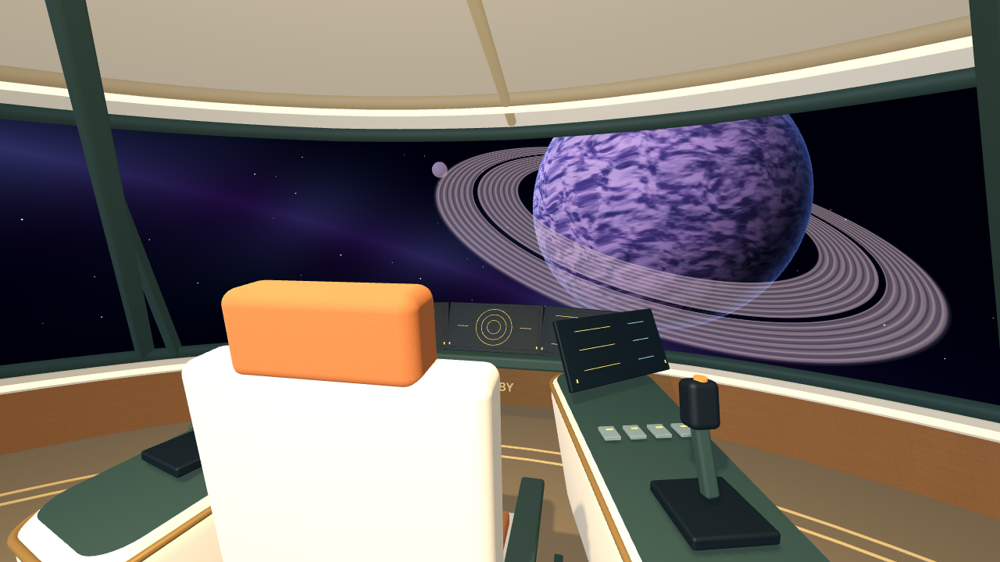
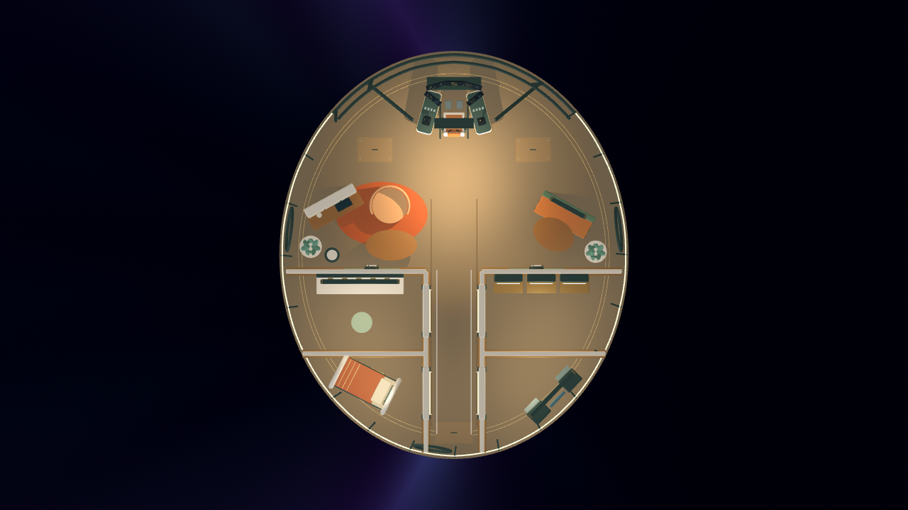

## Remaining boundaries

Handheld visuals/performance are deferred at the owner's request. The previous
open lifecycle acceptance, authored boarding animation, flight, crafting,
wardrobe actions and owned reward display remain unchanged. See
[earlier pilot/device evidence](../2026-11-14-ship-pilot/README.md).
