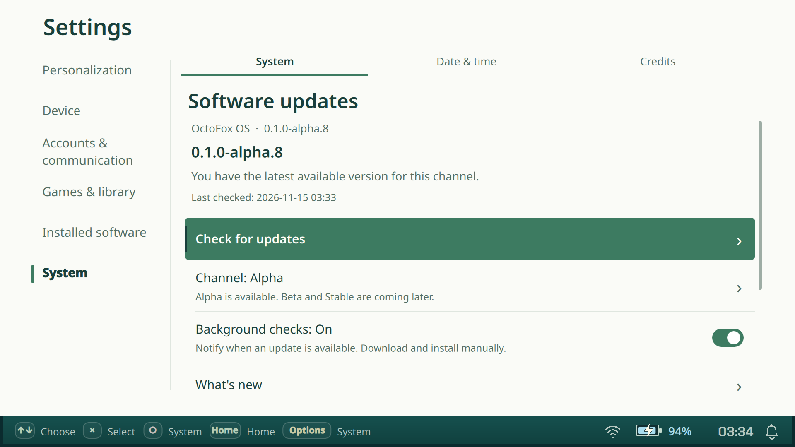
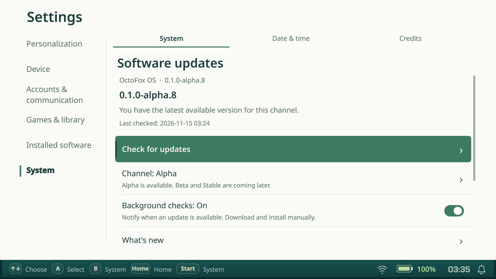
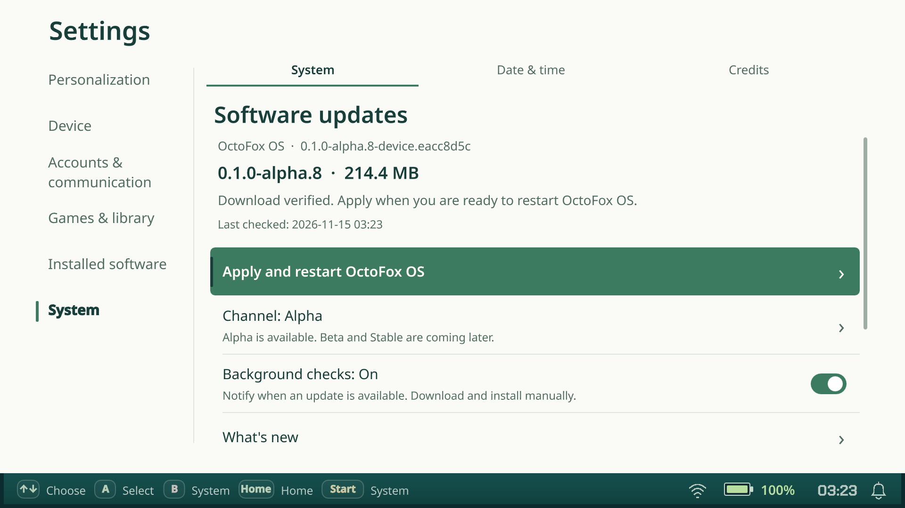
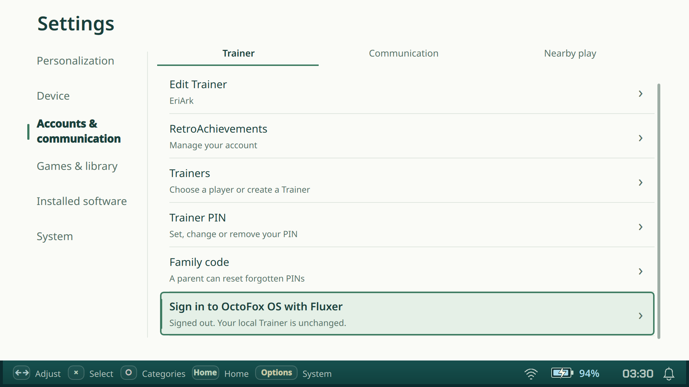
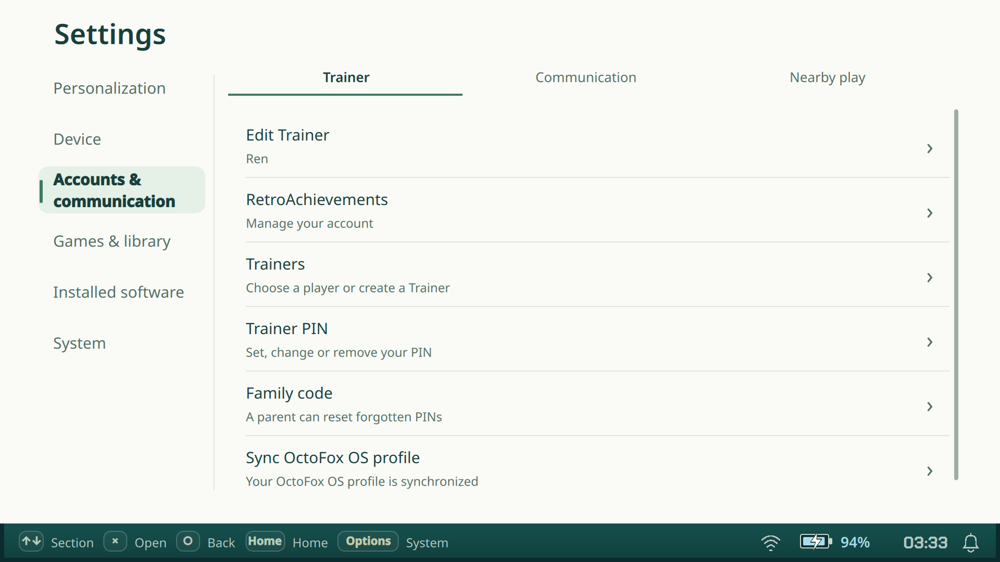

# Alpha 8 — public OTA and automatic accounts, 15 November 2026

[Published release](https://github.com/EriArk/OctoFox-OS/releases/tag/v0.1.0-alpha.8)
was made public at **01:20:20 UTC**, before handheld updates. Software **49** and
all release assets use source `2da283bd547e05a735517af7e1ecdfa4035f3671`.
All source feature branches and publication documents are merged into `main`;
`updates` remains the separate signed-feed branch. No branch history was removed.

## Distribution

All 14 GitHub asset sizes and SHA-256 digests matched the locally verified package
record. Anonymous download of the release manifest and public Alpha feed matched
the signed originals. Full Setup is 1,966,172,160 bytes; Software archive is
224,843,379 bytes. Source, signing public key and dependency source links accompany
the release. Existing reviewed runtime dependencies are reused; the source capsule
and setup helpers are updated. A new clean-device Alpha 8 Setup run is not claimed.

## Handheld OTA

Both devices discovered Alpha 8 through the public feed, displayed the notification
inbox entry, downloaded the public GitHub archive in Settings, verified it and
applied it using **Apply and restart**. Both receipts reached
`first-frame-confirmed` with Software **49**, retaining **48** for rollback.
The running executable hash on both is
`6ba39a6e6ef460e9da4a81bd4373d19585d17efb5330fe73143d79147364802f`.

Odin previously ran a manually replaced executable. Before downloading Alpha 8,
its exact existing signed Software 48 was moved into a managed installation on
internal storage. This baseline migration is not counted as OTA. Its initial OTA
restart was blocked by an existing library scan waiting on unavailable network
mounts; the scan later reported an invalid-entry error. A normal Desktop exit and
restart with startup scanning temporarily disabled allowed the OTA action.
The original startup scanning preference was restored afterward. This is an
assisted successful update, not a claim that the original attempt was uninterrupted.
Flip applied the update through its existing managed installation.

## Account restoration

On Odin, Fluxer remained connected as Ren. The old standalone OS account session
was explicitly signed out using Software 48's UI. After public OTA to Software 49,
the shell automatically claimed an OS session and restored the same server player,
name, appearance and balance without browser sign-in. Server evidence is one
`social / claimed` attempt and the unchanged total of three players. Local profile
name changed from EriArk to the server name Ren as requested; appearance remained
identical. The UI reports **Your OctoFox OS profile is synchronized**.

Flip's Fluxer session was already signed out before this check. Its old OS session
was signed out for restoration testing, but the provider login then required
CAPTCHA. The owner's fresh Fluxer login is still required to complete that device's
live account acceptance. Its local Mika profile and appearance are unchanged.
No CAPTCHA was solved or bypassed. New-player temporary names, avatar/name setup,
lost claim retry and concurrent-claim deduplication are covered by isolated tests;
a newly registered live provider user on hardware was not manufactured.

## Verification and preservation

- Latest native unit binaries: **430 passed**, six prerequisite-dependent skips.
- Nine prior smoke/regression suites passed, including unchanged first-run and
  Software Update QML. The later changes affected account C++ only and were
  covered by the latest native unit run plus the final ARM production build.
- Backend: 214 cases passed in the merged run; the one migration-name expectation
  was corrected and its focused test passed (215 cases validated collectively).
- Packaging/channel/release/setup tests: **99 passed**.
- ARM executable built from the exact published source. Both source trees were
  compared against all compiled source/resource inputs before packaging.
- SQLite quick checks passed; player ownership, history, worlds and game IDs were
  retained. Odin's preceding scan refreshed availability for 24 catalogue rows;
  eight configuration changes were limited to `available`/`issue` and revision.
  No game identity or personal configuration fields changed. Flip's checked tables
  and profile are identical to its checkpoint.
- Task staging and download caches were cleaned; Software 48 remains the rollback.
  The earlier ship-header staging no longer exists on either device. Odin volume
  is zero. No suspend, lid, OS reboot or physical-controller test was performed.

The new transient OTA toast is covered by controller/QML tests. The public update
was discovered by the old Software 48 inbox; that is not presented as a visual
hardware test of Software 49 advertising a future release. Physical pad/touch,
a fresh Alpha 8 installer journey and Flip's new Fluxer sign-in remain separate.

Machine-readable bounded results: [verification.json](verification.json).
