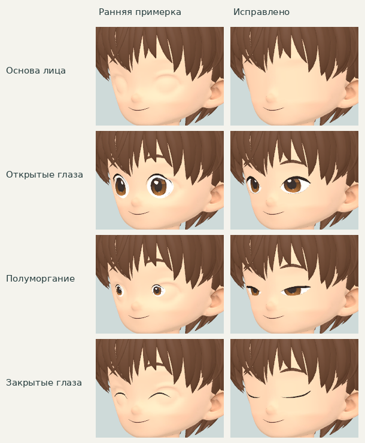
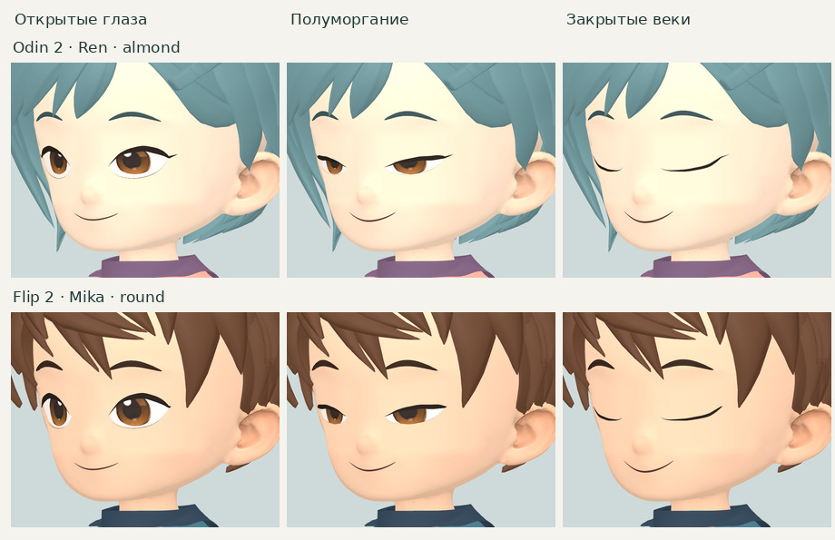
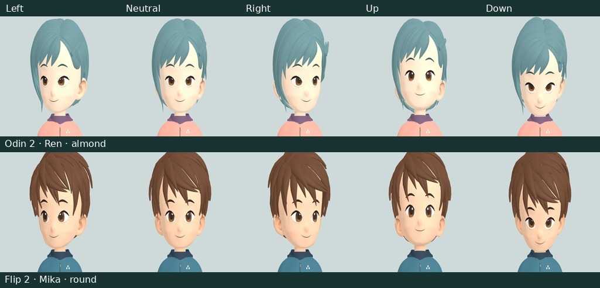
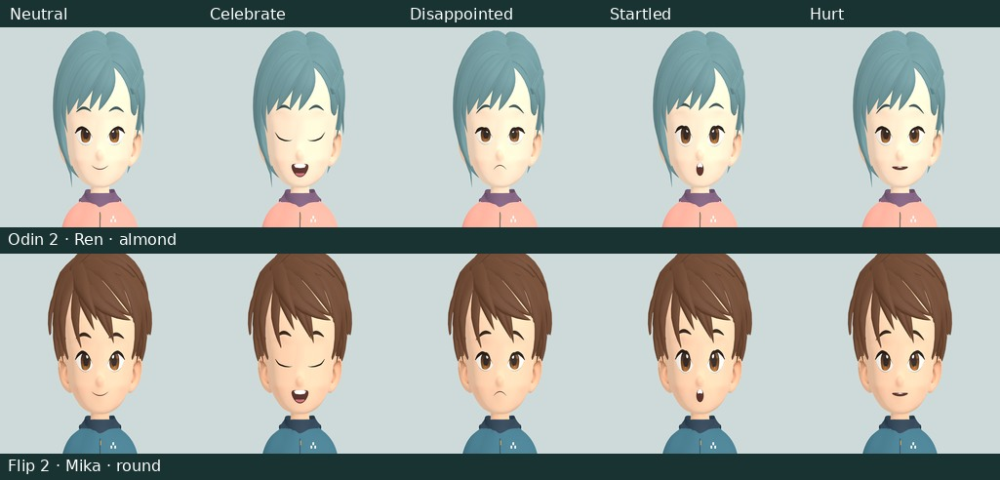
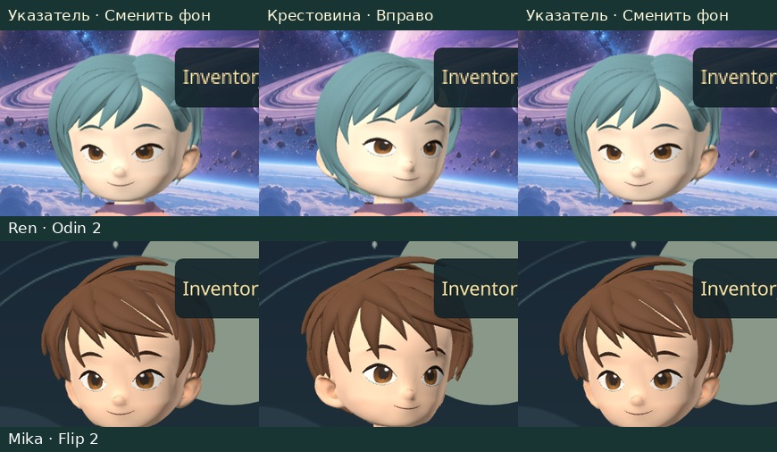
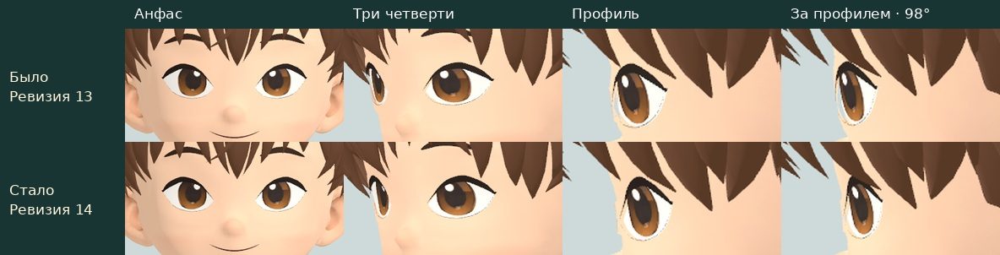
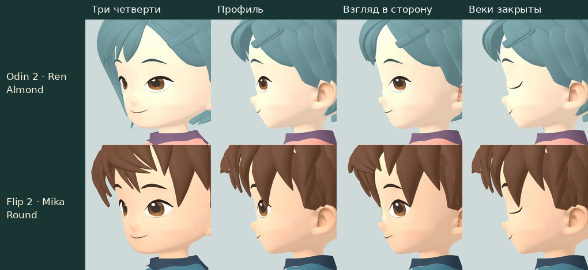

# Посадка глаз и моргание

Нейтральное лицо подбиралось по рисунку №1. Скруглённая верхняя линия утолщается к виску, у внутреннего уголка виден белок. Радужка заходит под верхнее веко.

На первом ряду сравнения ниже выключены белок, радужка, ресницы и веки. При одинаковых свете и положении камеры на предыдущей примерке видно выпуклое очертание старого глаза. В ревизии 12 эта область плавно переходит от скулы ко лбу. На остальных рядах включены все слои.

[Моргание круглых и узких глаз до и после](blink.gif) · [Поворот головы от 0° до 48°](turn.gif) · [Все 14 вариантов анфас и в три четверти](styles.png)

## Проверка

Штатный резолвер OctoFox подготовил 14 моделей с одинаковой причёской. В Godot Mobile для каждой сняты девять фаз закрытия анфас и с поворотом 32°. Для каждого кадра сделан контрольный снимок с выключенными белком и радужкой. При закрытии площадь видимого глаза последовательно уменьшалась у всех вариантов. Все 28 полностью закрытых кадров попиксельно совпали с контрольными. [Измерения покрытия](coverage.json)

Тесты лицевой анимации SDK прошли в Godot Mobile и Compatibility. В Qt прошли девять проверок AvatarScene. Из упакованных ресурсов .tav тест approvedVariants загрузил все 14 вариантов с разными причёсками и двумя оттенками кожи. Проверка геометрии сравнила попадание лучей в белок, радужку, ресницы и веки при пяти степенях закрытия. Проверены исходный контур головы вне зоны коррекции, лицевой риг, одежда и привязки палитры. [Проверка слоёв](eye-layers.json) · [Проверка пакета](pack.json)

### Проверка общего SDK на Odin 2 и Flip 2

На обоих устройствах установлен общий пакет ревизии 12 в пользовательском каталоге `~/.local/share/traineros/avatar/packs/trainer-avatar-1`. Штатный упаковщик собрал 52 файла, их контрольные суммы проверены перед атомарной установкой. Пакет пользователя имеет приоритет над комплектом оболочки. Для отката Odin сохранил прежний пользовательский пакет в `~/.local/share/traineros/avatar/device-trials/eyelids-5f068701/previous-user-pack`. На Flip предыдущим источником служит комплект установленной оболочки.

Переход из гардероба обратно в профиль обновил модель в работающей оболочке. На каждой портативке ответы `avatar.get` и `avatar.subscribe` совпали по модели, профилю и ревизии внешности. Идентификатор профиля и сохранённые параметры внешности совпали с данными до установки. На Odin выбран `almond`, на Flip — `round`.

Отдельный Godot-клиент без моделей в проекте получил текущего персонажа через `avatar_client.gd` и открыл его ресурс TAV1 с помощью `avatar_presenter.gd`. На обеих портативках сняты три фазы выражения `content` анфас и при повороте 32°. Рендерер Godot Mobile работал на Adreno 740 и 650 соответственно. Ниже — кадры непосредственно с устройств. Иллюстрации выше сняты на компьютере.

## Ревизия 13 на Odin 2 и Flip 2

На обоих устройствах запущена локальная сборка 53 с исходниками `551f298f`. Она включает изменения установленной ранее сборки 51. Профиль, внешность и выбранный стиль глаз сохранены. Хост подтвердил первый кадр и выдал новую модель через `avatar.get` и `avatar.subscribe`.

Один клиент Godot получил активный аватар через SDK. На Odin 2 использовался Mobile / Turnip Adreno 740, на Flip 2 — Mobile / Turnip Adreno 650. В первом ряду Ren с миндалевидными глазами, во втором Mika с круглыми.

В установленном профиле указатель оставался над «Сменить фон». Одно нажатие вправо через открытое оболочкой устройство геймпада переводило взгляд на выбранную кнопку. После движения указателя внутри «Сменить фон» персонаж снова смотрел влево. Все три кадра сняты из работающей оболочки.

В установленном Ship Home тест загрузил реального персонажа и проверил выбор верстака, поворот головы, паузу, предмет за спиной и выход из зоны действия. Тест сохранил расстановку мебели игрока. Для локального повтора `tests/attention.gd` внутри проекта корабля также принимает дескриптор через `SHIP_TEST_DESCRIPTOR`.

В Qt прошли все 10 проверок AvatarScene, включая остановку таймера после возвращения в нейтральную позу. В Godot проверены выражения лица, временные реакции и движение глаз в рендерах Mobile и Compatibility. В геометрии пакета проверены направления для всех 14 стилей и 182 сочетания положений век.

## Посадка в профиль, ревизия 14

При боковом взгляде в ревизии 13 проявлялся зазор между кожей и глазом. Центр глазницы углублён примерно на 6,5 мм в масштабе модели. Белок и радужка следуют этой поверхности. Геометрия века плавно переходит в кожу, а цвет открытого века берётся в его открытом положении. На снимках одна модель при одинаковой камере и свете.

При подборе зазора между слоями проверены обе портативки. На Flip 2 слишком тесная посадка давала рябь в радужке при повороте на 45°. Проверка одной позы с дальней плоскостью ортографической камеры на 10 и 4000 единиц помогла подобрать устойчивый зазор. В финальном пакете минимальное измеренное расстояние между радужкой и белком в 182 положениях век — 0,826 мм. Плавное моргание, закрытие и диагональные направления взгляда проверены для всех 14 стилей.

