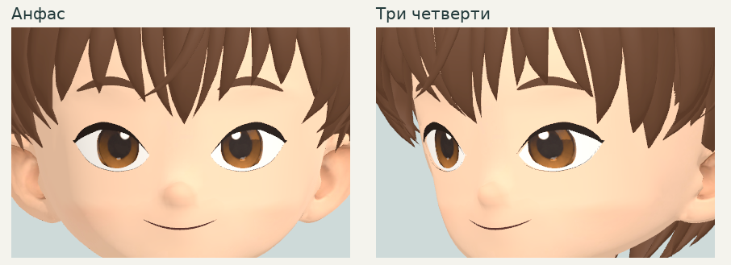

# Посадка глаз и моргание

Нейтральное лицо подбиралось по рисунку №1. Скруглённая верхняя линия утолщается к виску, у внутреннего уголка виден белок. Радужка заходит под верхнее веко.

На первом ряду сравнения ниже выключены белок, радужка, ресницы и веки. При одинаковых свете и положении камеры на предыдущей примерке видно выпуклое очертание старого глаза. В ревизии 12 эта область плавно переходит от скулы ко лбу. На остальных рядах включены все слои.

[Моргание круглых и узких глаз до и после](blink.gif) · [Поворот головы от 0° до 48°](turn.gif) · [Все 14 вариантов анфас и в три четверти](styles.png)

## Проверка

Штатный резолвер OctoFox подготовил 14 моделей с одинаковой причёской. В Godot Mobile для каждой сняты девять фаз закрытия анфас и с поворотом 32°. Для каждого кадра сделан контрольный снимок с выключенными белком и радужкой. При закрытии площадь видимого глаза последовательно уменьшалась у всех вариантов. Все 28 полностью закрытых кадров попиксельно совпали с контрольными. [Измерения покрытия](coverage.json)

Тесты лицевой анимации SDK прошли в Godot Mobile и Compatibility. В Qt прошли девять проверок AvatarScene. Из упакованных ресурсов .tav тест approvedVariants загрузил все 14 вариантов с разными причёсками и двумя оттенками кожи. Проверка геометрии сравнила попадание лучей в белок, радужку, ресницы и веки при пяти степенях закрытия. Проверены исходный контур головы вне зоны коррекции, лицевой риг, одежда и привязки палитры. [Проверка слоёв](eye-layers.json) · [Проверка пакета](pack.json)

Снимки сделаны на компьютере. Аппаратная проверка на Odin и Flip в эту серию не входила.
