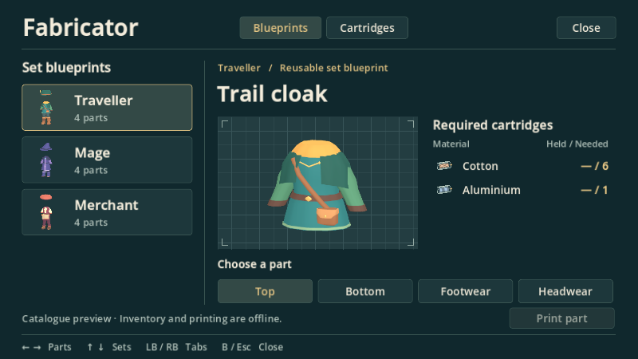
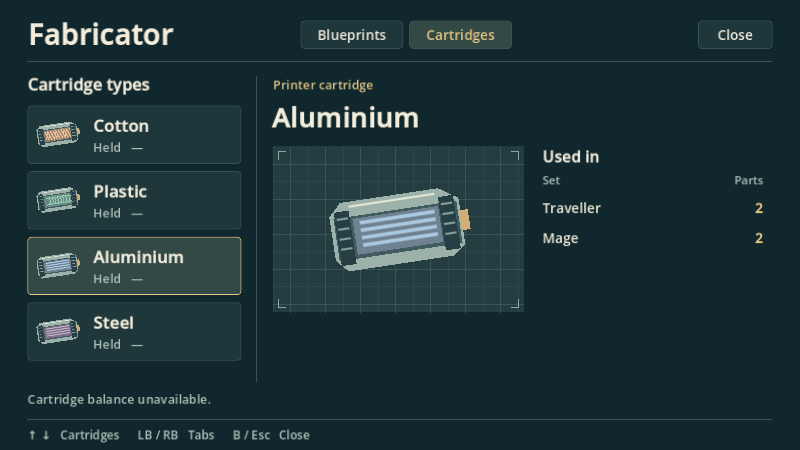

# Фабрикатор корабля

Кадры игрового интерфейса при 800 × 450 сняты настольным клиентом Godot 4.7.2 с рендером Vulkan Mobile. Изображения деталей получены из моделей Traveller, Mage и Merchant в THREAD.

Один постоянный блюпринт относится к комплекту целиком. Направления вверх и вниз выбирают комплект, влево и вправо — деталь. Требования к ней показаны отдельно. Количества материалов в этом каталоге предварительные. Прочерк в колонке остатка означает, что запас профиля пока неизвестен.

LB/RB переключают каталог и картриджи. В карточке материала показано, в каких комплектах он используется и для скольких деталей нужен. B закрывает консоль и возвращает управление персонажем. На время работы с каталогом отключается отрисовка корабля в 3D.

Выбор блюпринта и детали, показ необходимых ресурсов и доступ к картриджам опираются на [официальное описание кузницы Warframe](https://support.warframe.com/hc/en-us/articles/38385820873741-Foundry-and-Crafting-FAQ). Печать, награды за игру, начисление ресурсов и выдача одежды ожидают отдельной реализации.
