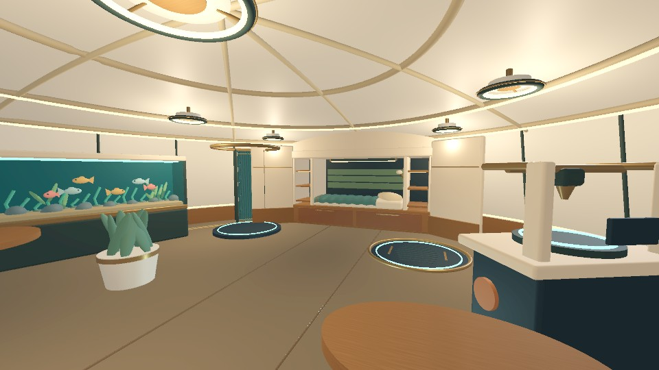
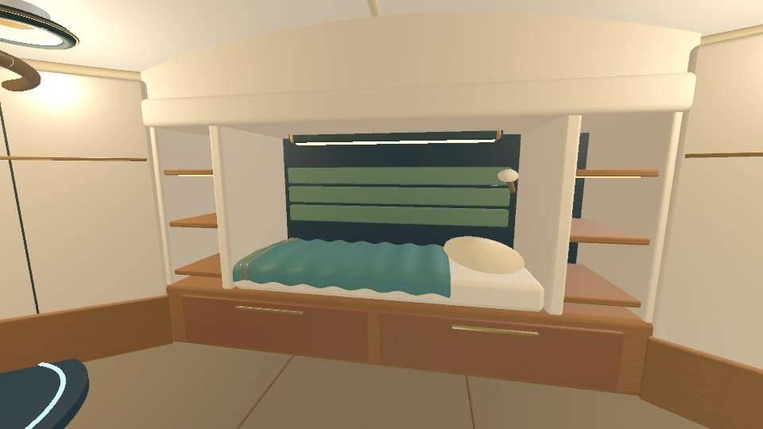
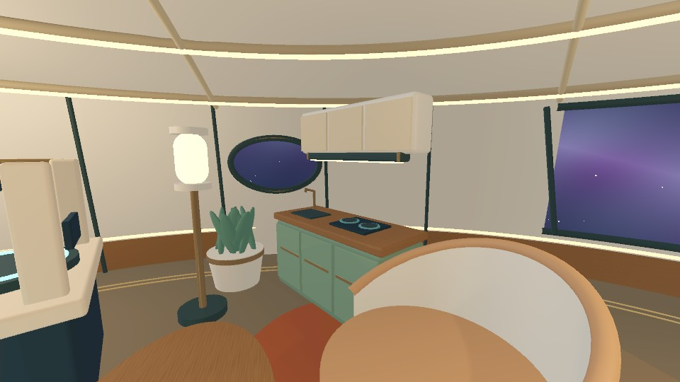
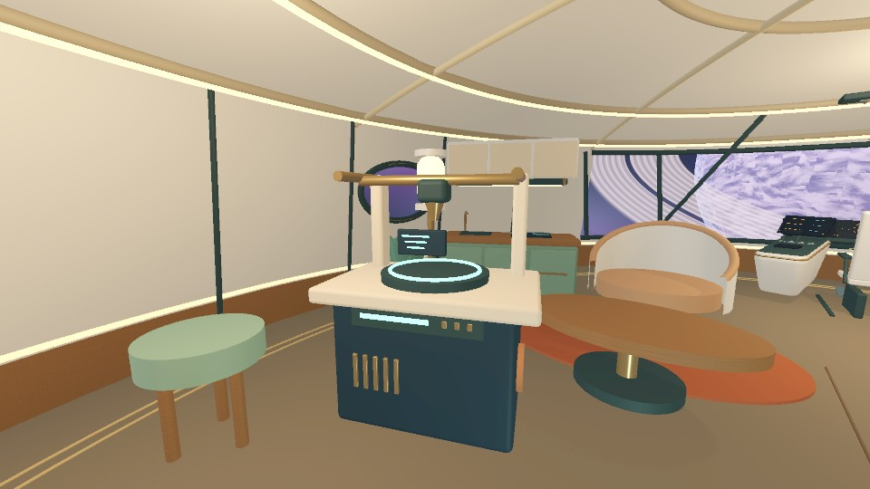
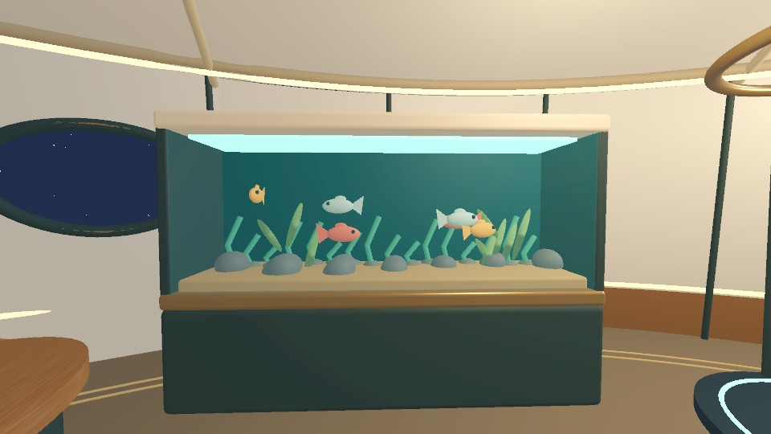
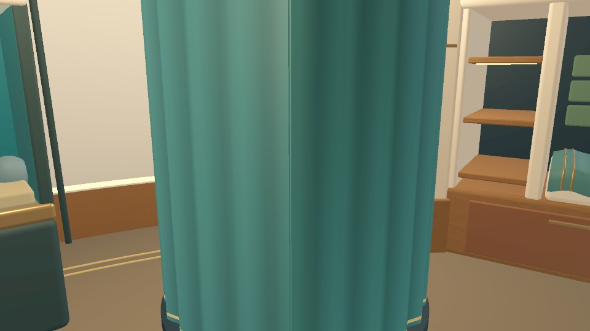
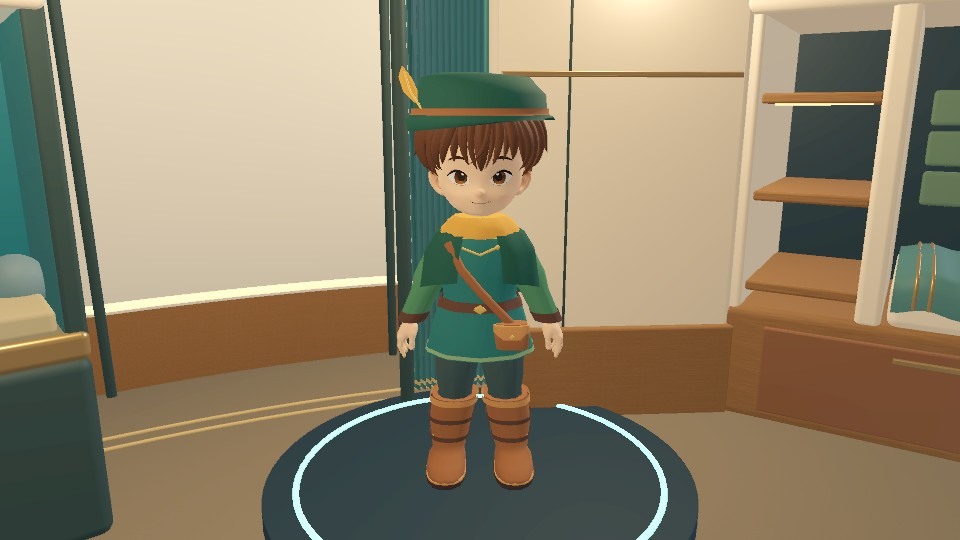
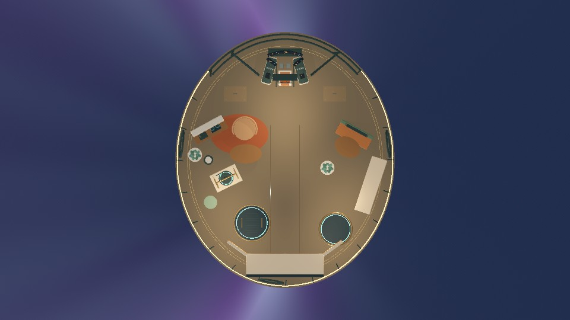
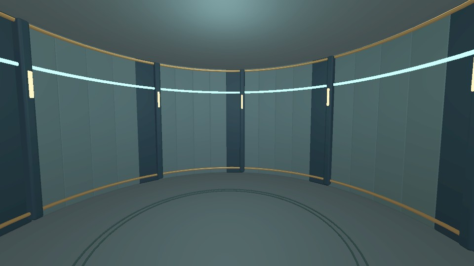

# Ship Home · студия

Кадры сняты из игровой сцены в Godot 4.7.2, Vulkan Mobile, на компьютере. На срезе сверху спрятана крыша.

| Кормовая ниша и полки | Кухня |
| --- | --- |
|  |  |
| Фабрикатор | Аквариум |
|  |  |
| Ширма закрыта | После смены на Traveller |
|  |  |
| Верхняя палуба | Техническая палуба |
|  |  |

В студии доступна примерка трёх комплектов из THREAD. Для смены костюма створки сходятся по окружности и скрывают персонажа. Выход из примерочной возвращает исходную одежду. Фабрикатор выполняет проверочный проход над столом. Выдача предметов, расход материалов и библиотека блюпринтов ждут подключения к экономике. Полки по сторонам спального места зарезервированы для личной коллекции.

Для регрессии используются тесты игрового клиента. Проверены смена и быстрая повторная смена комплекта, восстановление внешности, отзыв профиля, спуск с паузой в пути, прогулка по нижней палубе и подъём обратно. Также проверены размещение мебели, столкновения, камера пилота и внимание аватара к фабрикатору.

На Odin 2 и Flip 2 обновлено отдельное приложение Ship Home до `ed187fee1105e161`. На каждом проверена команда существующего ярлыка, а тесты выполнены на установленной копии в Godot 4.7.2 без вывода окна с действующим аватаром SDK. Графический запуск ярлыка, защита от второй копии и штатное закрытие окна проверены отдельно на компьютере.
