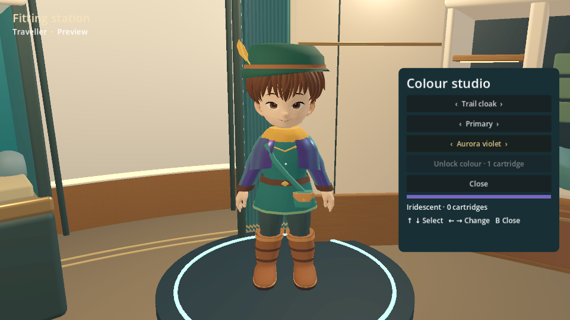

# Инвентарь корабля и окраска

Кадр из Godot 4.7.2, Vulkan Mobile, 960 × 540. На тестовом персонаже SDK выбран канал Primary плаща Traveller. Любую отделку можно примерить до получения картриджа. Кнопка активации показывает цену в картриджах. После открытия цвета его можно применять к нескольким вещам.

### Как проверить

1. Войти в профиль и поиграть через Games. Сервер отсчитывает пять минут одной запущенной игровой сессии и выдаёт одну награду за игровой день по UTC. Подтверждённые новые достижения RetroAchievements и полное прохождение дают дополнительные награды.
2. Открыть **Профиль → Inventory**. Первый комплект наград содержит блюпринт Traveller, шесть единиц хлопка, единицу алюминия и цветной картридж Sea glass. Этого хватает на плащ. В инвентаре у каждой партии есть идентификатор и количество.
3. Войти на корабль, подойти к фабрикатору, нажать **A**, выбрать комплект и деталь. **A** на выбранной детали запускает печать. Блюпринт остаётся у владельца. Ресурсы списываются, готовая вещь появляется в том же инвентаре.
4. На круглой площадке открыть примерочную кнопкой **A**, затем нажать **Y**. Выбрать вещь, участок и цвет. **Unlock colour** расходует один картридж и добавляет цвет в палитру профиля. **Apply finish** сохраняет отделку на выбранном экземпляре. **Original finish** возвращает исходный материал участка.
5. При продаже покупатель получает вещь вместе с окраской. Запертый в лоте предмет недоступен для печати, активации и перекраски. Активированная палитра, слоты образов и лицензии принадлежат аккаунту.

### Проверки

Тесты PostgreSQL открывают отдельную временную базу. Проверяется первая награда, повторы синхронизации и параллельная печать, расход картриджей, изоляция палитр двух игроков, продажа каждого типа предметов и сохранение окраски после перехода к покупателю. Торговый тест использует существующие лоты Базара и две учётные записи внутри тестовой базы. В публичной версии касса Базара пока закрыта.

Проверка Godot проходит обычный путь от стола до примерочной событиями геймпада. Она использует тестовый ответ инвентаря. Сценарии студии и окраски также выполнены отдельно на Odin и Flip с их SDK-персонажами и временными каталогами. Кадр выше снят на настольной машине.

Проверки оболочки прошли в настольной сборке Qt: учётная запись, Platform SDK, служба запуска приложений, Apps и экран Inventory в QML. Полный серверный прогон — 218 тестов. После добавления образца цвета в карточку инвентаря отдельно повторены 17 тестов инвентаря, мастерской и торговли.
