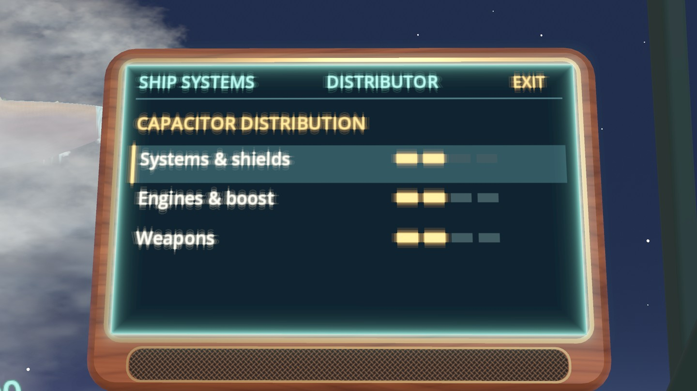
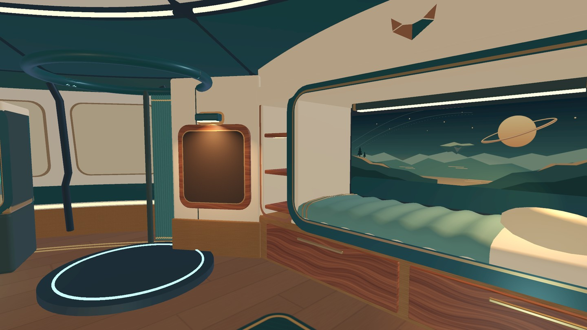
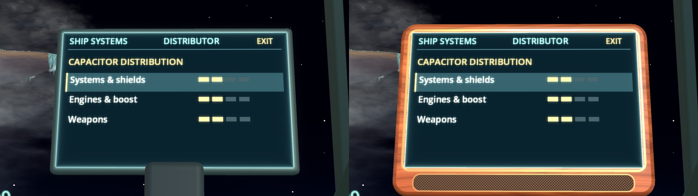
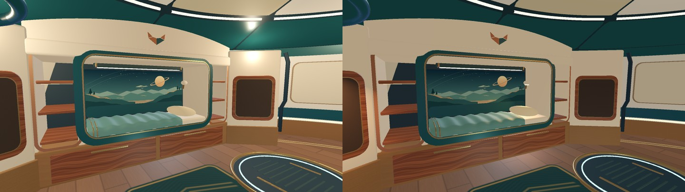

# Отделка и свет в каюте

| Правая консоль из капитанского кресла | Бра у спальной ниши |
| --- | --- |
|  |  |

У каждого места свой свет. В кокпите тёплая потолочная оптика освещает кресло и латунь, а под приборами виден прохладный отблеск. Лампа для чтения направлена на край постели, рабочая полоса на кухне — на столешницу. Возле аквариума световой рисунок медленно перемещается по доскам.

[Вид пилота](helm.jpg) · [Мостик со стороны прохода](bridge.jpg) · [Каюта целиком](cabin.jpg) · [Спальная ниша](alcove.jpg) · [Свет у аквариума](spill.jpg)

Верхние кадры и виды по ссылкам сняты на Odin 2 в мобильном рендерере Godot. Для сравнения ниже использована одна и та же камера рабочей станции. На первом снимке слева прежний корпус терминала, справа новый. На втором показан свет в каюте до и после настройки светильников.

