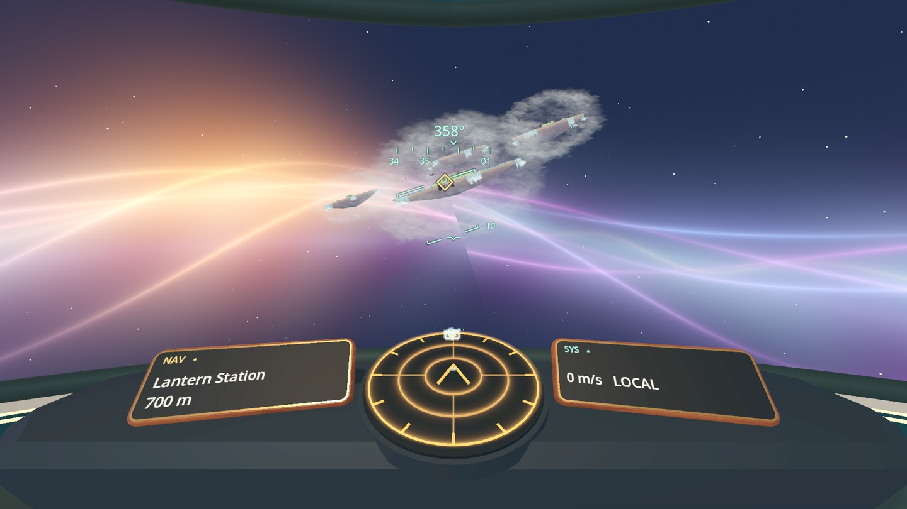
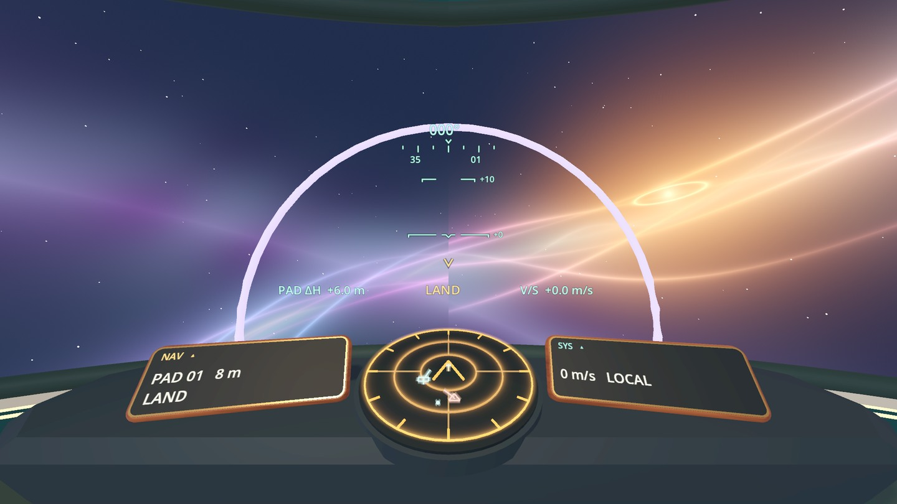
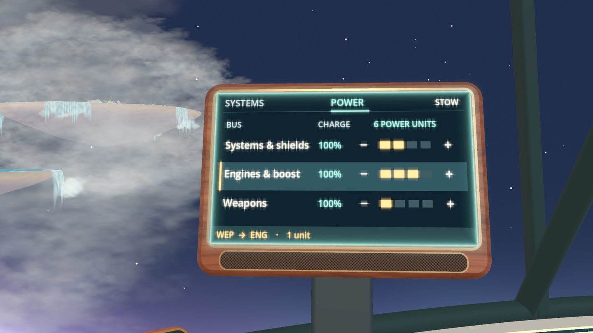

# Проекция на стекле и распределение питания

| Полёт с креном | Заход на площадку |
| --- | --- |
|  |  |

Мятная шкала показывает ориентацию корабля. Кружок с короткими крыльями показывает, куда корабль фактически движется, пока вектор скорости попадает в поле проекции. Янтарный ромб отмечает направление выбранной цели или проложенного прыжка. На краю стекла его заменяет стрелка. На стоянке, в прыжковом коридоре и при чтении боковой панели проекция гаснет.

Касание **SYS** или **Y + крестовина вниз** сразу открывает распределитель. Вверх и вниз выбирают строку. Вправо или **A** добавляет одну единицу, влево снимает. На стекле терминала те же действия выполняют **+** и **−**. Всего доступно шесть единиц, по четыре максимум на систему. В нижней строке видно, откуда и куда ушла последняя единица.

[Крейсерский полёт](cruise.jpg) · [Стоянка](moored.jpg). Кадры сняты на Odin 2 в мобильном рендерере Godot. Кнопки и касания в проверочном рейсе подавались программно.
