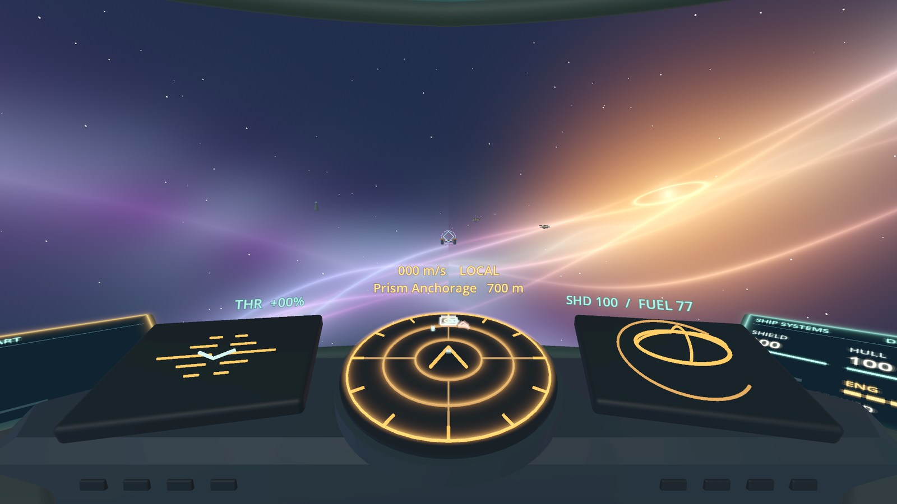
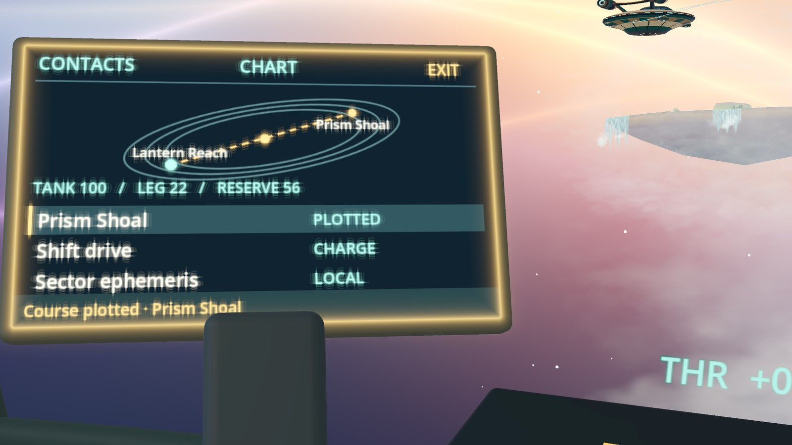
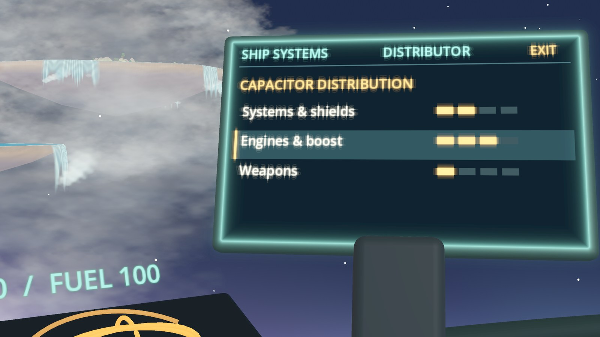
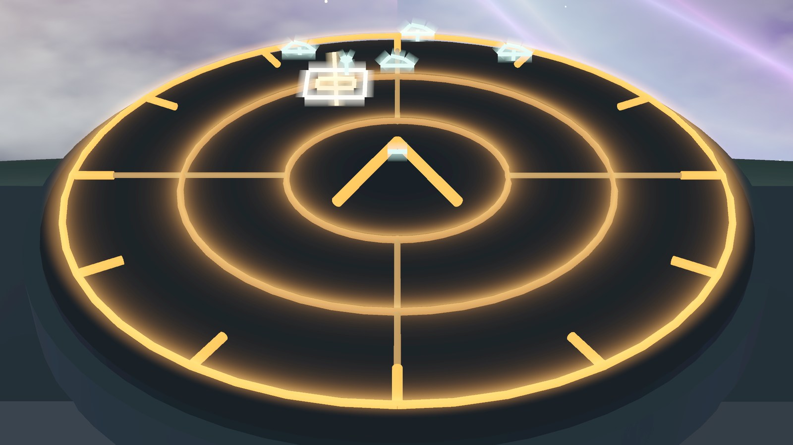
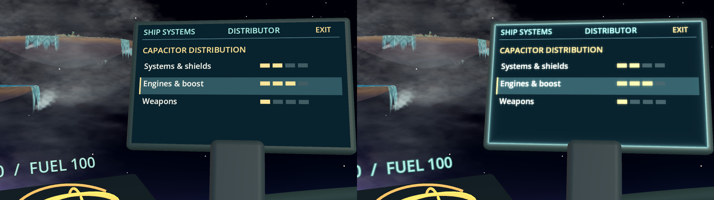

# Капитанский мостик

Слева от кресла стоит навигационный терминал. Справа — распределитель и управление оборудованием. Когда капитан обращается к терминалу, экран поднимается из консоли и камера поворачивается к нему из кресла. При закрытии экран опускается. В полёте основной курс и скорость видны над центральным локатором.

| Из кресла у Prism Anchorage | Карта кольца на левом терминале |
| --- | --- |
|  |  |

Удерживайте **Y** и нажмите направление на крестовине. Влево открывает контакты, вверх — карту, вправо — оборудование, вниз — распределитель. **A** принимает команду, **B** возвращает на уровень выше. Короткое **Y** выбирает контакт перед носом. **R3** позволяет рассмотреть центральный локатор. На клавиатуре используются **Y** со стрелками и **V**.

| Распределение энергии | Центральный локатор |
| --- | --- |
|  |  |

Навигационное стекло светится янтарным, системное — мятным. На центральном приборе светятся кольца дальности, отметки и линии относительной высоты. В сравнении ниже показана одна и та же панель с одной камеры на рабочей станции. Слева исходный вид, справа включено свечение.

Кадры рейса сняты на Odin 2 в мобильном рендерере Godot. Кнопки геймпада и касание строки датчиков на правом стекле подавались программно.

В проверочном рейсе капитан связался с курьером, вышел из зоны станции, разогнался в крейсерском режиме и совершил прыжок. У Prism Anchorage отдельно выбрал и захватил патрульный контакт, убрал орудия, запросил площадку 01 и сел. После повторной загрузки сохранились место стоянки, топливо и распределение энергии. Обратный рейс потребовал развернуть корабль и заново зарядить привод.

[Эфемериды сектора](local.jpg) · [Во время прыжка](jump.jpg) · [Выдвинутые орудия](hull.jpg) · [Ответ диспетчера](clearance.jpg) · [Бортовые модули](modules.jpg)
