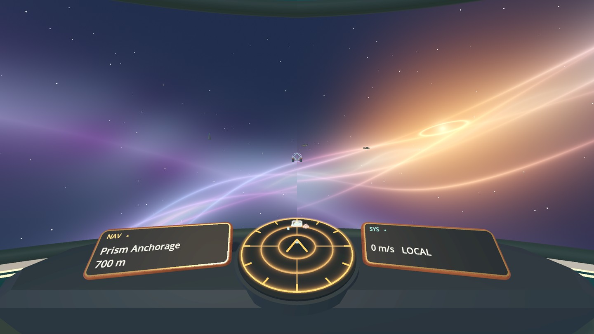
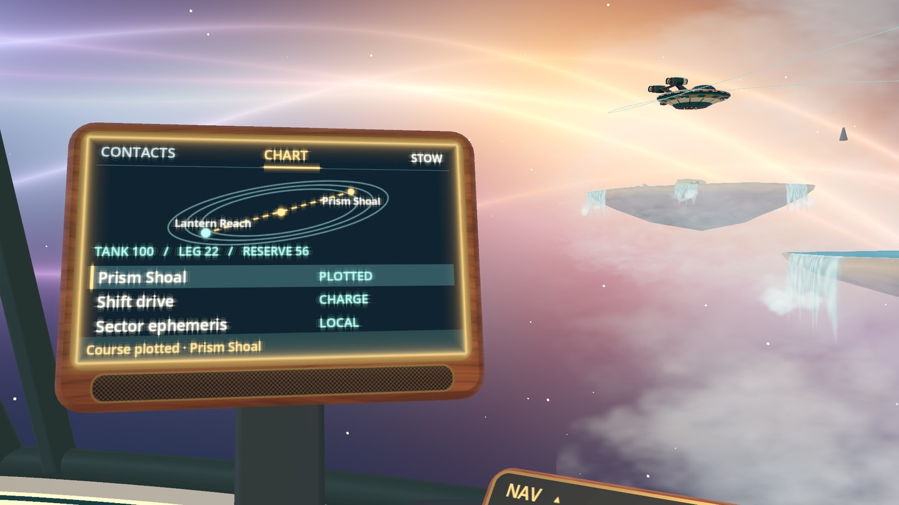
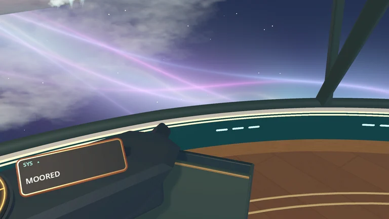

# Выдвижные приборы капитана

| Полёт к Prism Anchorage | Левая панель с картой |
| --- | --- |
|  |  |

Клавиши **NAV** и **SYS** встроены в торпедо по сторонам локатора. Нажатие на клавишу поднимает соответствующий экран. С геймпада удерживайте **Y** и нажмите крестовину влево для контактов, вправо для систем, вверх для карты или вниз для энергии. Короткое **Y** или касание **STOW** убирает экран с любой страницы. После этого взгляд возвращается к прежнему направлению.

При подлёте к площадке на торпедо видны дальность и условие посадки. Когда скорость и положение подходят, появляется **LAND**. Запас топлива, щиты, корпус и состояние модулей доступны на правой панели. [Заход на посадку](approach.jpg) · [Распределение энергии](power.jpg) · [Стоянка](moored.jpg).

Кадры сняты в установленной версии Ship Home на Odin 2. В проверочном рейсе кнопки геймпада и касания подавались программно. Для съёмки хода панели камера закреплена сбоку от кресла.
