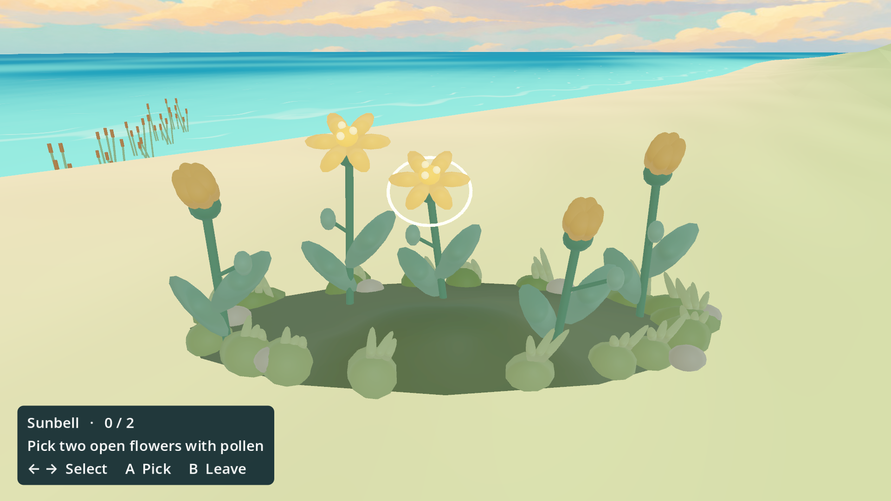
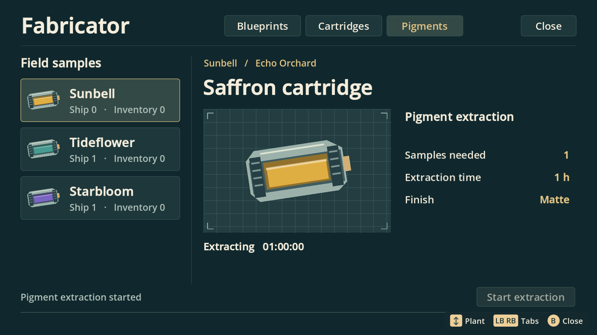

# Растения островов и красители

У посадочной площадки Echo Orchard растёт Sunbell. Для шафранового красителя нужны две раскрытые головки с пыльцой. Крестовина выбирает стебель, **A** собирает цветок. Закрытые бутоны можно оставить до следующего цветения. При выходе после первого цветка заросль остаётся доступной. После полного сбора образец сохраняется в профиле, а новые цветы появляются на следующие сутки по UTC.

На Table Isle из Tideflower получается сатиновый Sea glass. На Cinder Garden из Starbloom получается переливчатый Aurora violet. Цвета входят в общую палитру примерочной.

В каюте откройте **Fabricator → Pigments** и выберите растение. **Store sample** переносит образец в инвентарь профиля. Его уже можно выставить на Базар. **Start extraction** расходует один образец и запускает часовую экстракцию. **Collect cartridge** забирает запечатанный картридж. Его можно продать или один раз активировать в примерочной.

## Что проверено

- На Odin 2 сценарий с программным вводом геймпада проходит от посадочного круга к растениям на каждом из трёх островов. Он проверяет выбор бутона, отмену неполного сбора, защиту от повторного сбора и восстановление трёх образцов после смены профиля. Для прогонов используются отдельные временные сохранения.
- На экране фабрикатора проверены старая или отключённая мастерская, потеря ответа, подтверждение передачи образца, запуск экстракции и команда выдачи готового картриджа. На кадре таймера клиент получает тестовый ответ мастерской.
- Серверный тест поднимает отдельную PostgreSQL и работает через HTTP. Две параллельные передачи дают один предмет. Покупатель сырого образца может переработать его сам. У уже выставленного на продажу образца переработка блокируется. После продажи готового картриджа его покупатель активировал постоянный цвет в своей палитре. Для проверки завершения заказа время сдвигается только в тестовой базе.
- Прошли 224 серверных теста, а на Odin прошли десять сценариев корабля, включая рыбалку, лифты и полёт. Для обработки живых предметов нужна серверная мастерская с миграцией 0029 и оболочка с доступом к мастерской.
