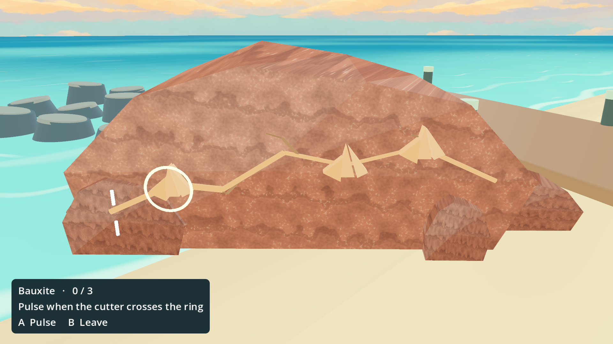
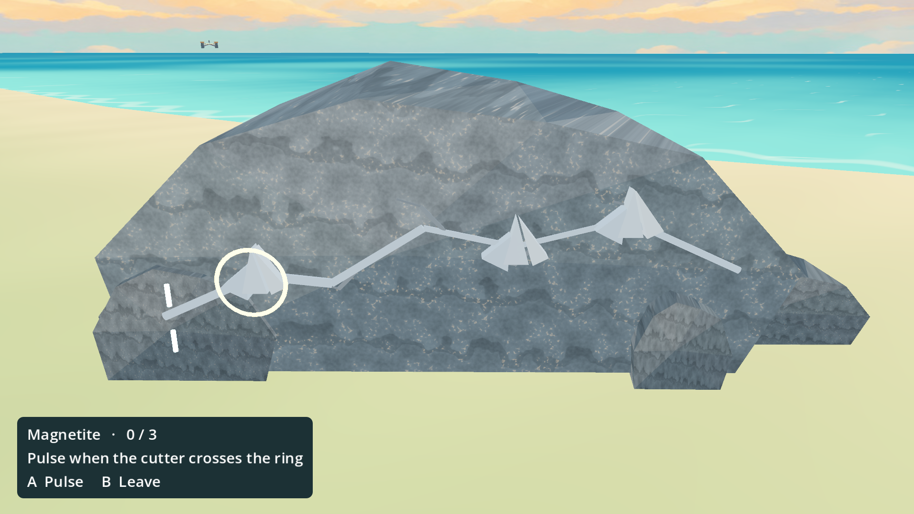
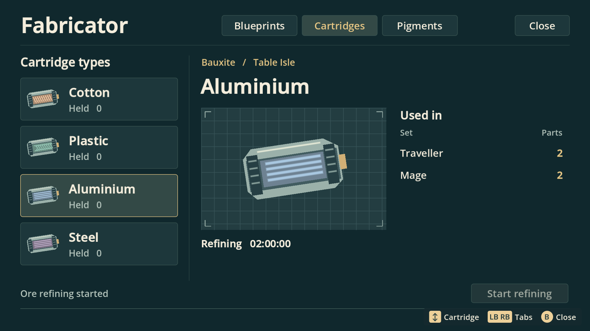

# Добыча руды на островах

На Table Isle рядом с посадочным кругом есть открытая жила боксита. Подойдите к ней и нажмите **A**. Резак идёт вдоль прожилки туда и обратно. Нажмите **A**, когда его метка пересечёт кольцо на разломе. После трёх точных импульсов кусок руды попадёт в груз корабля. Промах можно исправить на обратном проходе. Кнопка **B** возвращает к персонажу. На клавиатуре эти действия выполняют **F** и **Esc**.

На Cinder Garden такой же резак извлекает магнетит. Каждая из двух жил обновляется в полночь по UTC. Собранную руду корабль сохраняет отдельно для каждого профиля.

В **Fabricator → Cartridges** выберите **Aluminium** для боксита или **Steel** для магнетита. Кнопка **Store ore** переносит руду в инвентарь профиля. Её можно выставить на Базар или переработать. **Start refining** расходует один образец и запускает двухчасовой заказ. **Collect cartridge** выдаёт картридж с одной единицей металла. Он подходит для существующих блюпринтов одежды.

## Проверка

- На Odin запущенный корабль принимал программный ввод геймпада. Персонаж дошёл от посадочного круга до обеих жил. Проверены промах, выход на середине, три последовательных попадания, повторная попытка на пустой жиле, смена профиля и загрузка сохранения.
- Проверка интерфейса фабрикатора использует тестовые ответы мастерской. При потере подтверждения руда остаётся на корабле. Кадр с таймером снят в этом сценарии.
- На изолированном сервере с PostgreSQL покупатель приобрёл сырьё на Базаре и поставил его на переработку. Игра отклонила досрочную выдачу и повторный заказ без руды. По окончании заказа повторный сбор вернул тот же картридж. Полученного алюминия хватило для печати головного убора Traveller, стали — для верха Merchant. Остальные ингредиенты и блюпринты покупатель уже имел. Время готовности сдвигалось в тестовой базе.
