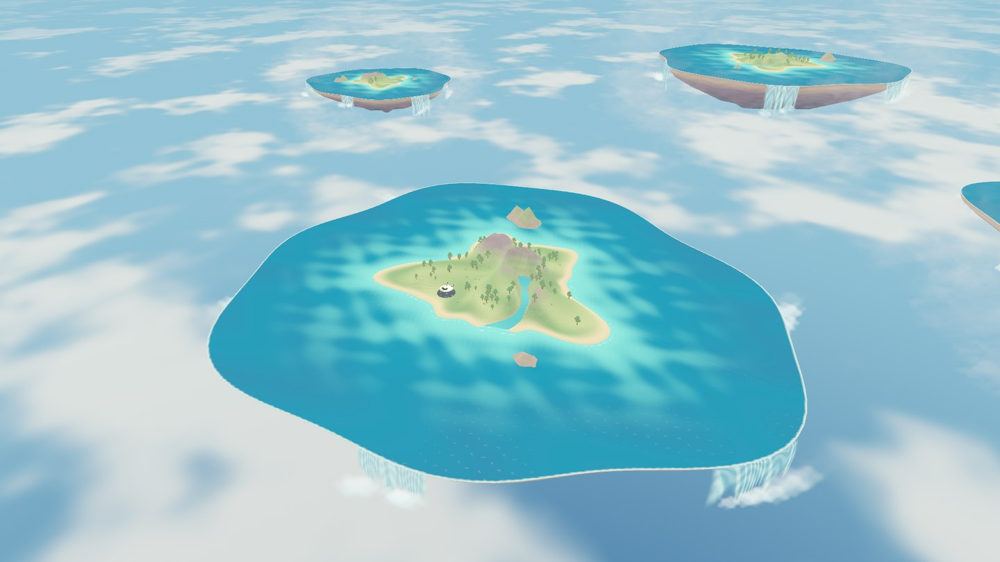
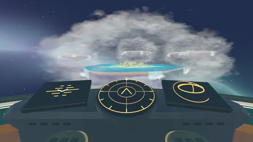

# Моря летающих островов

«Сад эха» занимает около 237 × 176 м по береговой линии. По внешнему краю воды весь массив занимает 545 × 495 м. Акватория между двумя контурами примерно в 7,3 раза больше суши внутри берега. При оценке площади внутренние заводи и отдельно стоящие скалы не вычитались.

На главном острове гряда разделяет рощи и бухты. Заводь переходит в извилистое устье, а за берегом поднимаются отдельные скалы. У трёх соседей свои силуэты — столовая возвышенность, кольцевой хребет и два вытянутых отрога. Вода срывается с внешнего края моря.

[Горы со стороны моря](coast.jpg) · [Устье с высоты](estuary.jpg)

От станции «Фонарь» до площадки 600 м. На подлёте облака перемещаются относительно кабины. В самой плотной полосе пропадает дальняя видимость. Когда облака расходятся, над морем видно местное небо. На вылете этот переход работает в обратном порядке.

[Перед входом](space.jpg) · [В облаке](cloud.jpg) · [После выхода к острову](sky.jpg) · [На площадке после посадки](walk.jpg)

Кадры сняты на Odin 2 (Adreno 740). Общий план и берег сняты внешней камерой, подлёт — из рабочего кокпита, последний кадр — камерой персонажа.
