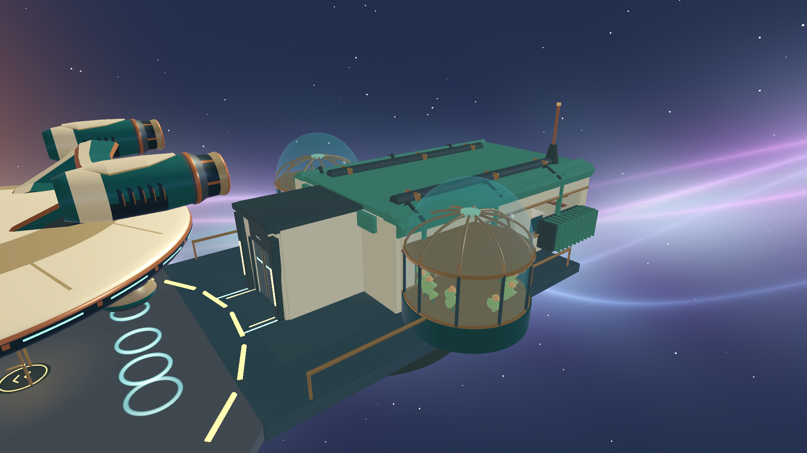
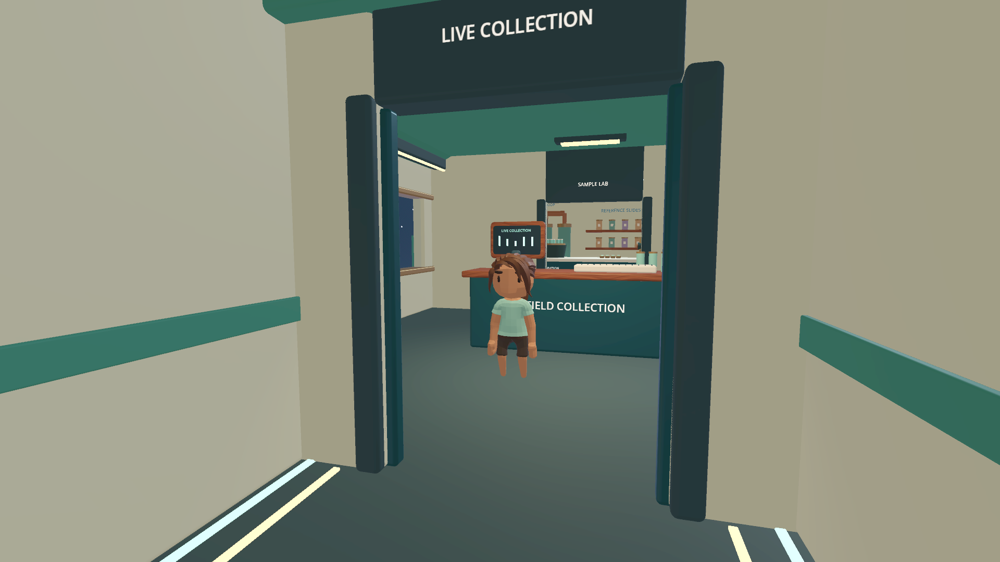
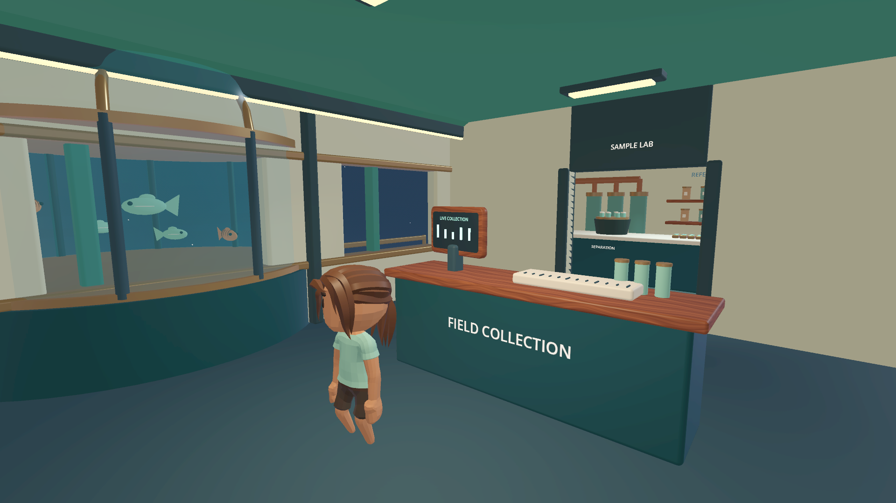
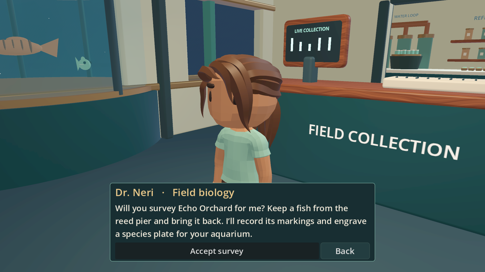
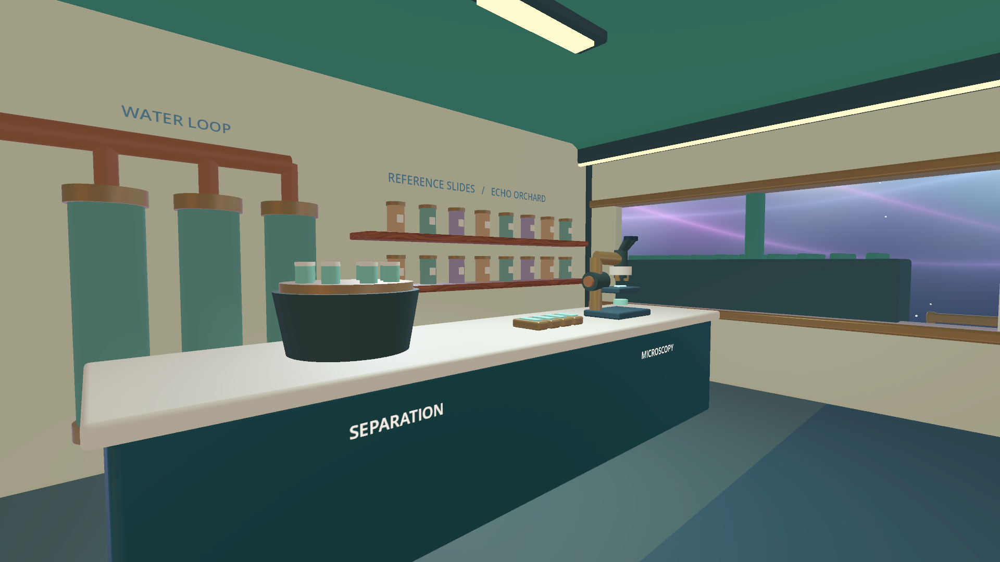
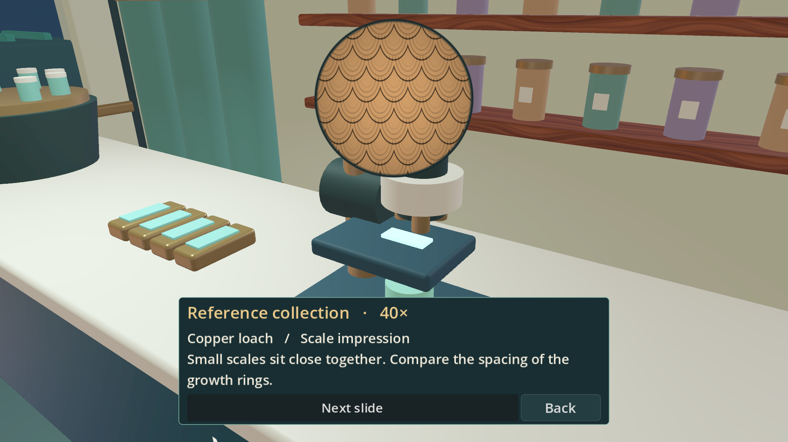
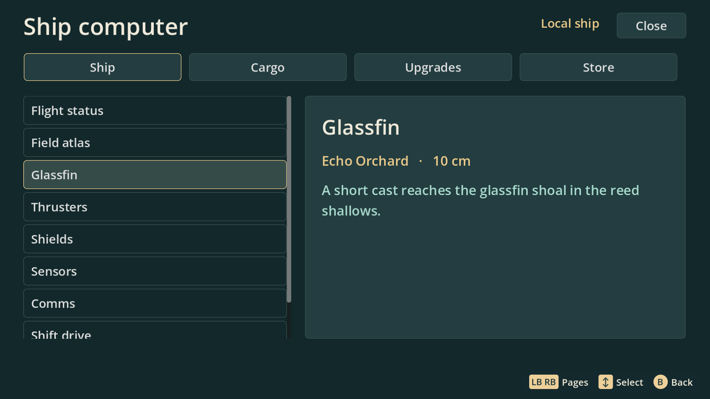
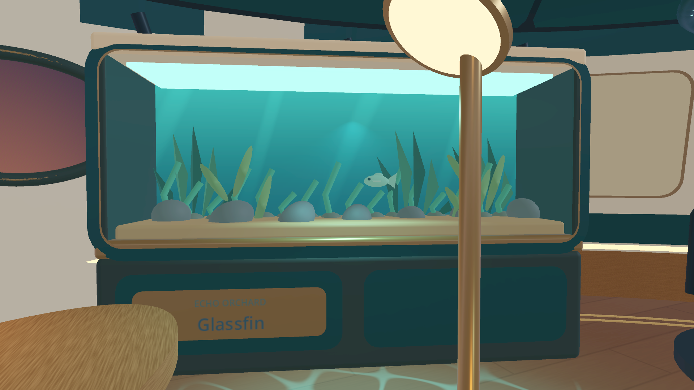

# Lantern Biostation и первая экспедиция

От нового порта в Lantern Reach до причала Echo Orchard примерно 6,8 км, или 44 секунды крейсерского хода при полной тяге. Выберите **Lantern Biostation** в контактах, запросите посадку и спуститесь на площадку через нижний лифт корабля.

## Внутри станции

Со стороны причала виден вход в шлюз. Подойдите к наружным створкам и войдите в камеру. Пройдите к следующей двери. Она откроется, когда за спиной закроется первая. На обратном пути порядок меняется.

В зале живой коллекции в иллюминаторы видны гидропоника и рыбы. У столика с измерительным лотком, пробирками и монитором работает доктор Нери. Поговорите с ней кнопкой **A** и примите приглашение обследовать остров.

За переборкой с надписью **Sample Lab** находится препараторская. На рабочем столе стоят бинокулярный микроскоп, предметные стёкла и центрифуга с ротором для пробирок. У стены находятся фильтры водяного контура и полки с образцами.

У микроскопа нажмите **A**, чтобы изучить эталонные отпечатки чешуи стеклопёра и медного вьюна. Следующее нажатие меняет препарат, **B** возвращает к столу. Вид в окуляре — игровая иллюстрация. Для записи в личный атлас нужен собственный улов.

## Поиск и регистрация вида

После разговора курс указывает на Echo Orchard. На причале короткий заброс в камыши приносит стеклопёра, дальний достаёт до медного вьюна. Оставьте улов в живом отсеке или пересадите в свой аквариум. Вернитесь к доктору Нери со своим кораблём и выберите **Record observation**. Первое наблюдение каждого вида открывает запись с местом поимки и длиной экземпляра. В каюте появляется латунная табличка, а рыба остаётся у капитана.

На бортовом ПК откройте **Ship → Field atlas**. Кнопка **Track** позволяет снова выбрать нужный порт или остров.

## Другие порты

Через шлюзы можно пройти и в служебные помещения остальных станций. В [Lantern Station](dispatch.png) это диспетчерская с отправлениями, в [Prism Anchorage](chart-room.png) — комната навигаторов с орбитальной схемой, в [Cinder Anchorage](service-shop.png) — ремонтный пост с агрегатом на стенде. Их торговые и сервисные операции относятся к дальнейшим этапам.

Доктор Нери использует модель Casual Female из набора жителей Базара. Автор модели — Quaternius. [Лицензия набора](../../../experiences/ship-home/licenses/Quaternius-Characters-CC0.txt).

## Как проверяли

На Odin 2 установлена версия корабля `3dba77f65416bc94`, прошли 14 сценариев Godot. Кадры сняты на устройстве с мобильным рендерером. Автоматизированный рейс использует отдельный локальный профиль, программные события геймпада и полётную модель. Курс в тесте выравнивается программно. Посадка проходит через проверку расстояния, скорости и разрешения порта. Капитан выходит на станции через оба лифта, проходит шлюз, заходит в препараторскую, летит на остров и проходит обычные стадии заброса, поклёвки и вываживания.

Идентификатор первого стеклопёра сверяется в живом отсеке, записи биолога и домашнем аквариуме. Проверены повторный показ вида, смена профиля, отказ записи и восстановление после него. Для отдельной проверки второго вида использовался подготовленный экземпляр медного вьюна. В каждом порту проверены проход в дальнюю комнату и возврат к кораблю, коллизии стен и потолка, открытие обеих пар створок и взаимная блокировка шлюза.
