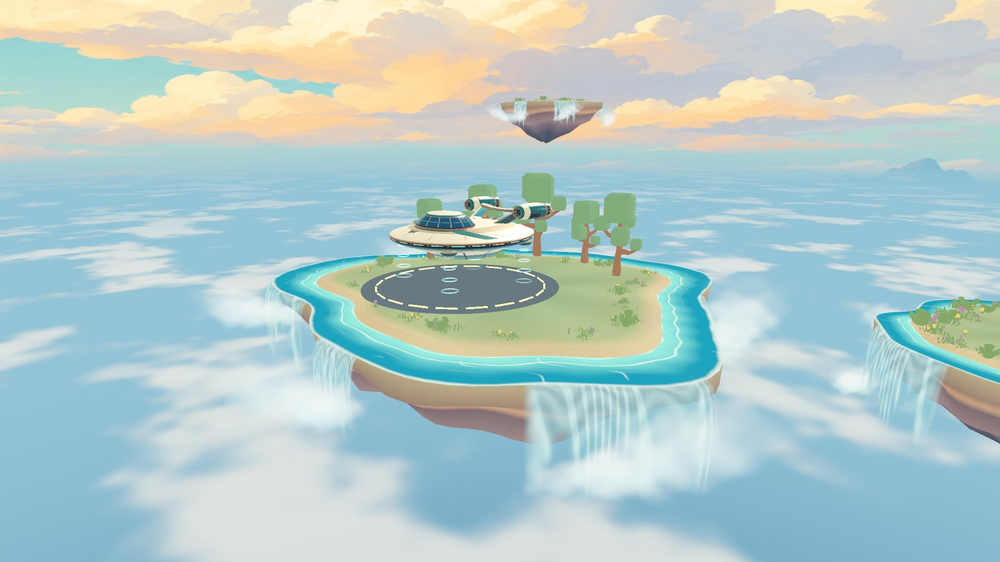
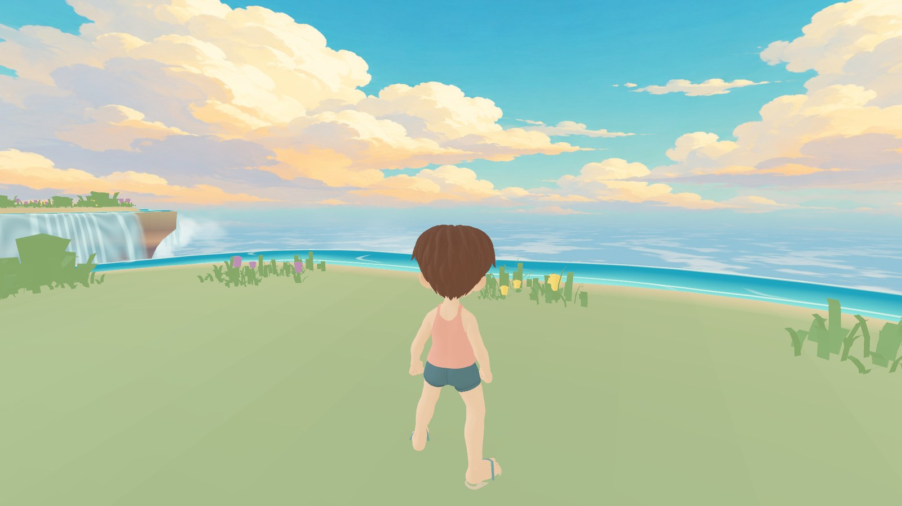
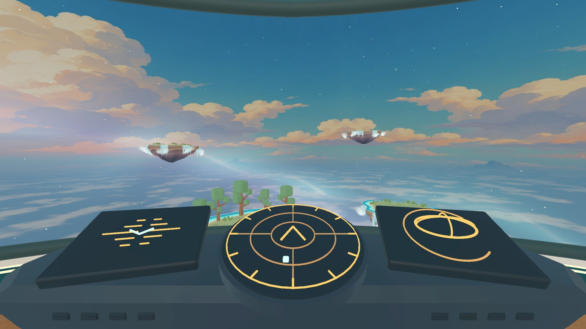
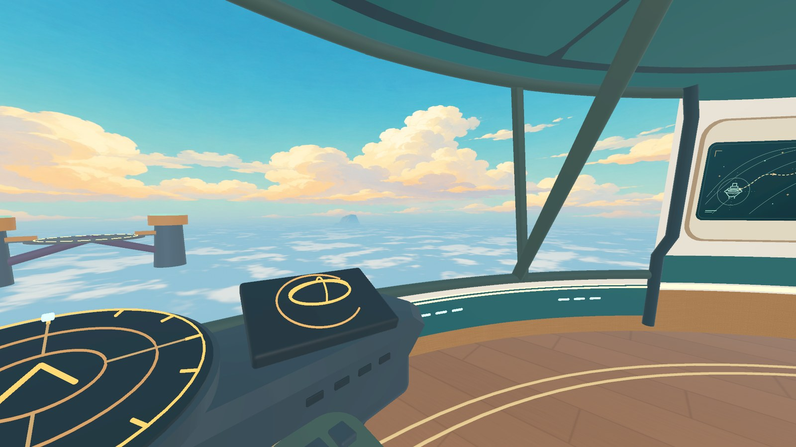
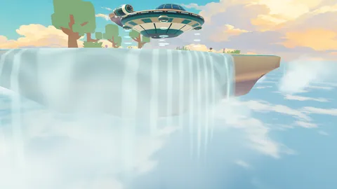

# Открытые острова эгрегора

«Сад эха» и три соседних малых острова окружены водой. На подлёте к ним постепенно становятся видны освещённые облака. После посадки то же небо видно через остекление и с берега. На обратном пути к станции «Фонарь» снова появляются звёзды.

| Общий вид с тарелкой | Пешком у воды |
| --- | --- |
|  |  |

| На подлёте | Из кокпита после посадки |
| --- | --- |
|  |  |

Снимки сделаны мобильным рендерером Godot на Odin 2, Adreno 740. Общий план и анимация сняты внешней камерой. Остальные три кадра показывают камеры пилота и персонажа. Для проверок полёта и выхода через лифт использован тестовый профиль с программной подачей ввода. [Источники панорамы и растений](../../../experiences/ship-home/assets/islands/SOURCE.md).
