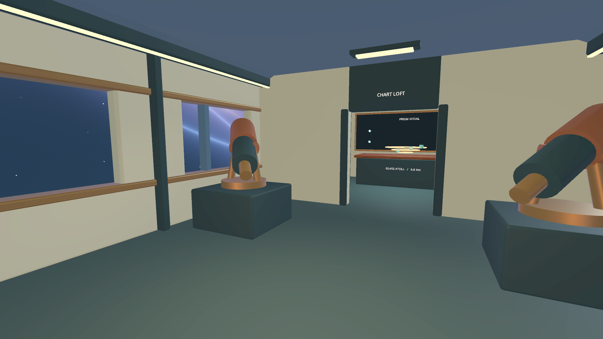
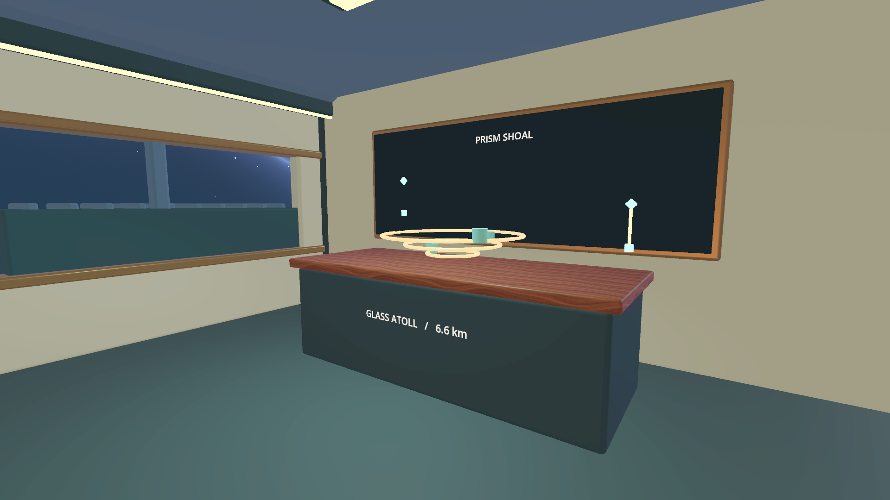
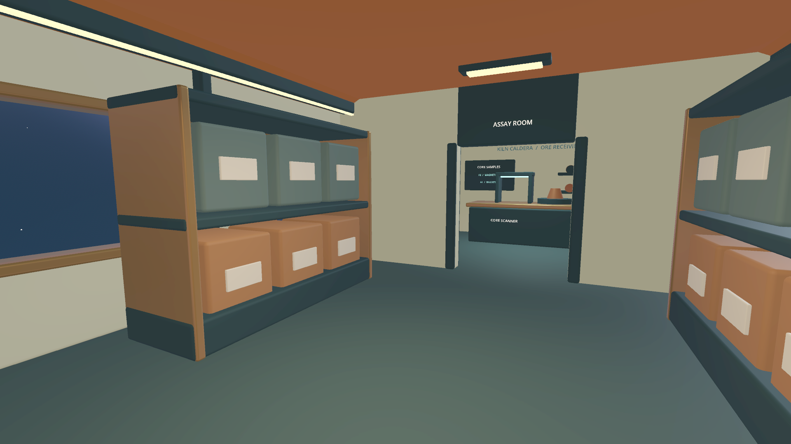
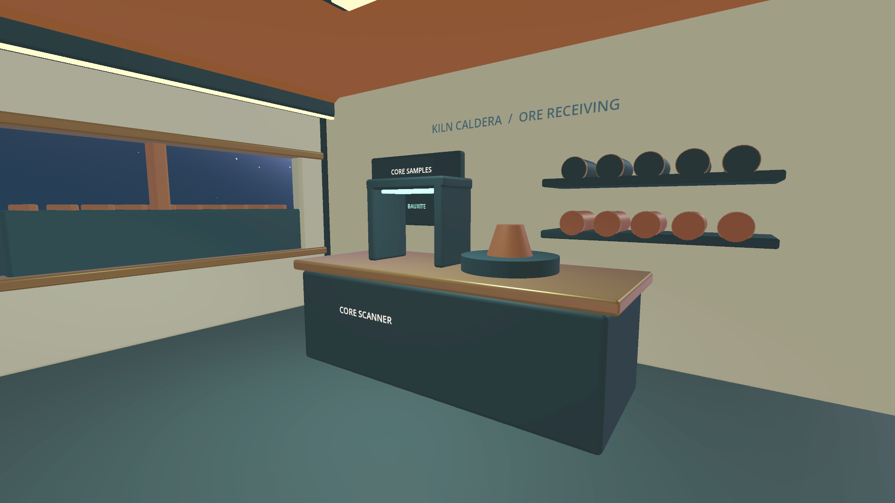
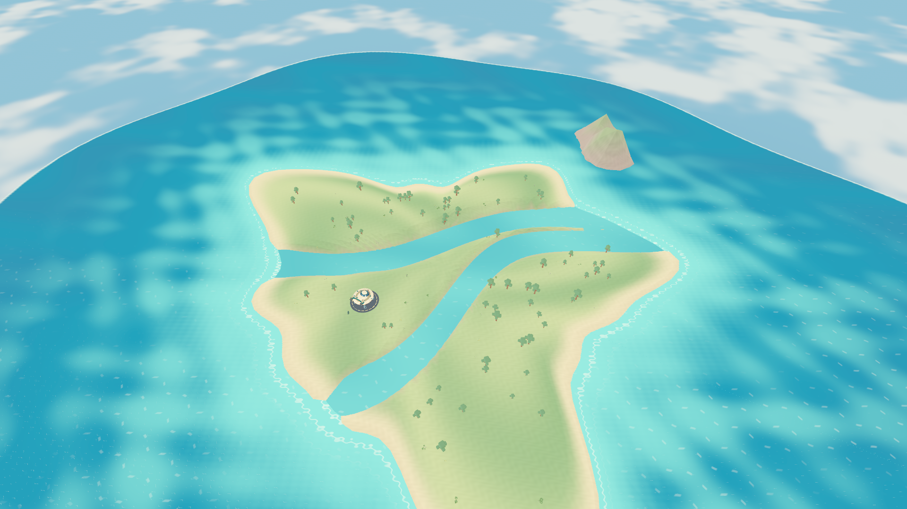
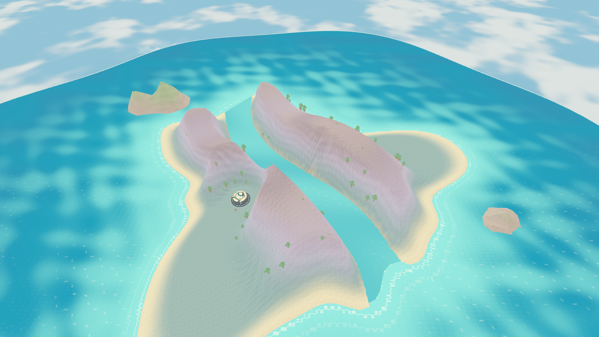
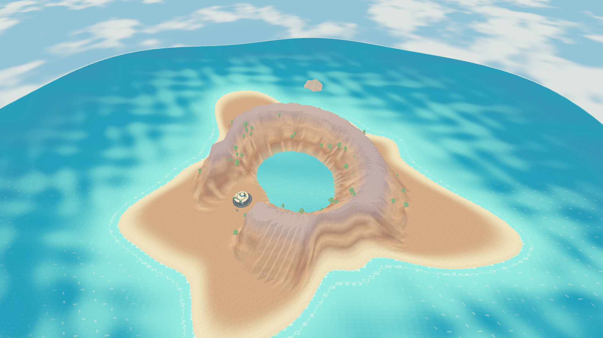

# Регионы эгрегора

На карте три региона, в каждом по две станции. Все десять островов имеют посадочную площадку, атмосферу и поверхность, по которой можно ходить. Старые сохранения используют прежние имена причалов.

| Регион | Станции | Острова |
| --- | --- | --- |
| Lantern Reach | Lantern Station, Lantern Biostation | Echo Orchard, Table Isle, Crown Isle, Twin Spurs, Reedwater Delta |
| Prism Shoal | Prism Anchorage, Wayfarer House | Glass Atoll, Meridian Rift |
| Cinder Drift | Cinder Anchorage, Cinder Exchange | Cinder Garden, Ember Isle, Kiln Caldera |

## Два рейса от станционного стола

**Wayfarer House → Glass Atoll.** Пройдите через шлюз и зал с двумя телескопами к столу с орбитальными кольцами. На стене показаны положения двух станций и двух островов Prism Shoal. Нажмите **A**, вернитесь на корабль через нижний лифт и садитесь в кресло. Glass Atoll уже выбран в навигации. Перелёт составляет 6,6 км. За посадочной площадкой на острове растёт звездоцвет.

**Cinder Exchange → Kiln Caldera.** За грузовыми стеллажами расположен стол проверки руды. Рядом стоят сканер керна и полки с поперечными срезами образцов. Нажмите **A** у стола, чтобы выбрать месторождение. До кальдеры 6,5 км. У площадки можно добыть магнетит. Для обратной посадки выберите свою станцию в контактах и запросите разрешение в пределах 850 м.

При полной крейсерской тяге эти рейсы занимают около 42 секунд без манёвров. Между островными группами расстояния больше. От Echo Orchard до Table Isle примерно 27 км, или почти три минуты полёта.

## Три новых острова

На **Reedwater Delta** два приливных рукава огибают низкие отмели. У площадки можно собрать цветы для пигмента. На **Meridian Rift** глубокая протока разделяет две гряды, у посадочной площадки есть выход боксита. У **Kiln Caldera** террасы окружают затопленный кратер. Материалы с новых берегов используют существующие рецепты переработчика. Суточный сбор каждого вида учитывается сразу для всех месторождений этого вида.

## Проверка на портативках

На Odin 2 и Flip 2 установлена сборка Ship Home `04dc577f639caf7e`. На каждом устройстве прошли 15 автоматизированных сценариев Godot. Сверены все 35 скриптов установленной игры с исходниками. Для полётов и скриншотов использовались отдельные тестовые профили.

Проверочный рейс начинается на базе. Капитан проходит оба шлюзовых затвора, выбирает остров у стола и возвращается через лифты. После взлёта тест задаёт направление. Разгон, торможение, проверку посадки и причаливание выполняет игровая полётная модель. На острове капитан доходит до цветов или рудной жилы, открывает сбор, возвращается на корабль и летит обратно. Для посадки на станцию рейс запрашивает разрешение.

На семи новых площадках отдельно проверены финальный заход с высоты шесть метров, спуск на лифте, выход за пределы посадочного круга и восстановление причала из сохранения. Управление воспроизводилось программно. Во время раннего прогона на Glass Atoll проявился обрыв между площадкой и берегом. Размер суши у площадок скорректирован.

На обоих устройствах маршрут также прошёл с мобильным рендерером Vulkan. Семь снимков выше сделаны на Odin в разрешении 1920 × 1080. В одном из предварительных графических прогонов на Odin персонаж остановился на выходе с площадки. При повторной проверке и на финальной сборке остановка не повторилась. Ручная проверка физическими кнопками остаётся открытой.
