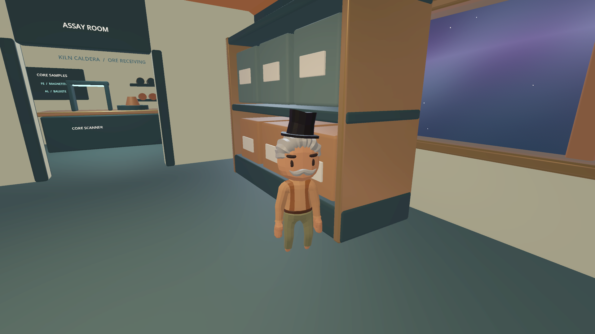
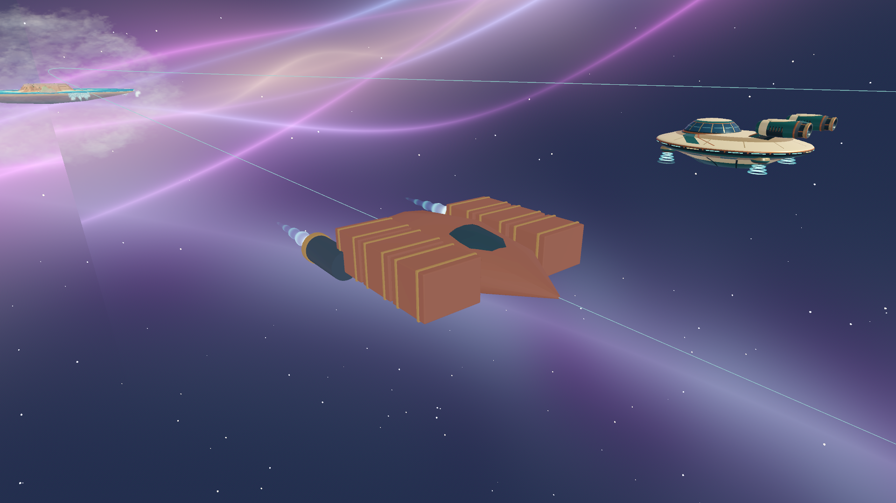
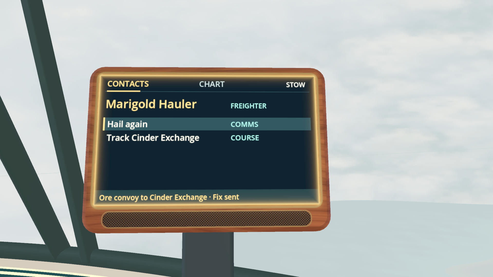
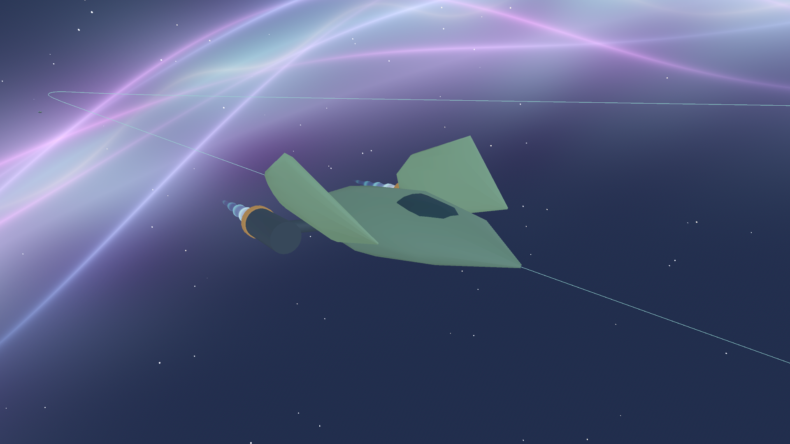
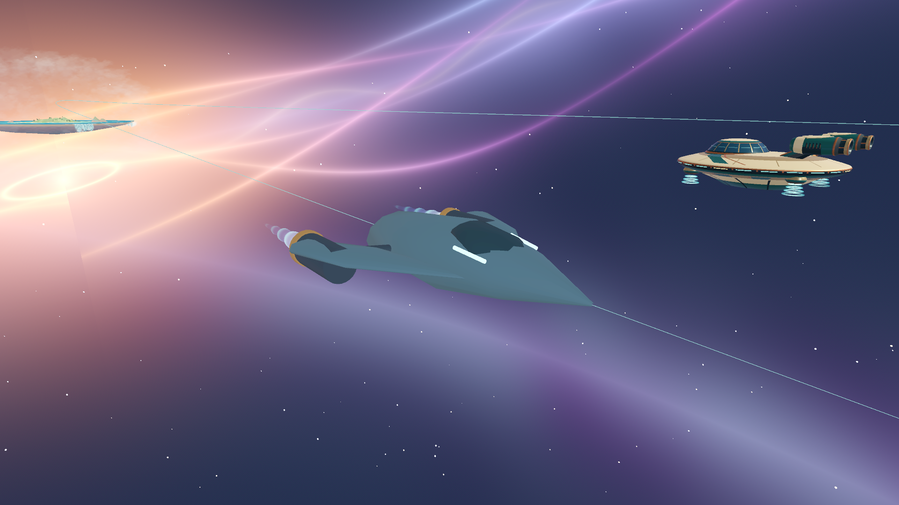
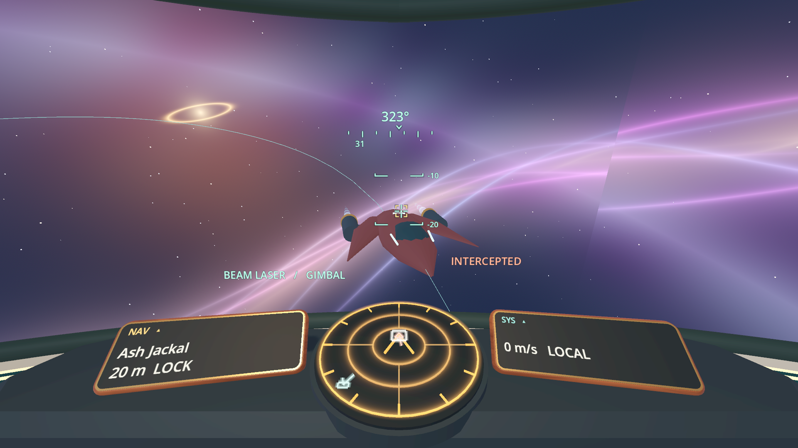
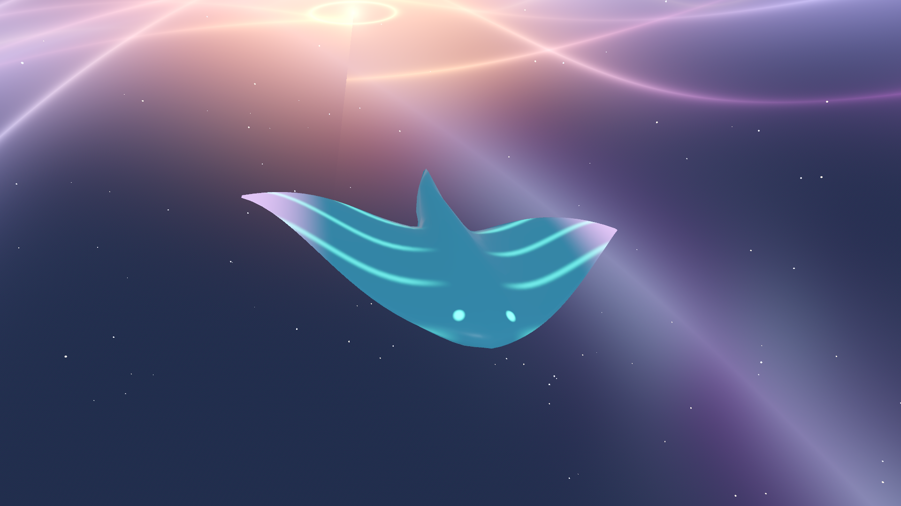

# Кого можно встретить в эгрегоре

Войдите в зал станции через шлюз. Подойдите к жителю и нажмите **A**. Он расскажет, кто сейчас ходит по местному маршруту, и передаст контакт в кабину. Чтобы поставить отметку, нужны включённые сенсоры.

| Где спросить | Кто отвечает | Кого можно найти |
| --- | --- | --- |
| Lantern Station | Делегат Сола | Посольский Vesper Envoy курсирует между Lantern Station и Lantern Biostation |
| Wayfarer House | Разведчица Иво | Threadrunner обследует путь к Glass Atoll |
| Cinder Exchange | Фактор Орин | Грузовоз Marigold Hauler перевозит руду между узлом и Kiln Caldera |

## Передача координат

Вернитесь через лифты и займите кресло. После взлёта догоните отмеченный корабль. В пределах 850 метров откройте **Contacts** сочетанием **Y + влево**. Выберите позывной и нажмите **Hail contact**. В ответ появится пункт **Track** с названием места. Он наносит переданные координаты на стекло пилота. На обратном рейсе корабль передаст уже другой пункт назначения. На сенсорном экране длинный список листается кнопками **Prev** и **Next**.

## Пират и скаты

На грузовой линии за Cinder Exchange патрулирует Ash Jackal. В обычном полёте при сближении до 400 метров он передаёт предупреждение. Если остаться в зоне досягаемости, появится входящая ракета. Работают захват, упреждение и противоракетная защита. Состояние пирата и состояние патруля Prism Warden учитываются отдельно в текущем сеансе.

У Prism Anchorage проплывает взрослый эгрегоральный скат, у Lantern Biostation — детёныш. На локаторе у них крылатая метка. Вызов **Listen to call** на панели связи воспроизводит двухчастный сигнал. У детёныша выше тон.

Корпуса кораблей и модель ската созданы для Ship Home. Сотрудники станций используют персонажей Quaternius из набора Базара и их штатную анимацию ожидания. [Лицензия персонажей](../../../experiences/ship-home/licenses/Quaternius-Characters-CC0.txt).

## Проверка

На Flip 2 и Odin 2 установлена одна версия корабля, `f7343d4bf4f50070`. На каждой портативке прошли 16 сценариев Godot. Для проверки использовался отдельный профиль и программные события кнопок. В гражданских рейсах персонаж проходит обе двери шлюза, получает отметку, возвращается на корабль и догоняет контакт. Разгон и торможение выполняет игровая модель, направление в тесте выставляется программно.

Для близких встреч со скатом и пиратом использованы заданные стартовые позиции после взлёта. Проверка звука подтверждает создание и запуск звукового сигнала в приёмнике. Прослушивание через динамики портативок и оценка управления физическим геймпадом остаются открытыми.

В первом прогоне на Odin тест рыбалки потерял улов. Поправлена техника вываживания в тесте. Повторный прогон прошёл полностью. В дополнительной проверке с максимальным размером рыбы и 200 последовательностями рывков тест довёл до конца все 200 вываживаний.

Графический сценарий с мобильным рендерером Vulkan прошёл на обоих устройствах, включая сенсорное перелистывание списка контактов. Семь снимков выше сняты на Odin 2 в разрешении 1920 × 1080.
