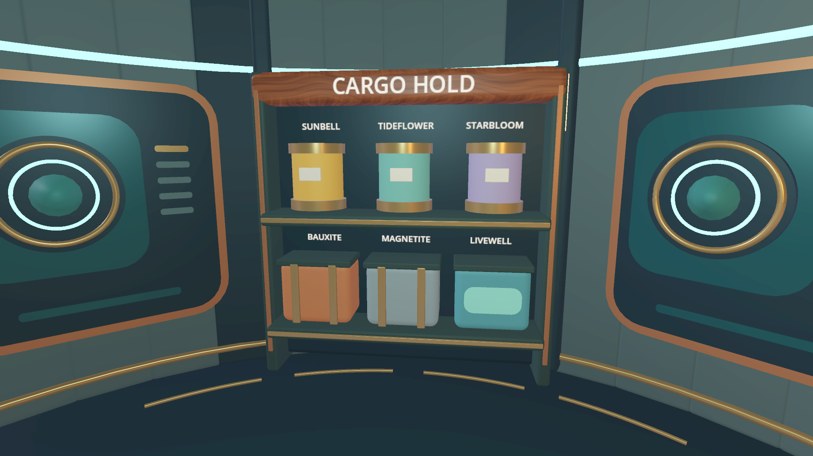
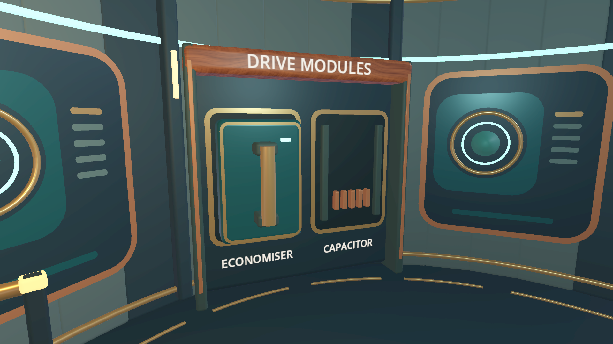
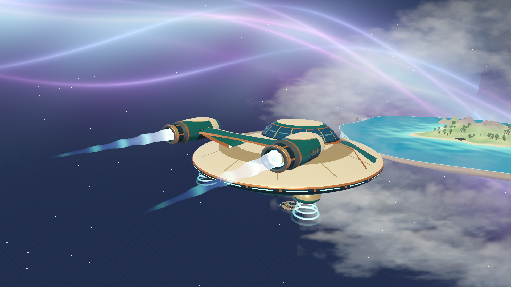

# Грузовой отсек и двигатели

Спуститесь на лифте с жилой палубы. На стеллаже Cargo Hold верхняя полка отведена под три вида растений. Внизу стоят кассеты для боксита и магнетита и контейнер для перевозки живой рыбы. Контейнер появляется, пока на борту остаётся хотя бы один образец этого вида. Количество можно посмотреть кнопкой **A** у стеллажа. После выгрузки последнего образца место освобождается. Рыба, переселённая в аквариум, освобождает место в грузовом отсеке.

На противоположной стене находятся гнёзда для круизного экономайзера и буст-конденсатора. Подойдите к нужному и нажмите **A**, чтобы посмотреть его состояние. Когда мастерская подтверждает установку, в гнезде появляется модуль со скобой для извлечения. На снимке установлен экономайзер, в соседнем гнезде видны направляющие и контакты.

Струи из двух кормовых сопел видны снаружи. Длина и яркость растут с прямой тягой, круиз и ускорение усиливают эффект. На стоянке под кораблём остаются гравитационные кольца. У пролетающих кораблей струи видны из кабины наблюдателя.

## Проверка на Odin 2

На устройстве установлена версия корабля `21442dbb3c953db1`. Прошли 13 сценариев Godot, в том числе спуск в отсек, проход к полкам и обоим гнёздам, выход через нижний лифт, взлёт и посадка. Проверены разгрузка образцов, переселение рыбы в аквариум, смена профиля и восстановление груза после загрузки. Эффекты проверены при прямой и обратной тяге, в круизе, при ускорении и отключении двигателей.

Три кадра сняты на Odin 2 с мобильным рендерером в отдельном тестовом профиле. Для открытия экранов подавались программные события геймпада. Установка картриджа проверена с тестовым подтверждением мастерской. Покупка на публичном сервере требует обновления оболочки и мастерской. Flip оставлен до зарядки.
