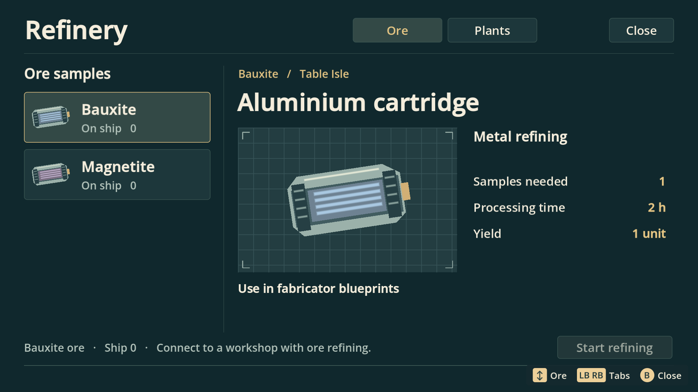

# Рабочие станции корабля

Перед капитаном три разных устройства. У компьютера видны монитор и клавиатура, у фабрикатора — портал печатающей головки, у переработчика — загрузочная воронка и гнездо выдачи картриджа. Подойдите к нужной станции и нажмите **A** или **F**. Подсказка над прибором показывает, какой экран откроется.

| Экран ПК | Что можно посмотреть или сделать |
| --- | --- |
| [Ship](ship.png) | Место стоянки, состояние корпуса и щитов, остаток топлива, питание и включённые системы. |
| [Cargo](cargo.png) | Образцы на борту, живая рыба в грузовом отсеке и доступные предметы мастерской в инвентаре профиля. |
| [Upgrades](upgrades.png) | Посмотреть действие улучшения, перейти к его заказу и установить полученный комплект. До установки комплект можно продать. |
| [Store](store.png) | Посмотреть цену в Sparks и подтвердить заказ. В ассортименте есть блюпринты пустого картриджа и двух комплектов одежды, готовые пустые картриджи, брюки, берет и два улучшения корабля. |

**LB / RB** переключают страницы. Крестовина выбирает строку. Покупку нужно подтвердить второй раз. **B** отменяет подтверждение или возвращает к персонажу.

Первая партия одного материала расходует один образец. Для второй одновременной партии того же материала нужен ещё один пустой картридж. Его можно купить или напечатать по многоразовому блюпринту за час из одной единицы пластика. Экстракция пигмента занимает час, переработка руды — два. Готовые и ранее начатые заказы выдаёт соответствующая станция.

## Проверки

- На Odin 2 проверены выбор каждого из трёх приборов и возврат в каюту, страницы ПК, печать оболочки, выбор растений и руды, подсказки, размещение стартовой мебели, полётные системы. Использовались программные события геймпада и отдельный тестовый профиль.
- На ПК корабля данные о корпусе, топливе и локальном грузе взяты из игры. Для кадров с покупкой и установкой улучшения использованы тестовые ответы мастерской. Полётная модель расходует на 20% меньше топлива в круизе с экономайзером. Для ускорения с улучшенным конденсатором нужно 27 единиц энергии вместо 36.
- На изолированном сервере с PostgreSQL проверены баланс и история списаний, повторный запрос после покупки, изменение ожидаемой цены, выдача одежды и установка улучшения. Фабрикатор распечатал пустой картридж, переработчик израсходовал его на дополнительную партию. Время окончания печати для теста сдвигалось в тестовой базе.
