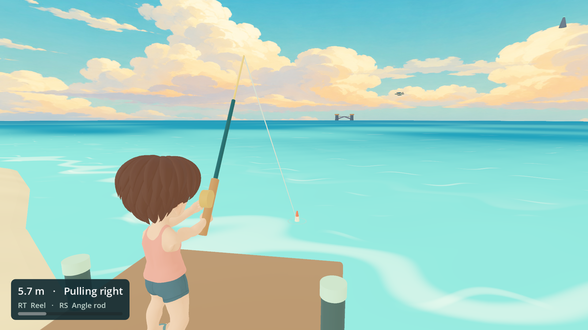
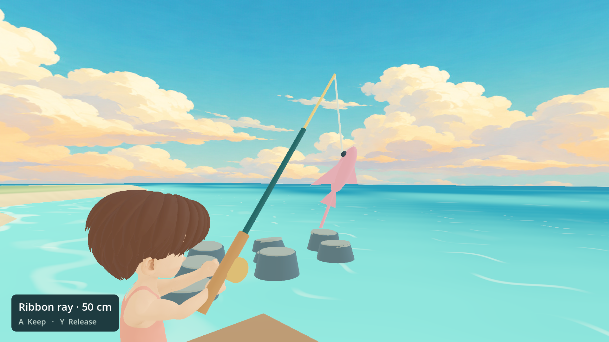
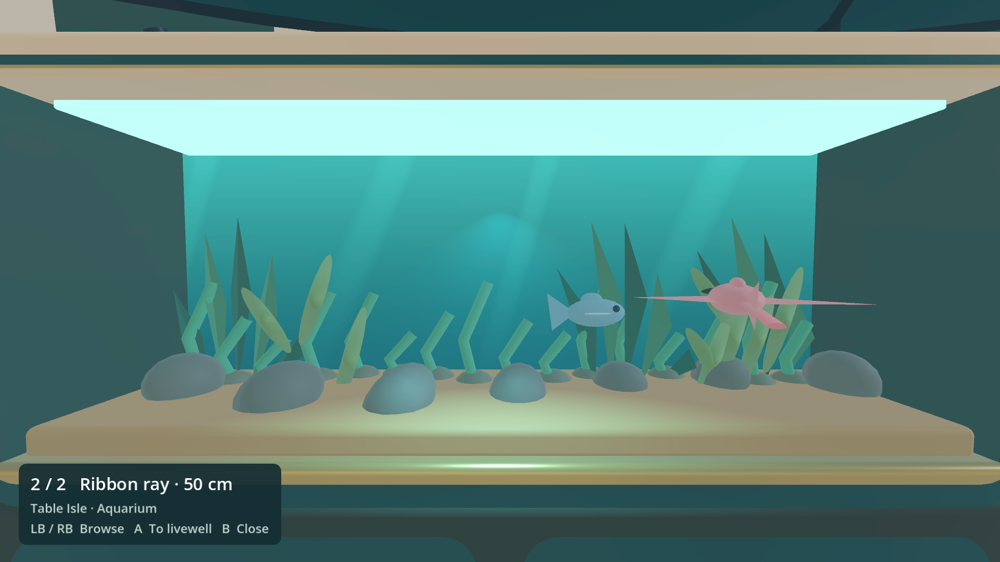

# Рыбалка на островах

На Echo Orchard и Table Isle от посадочного круга можно дойти до причала. У его края появляется **Fish from pier**. Персонаж берёт удочку из SDK. Сила заброса определяет расстояние. После поклёвки рыба тянет леску в сторону, делает рывки и постепенно устаёт.

На коротком забросе у берега попадается стеклопёрая рыба Glassfin. На длинном забросе в Echo Orchard водится медный голец Copper loach, а у камней Table Isle — ленточный скат Ribbon ray. Скат сильнее остальных нагружает леску во время рывка.

Пойманную рыбу можно отпустить сразу или сохранить в садке. В каюте у стекла **A** переносит выбранный экземпляр из садка в аквариум и обратно. Длина и цвет сохраняются вместе с идентификатором экземпляра при смене профиля и повторном входе.

## Проверки

На Odin 2 девять сценариев Godot прошли в изолированных каталогах. Проверки охватывают каюту, посадку в кресло, подсказки, полёт, лифты, студию, мастерскую, авионику и рыбалку. Для снимков использован Vulkan Mobile с тестовым SDK-персонажем и программным вводом геймпада. Сценарий начинает прогулку на посадочном круге каждого острова, проходит к причалу, забрасывает удочку, подсекает, вываживает и сохраняет обеих рыб. Затем он заново открывает профиль, помещает улов в аквариум и проверяет его после смены профиля. Полёт между островами и обратный путь с берега на лифте покрыты отдельными сценариями.

Серверные проверки прошли на отдельной PostgreSQL. С одним и тем же уловом проверены повтор передачи при потере ответа, выставление в лот, покупка другим аккаунтом и помещение купленного медного гольца в аквариум покупателя. Для сделки в тесте включена касса Базара. В серверном наборе прошли 223 теста. Обе изменённые единицы трансляции моста Qt прошли синтаксическую проверку с Qt 6.11.2.

Проверка портативки охватывает сохранение улова на устройстве. Для передачи в общий инвентарь нужны обновлённые оболочка с возможностью `ship.fishing` и сервер с миграцией 0028. Физическая проверка курков и вибрации остаётся открытой. [Управление и вместимость](../../../experiences/ship-home/README.md#shore-fishing-and-the-ship-aquarium) · [Исходная модель Tidewater](https://github.com/dgreenheck/tidewater/blob/4811ba48d795197de5621985f404e765c0b7c0ef/src/game/CatchMinigame.js).
