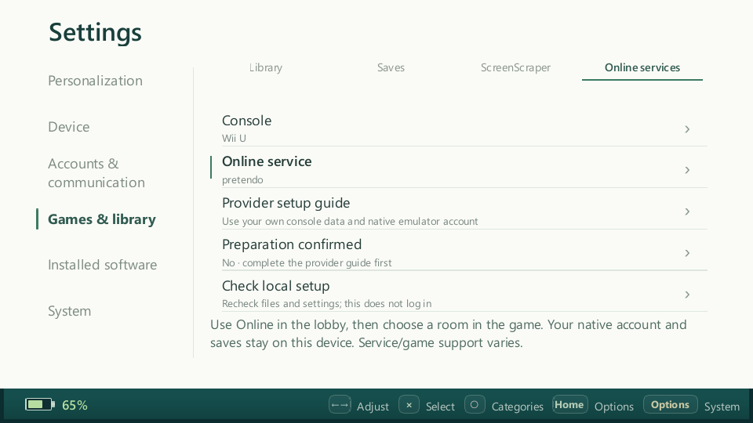
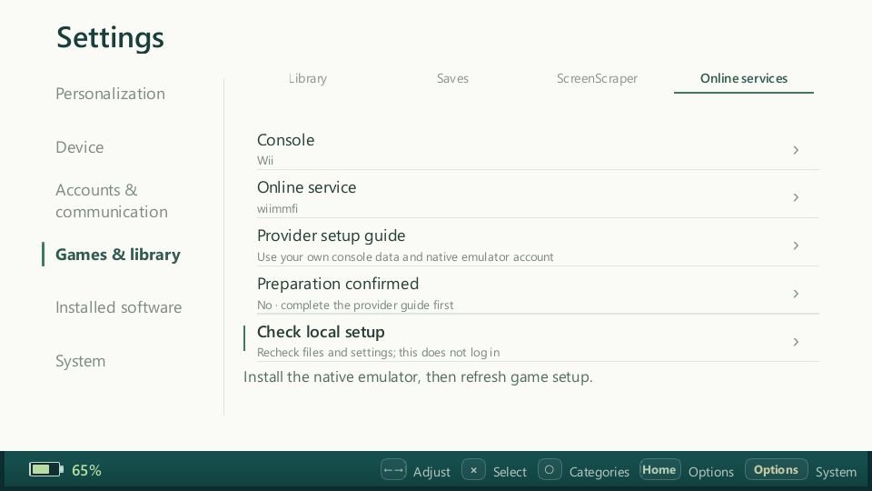

# Nintendo native Online — 2 ноября 2026, source preparation

Прирост: Wiimmfi/WiiLink (Wii), Pretendo (3DS/Wii U), отдельные режимы обычного
Lobby и общая страница Settings. [Контракт и upstream](../../emulators/nintendo-online.md).
Портативки, их настройки и локальный Docker не использовались. Новая установка
на устройства и live provider/game acceptance не заявляются.

## Проверки

Windows x64, Qt 6.11.1 / GCC 16.1, Debug; реальные дочерние probe-процессы в
общем lifecycle, локальные изолированные fixtures для native конфигурации.

| Проверка | Результат и значение |
| --- | --- |
| `traineros`, `trainer_standalone_tests`, `trainer_runtime_multiplayer_tests` | Собраны; это host-сборка, не новый ARM64 пакет |
| `StandaloneTests::nintendoNativeOnline` | Все 4 сервиса: отсутствие предпосылок/отключение/отмена, подготовка команды, запрет параллельного использования, отсутствие изменений native данных при crash, отсутствие console/account данных в descriptor, несовпадение сервиса; Cemu Nintendo вместо Pretendo и неполные Nimbus rules отклоняются |
| Целевые Standalone tests | **8 passed / 0 failed / 1 skipped**; Cemu/discovery preferences и Azahar event admission сохранены. Linux-only `azaharPreparationKeepsEachPlayersOwnStorageAndSettings` пропущен на Windows; старые ARM64 результаты не выдаются за проверку этого прироста |
| Полный `RuntimeMultiplayerTests` | **115 passed / 0 failed**: отдельные modes не подменяют NetPlay/Wireless; ready связан с конкретным местом; native process start не равен матчу; потеря Lobby не закрывает свой процесс и не запускает rejoin; прежние save/session отказы сохранены |
| `traineros --ephemeral --settings-smoke-test` | Exit 0; Settings/общая навигация плюс новая страница: touch, controller, Back, выбор трёх платформ, раздельное подтверждение подготовки, понятный missing-runtime status |
| Визуальный просмотр | Рендер 960×540, ordinary Settings. Выбор и текст состояния читаются; длинное объяснение занимает две строки и не перекрывает элементы |
| Adapter export / knowledge / whitespace | Обновлён переносимый snapshot и четыре capability записи; проверка консистентности и `git diff --check` |

## Что это не доказывает

Fixtures не являются действительными OTP/сертификатами или игровыми образами и
не отправляются провайдерам. Эмуляторные подписи, полноценный комплект console
data, серверный вход, доступность конкретной игры, матч и производительность
проверяют владельцы консолей. Игра должна поддерживаться выбранным сервисом;
карточки не ограничены нашими проверенными названиями. География/NAT и сервисные
ограничения не заменяются новым relay, VPN или эмуляцией серверов Nintendo.

Подготовка пользователя по официальной инструкции остаётся обязательной.
В этом приросте нет автоматического импорта консоли, установки Nimbus или
ROM-патчера; переключатель TrainerOS выбирает mode, не переписывает native
аккаунты. Сохранения принадлежат обычному native runtime, без нового snapshot
всего NAND/MLC и без peer-save возврата. Прежние серверные и локальные режимы
сохранены; выключение новых сервисов — достаточный откат их доступности в Lobby.
